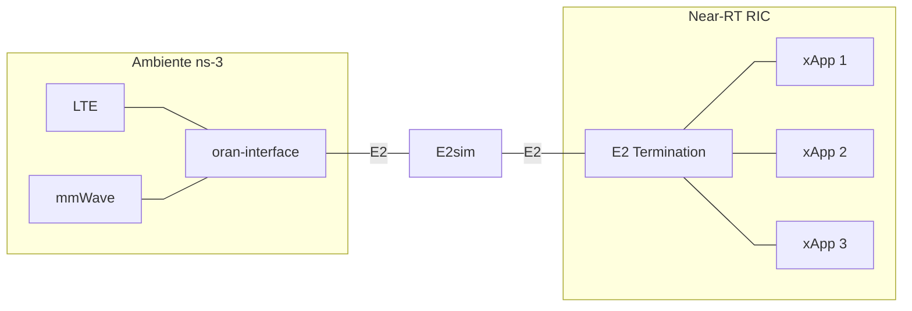

# Bootcamp: Integração ns-3 e O-RAN (OSC RIC Release E)

Bem-vindo ao repositório do Bootcamp de integração entre o simulador de redes **ns-3** e o **Near-RT RIC** (O-RAN Software Community - Release E).

Este repositório fornece o ambiente, os roteiros e as configurações necessárias para provisionar o **Near-RT RIC**, conectar uma simulação do **ns-3** via interface E2 e executar um xApp de monitoramento.

---

## 🌐 1. Conexão ao Laboratório Remoto (VPN LANCE e Acesso SSH)

As atividades práticas deste bootcamp são desenvolvidas em **Máquinas Virtuais (VMs) dedicadas** hospedadas na infraestrutura de servidores do laboratório **LANCE (UFRN)**. Cada participante conta com uma VM privativa alocada na sub-rede `172.31.0.0/12`.

Para acessar esse ambiente a partir do seu computador pessoal, é necessário iniciar um túnel VPN transparente com o utilitário **`sshuttle`**. Essa ferramenta encaminha exclusivamente as requisições destinadas à faixa de rede interna do laboratório através do servidor gateway do LANCE, preservando sua conexão de internet local para as demais tarefas.


---

### 1.1 Resumo dos Parâmetros e Credenciais de Acesso

| Serviço | Parâmetro | Valor | Descrição |
| :--- | :--- | :--- | :--- |
| **VPN LANCE (`sshuttle`)** | **Servidor e Porta** | `177.20.148.103:2245` | Gateway de acesso externo do laboratório |
| | **Usuário do Gateway** | `bootcampns3` | Conta utilizada para estabelecer o túnel |
| | **Senha da VPN** | `<SENHA_FORNECIDA>` | Senha de autenticação no gateway |
| | **Sub-rede Tunelada** | `172.31.0.0/12` | Faixa de endereçamento das VMs dos alunos |
| **Sua Máquina Virtual (SSH)** | **Endereço IP (Host)** | `172.31.0.xxx` | Substitua `xxx` pelo número atribuído a você |
| | **Porta** | `22` | Porta padrão do serviço OpenSSH |
| | **Usuário** | `bootcamp` | Usuário de trabalho configurado na VM |
| | **Senha do Usuário** | `aluno` | Senha de login e privilégios administrativos (`sudo`) |

---

### 1.2 Instruções de Acesso para Linux (Começando do Zero)

Siga os passos abaixo em distribuições Linux (como Ubuntu, Debian, Fedora ou Arch).

#### Passo 1: Instalação das Ferramentas Essenciais
Abra o terminal do seu sistema operacional e instale o Python 3, o gerenciador de pacotes `pip`, o cliente SSH e o utilitário `sshuttle`:

* **No Ubuntu, Debian e derivados:**
  ```bash
  sudo apt update
  sudo apt install -y python3 python3-pip openssh-client sshuttle
  ```

* **No Fedora, Red Hat ou Rocky Linux:**
  ```bash
  sudo dnf install -y python3 python3-pip openssh-clients sshuttle
  ```

* **No Arch Linux ou Manjaro:**
  ```bash
  sudo pacman -Sy python python-pip openssh sshuttle
  ```

> [!TIP]
> Caso sua distribuição não liste o pacote `sshuttle` no repositório nativo, você pode instalá-lo diretamente pelo `pip`:
> ```bash
> pip3 install sshuttle
> ```

#### Passo 2: Estabelecer o Túnel VPN (Terminal 1)
O `sshuttle` gerencia as rotas locais de rede no kernel via `iptables` ou `nftables`, exigindo privilégios administrativos (`sudo`):

```bash
sudo python3 -m sshuttle -r bootcampns3@177.20.148.103:2245 -x 177.20.148.103 172.31.0.0/12
```

1. Digite a senha do `sudo` da sua própria máquina caso o sistema solicite autorização.
2. Quando for solicitado o password de `bootcampns3@177.20.148.103:2245`, informe a senha da VPN:
   ```text
   <SENHA_FORNECIDA>
   ```
3. Assim que a conexão for autenticada, o utilitário exibirá o status operacional (`Connected.`).
4. **Mantenha este terminal aberto!** Ele deve permanecer em execução para sustentar a rota até a rede do laboratório.

#### Passo 3: Conectar via SSH à sua Máquina Virtual (Terminal 2)
Abra um **segundo terminal** (ou uma nova aba) e inicie a sessão SSH direcionada à sua VM:

```bash
ssh -p22 bootcamp@172.31.0.xxx
```
*(Substitua `xxx` pelo número do IP da sua VM alocada).*

Quando for solicitada a senha do usuário `bootcamp`, digite:
```text
aluno
```

---

### 1.3 Instruções de Acesso para Windows (Começando do Zero)

Para usuários de Windows, apresentamos duas abordagens: a **Opção A (via WSL 2)**, que é a alternativa recomendada devido à total compatibilidade com o ecossistema Linux, e a **Opção B (Nativa)**, executada diretamente no PowerShell.

#### Opção A (Recomendada): Usando o WSL 2 (Ubuntu no Windows)

O *Windows Subsystem for Linux* (WSL 2) disponibiliza um ambiente Linux nativo diretamente no Windows.

1. **Instalar o WSL (caso não possua instalado):**
   * Abra o **PowerShell** como Administrador (clique com o botão direito no menu Iniciar > "PowerShell (Admin)" ou "Terminal (Admin)").
   * Digite o comando de instalação:
     ```powershell
     wsl --install
     ```
   * Reinicie o computador se solicitado pelo assistente do Windows.

2. **Preparar o ambiente Ubuntu:**
   * Localize e abra o aplicativo **Ubuntu** no menu Iniciar.
   * Na primeira inicialização, informe um nome de usuário e uma senha local de sua escolha.
   * Atualize os repositórios e instale os utilitários de rede:
     ```bash
     sudo apt update
     sudo apt install -y python3 python3-pip openssh-client sshuttle iptables
     ```

3. **Terminal 1 do WSL (Iniciar a VPN):**
   * Inicie o túnel VPN dentro do terminal do Ubuntu:
     ```bash
     sudo python3 -m sshuttle -r bootcampns3@177.20.148.103:2245 -x 177.20.148.103 172.31.0.0/12
     ```
   * Digite sua senha local do Ubuntu se requisitado pelo `sudo`.
   * Quando solicitada a senha do gateway, digite a senha da VPN: `<SENHA_FORNECIDA>`
   * Mantenha essa janela aberta.

4. **Terminal 2 do WSL (Acessar a Máquina Virtual):**
   * Abra uma segunda aba ou nova janela do aplicativo Ubuntu e conecte-se à sua máquina:
     ```bash
     ssh -p22 bootcamp@172.31.0.xxx
     ```
   * Informe a senha: `aluno`

---

#### Opção B: Conexão Nativa no Windows (PowerShell / Prompt de Comando)

Caso queira executar a conexão sem instalar o WSL:

1. **Instalar o Python 3 no Windows:**
   * Baixe o instalador oficial em [python.org](https://www.python.org/downloads/).
   * **ATENÇÃO:** Na primeira tela do instalador, marque a opção obrigatória **"Add Python to PATH"** antes de clicar em "Install Now".

2. **Verificar o Cliente OpenSSH:**
   * O Windows 10 e Windows 11 trazem o cliente OpenSSH ativo por padrão.
   * Para confirmar, abra o PowerShell e digite `ssh`. Caso não seja reconhecido, instale em: *Configurações > Aplicativos > Recursos Opcionais > Adicionar um recurso > Cliente OpenSSH*.

3. **Instalar o `sshuttle` e o driver `pydivert`:**
   * No ambiente Windows nativo, o `sshuttle` utiliza a biblioteca `pydivert` (que traz embarcado o driver WinDivert para captura de pacotes TCP).
   * Abra o PowerShell ou Prompt de Comando e execute:
     ```powershell
     pip install sshuttle pydivert
     ```

4. **Terminal 1: Iniciar a VPN como Administrador:**
   * No menu Iniciar, pesquise por **PowerShell**, clique com o botão direito e selecione **"Executar como Administrador"** (exigência indispensável para acionar o driver de rede WinDivert).
   * Execute o comando do túnel:
     ```powershell
     python -m sshuttle -r bootcampns3@177.20.148.103:2245 -x 177.20.148.103 172.31.0.0/12
     ```
     *(Se sua versão do sshuttle requerer a seleção explícita do driver de captura no Windows, utilize: `python -m sshuttle --method windivert -r bootcampns3@177.20.148.103:2245 -x 177.20.148.103 172.31.0.0/12`)*.
   * Ao ser solicitado, digite a senha da VPN: `<SENHA_FORNECIDA>`
   * Mantenha esta janela aberta durante a execução das práticas.

5. **Terminal 2: Conectar à Máquina Virtual:**
   * Abra uma janela comum do PowerShell, Prompt de Comando ou seu cliente SSH preferido (como PuTTY ou MobaXterm).
   * Conecte-se com o comando:
     ```powershell
     ssh -p22 bootcamp@172.31.0.xxx
     ```
   * Informe a senha: `aluno`

---

### 1.4 Dicas de Operação e Resolução de Problemas

* **Como encerrar a VPN com segurança:**
  Ao finalizar as atividades, vá até o Terminal 1 (onde o `sshuttle` está rodando) e pressione `Ctrl + C`. O túnel será desfeito e o roteamento da sua máquina voltará ao estado inicial.
* **Teste de Conectividade:**
  Com o túnel do Terminal 1 ativo, você pode verificar a resposta da sua máquina remota a partir do Terminal 2 através do utilitário de ping:
  ```bash
  ping -c 3 172.31.0.xxx
  ```
* **Aviso de chave de host alterada (*Host key verification failed*):**
  Caso a VM tenha sido redefinida e o cliente SSH recuse a conexão por divergência de assinatura digital, limpe o registro antigo com o comando:
  ```bash
  ssh-keygen -R 172.31.0.xxx
  ```
* **Erro de autorização ao inicializar o túnel:**
  Certifique-se de executar o `sshuttle` com privilégios de superusuário (`sudo` no Linux/WSL e `Executar como Administrador` no PowerShell do Windows).

---

## 📋 2. Especificações da VM e Arquitetura do Ambiente

Cada participante opera em uma Máquina Virtual (VM) dedicada, dimensionada para acomodar tanto o cluster Kubernetes *single-node* quanto os processos de compilação C++ e simulação do ns-3.

### Especificações Mínimas da Máquina Virtual:
* **Sistema Operacional:** Ubuntu 20.04 LTS
* **Memória RAM:** Mínimo de 4GB (Recomendado: 8GB)
* **Processador:** Dual-core (Recomendado: 4 vCPUs)
* **Armazenamento:** Pelo menos 50 GB de espaço em disco

### Arquitetura do Ambiente Integrado

O diagrama abaixo ilustra a integração entre os componentes do ecossistema ns-3 e a plataforma Near-RT RIC:



### Dependências de Software Pré-instaladas na VM
Caso precise verificar ou reproduzir as dependências do simulador e da infraestrutura na máquina virtual, os pacotes essenciais são instalados com:
```bash
sudo apt update -y && sudo apt upgrade -y
sudo apt install -y python3-pip git curl cmake tree vim net-tools build-essential nfs-common openssh-server libsctp-dev lksctp-tools autoconf automake libtool bison flex libboost-all-dev apt-utils
```

---

## 🚀 3. Roteiro do Bootcamp

O bootcamp está dividido em etapas práticas sequenciais. Acesse os roteiros de cada laboratório para consultar os conceitos teóricos, as instruções passo a passo e os códigos-fonte:

| Laboratório | Descrição | Status |
| :--- | :--- | :---: |
| 🌐 [**Lab 1: Fundamentos da Arquitetura O-RAN e Deploy do Near-RT RIC**](./labs/lab01-setup-RIC.md) | Fundamentos da Arquitetura O-RAN, orquestração Cloud-Native (Kubernetes e Helm), configuração da RECIPE e deploy dos microsserviços do RIC | ✅ Disponível |
| ⚙️ [**Lab 2: Fundamentos do ns-3, Arquitetura ns-O-RAN e Preparação do Ambiente**](./labs/lab02-setup-ns3.md) | Fundamentos do ns-3, pilha 5G mmWave/DC, arquitetura ns-O-RAN, aplicação do patch do bootcamp e compilação com Waf | ✅ Disponível |
| 🔄 [**Lab 3: Validação da Integração ns-3 e Near-RT RIC**](./labs/lab03-validacao-e2setup.md) | Protocolo E2AP, transporte SCTP, barramento RMR, execução do cenário de simulação e validação via REST API | ✅ Disponível |
| 📊 **Lab 4: Onboarding do KPIMon xApp e Simulação** | Implantação de xApp no RIC e coleta de telemetria da simulação em tempo real | ⏳ *Em breve* |

---

### [Lab 1: Fundamentos da Arquitetura O-RAN e Deploy do Near-RT RIC](./labs/lab01-setup-RIC.md)
Nesta etapa, exploramos a fundamentação teórica da Arquitetura O-RAN (desagregação da RAN, loops de controle temporal, SMO, RICs e interfaces abertas) e os princípios de infraestrutura Cloud-Native com Kubernetes e Helm. Em seguida, realizamos o provisionamento prático de um cluster Kubernetes *single-node*, a customização da receita de deploy (*RECIPE*) e a implantação completa dos microsserviços do Near-RT RIC da O-RAN SC.

### [Lab 2: Fundamentos do ns-3, Arquitetura ns-O-RAN e Preparação do Ambiente](./labs/lab02-setup-ns3.md)
Neste laboratório, aprofundamos a teoria do simulador ns-3 (versão 3.33), o funcionamento de simulações de eventos discretos versus tempo real com `RealtimeSimulatorImpl`, e a pilha de protocolos de ondas milimétricas do módulo `ns3-mmwave` com Conectividade Dupla (LTE + mmWave). Exploramos a arquitetura do arcabouço `ns-O-RAN`, detalhando a comunicação multi-threaded via `E2sim`, os modelos de serviço E2SM-KPM e E2SM-RC, a aplicação do patch de customizações do bootcamp (`patch_bootcamp.patch`) e o processo prático de compilação com o sistema Waf.

### [Lab 3: Validação da Integração ns-3 e Near-RT RIC (O Caminho do E2 Setup)](./labs/lab03-validacao-e2setup.md)
Neste laboratório, o foco é validar e dissecar a comunicação fim-a-fim entre o ns-3 e o Near-RT RIC através do procedimento de E2 Setup. O roteiro aprofunda a especificação do protocolo E2AP (Procedimentos Elementares e codificação ASN.1 APER), a camada de transporte SCTP (multi-streaming e RFC 4960), a mensageria interna RMR e o armazenamento na Shared Data Layer (SDL/Redis). Guiamos o aluno pela parametrização do cenário de Conectividade Dupla (`scenario-trainning.cc`), observabilidade em tempo real nos pods do `e2term` e homologação definitiva dos nós com status CONNECTED via API REST do E2 Manager.

### Lab 4: Onboarding do KPIMon xApp e Execução da Simulação *(Em breve)*
O último laboratório realiza o fechamento do loop da arquitetura (Simulador ↔ RIC ↔ xApp). O roteiro orientará sobre como obter o código de um xApp de monitoramento de métricas, configurar um registro local de imagens Docker, realizar o processo de onboarding e lançamento no cluster Kubernetes e visualizar as métricas sendo coletadas em tempo real.