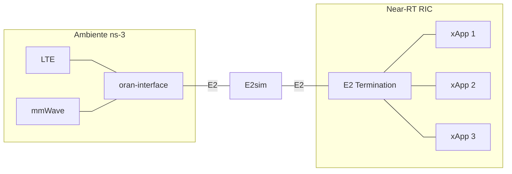

# Bootcamp: Integração ns-3 e O-RAN (OSC RIC Release E)

Bem-vindo ao repositório do Bootcamp de integração entre o simulador de redes **ns-3** e o **Near-RT RIC** (O-RAN Software Community - Release E) 

Este repositório fornece o ambiente, os roteiros e as configurações necessárias para provisionar o **Near-RT RIC**, conectar uma simulação do **ns-3** via interface E2 e executar um xApp de monitoramento.

---

## 📋 1. Pré-requisitos e Ambiente

Para reproduzir este laboratório, você precisará de um *host* (*Bare Metal* ou *Virtual Machine*) com as seguintes especificações mínimas:
* **Sistema Operacional:** Ubuntu 20.04
* **Memória RAM:** Mínimo de 4GB
* **Processador:** Dual-core (Recomendado: 4 Cores)
* **Armazenamento:** Pelo menos 50 GB de espaço em disco

### Arquitetura do Ambiente

Abaixo está o diagrama ilustrando a arquitetura abordada neste laboratório de forma simplificada:



### Dependências de Software
Antes de iniciar, certifique-se de que o sistema está atualizado e instale as ferramentas essenciais:
```bash
sudo apt update -y && sudo apt upgrade -y
sudo apt install -y python3-pip git curl cmake tree vim net-tools build-essential nfs-common openssh-server libsctp-dev lksctp-tools autoconf automake libtool bison flex libboost-all-dev apt-utils
```
*Nota: Lembre-se de instalar os Virtual Box Guest Addons se estiver utilizando o VirtualBox*

---

## 🚀 2. Roteiro do Bootcamp

O bootcamp está dividido em quatro etapas principais. Acesse os diretórios de cada laboratório para consultar as instruções detalhadas, os comandos passo a passo e os códigos-fonte necessários:

### Lab 1: Deploy do Near-RT RIC
Nesta etapa, o foco é levantar a infraestrutura principal do RIC da O-RAN SC. O roteiro aborda a instalação do cluster Kubernetes e Helm, a configuração de IPs na receita de deploy e a preparação do ambiente gerenciador de xApps (xApp Onboarder e `dms_cli`).

### Lab 2: Instalação do ns-O-RAN
O objetivo deste laboratório é preparar o simulador de redes para se comunicar com o RIC. O roteiro guia o aluno pela instalação das dependências de compilação, construção da biblioteca `E2sim` a partir do código-fonte e a compilação nativa do simulador `ns-3` integrado aos módulos `mmwave` e `oran-interface`.

<!-- *(Conteúdo Extra)* O laboratório também discute a alternativa de deploy conteinerizado do ns-3 via Docker. -->

### Lab 3: Onboarding do KPIMon xApp
Aqui, exploramos o fluxo de implantação de uma aplicação de controle no RIC. O roteiro detalha como obter o código de um xApp de monitoramento de métricas, configurar um registro local de imagens Docker e realizar o processo de onboarding e lançamento no cluster Kubernetes.

### Lab 4: Execução da Simulação
O último laboratório realiza o fechamento do loop da arquitetura (Simulador ↔ RIC ↔ xApp). O roteiro orienta sobre como descobrir o IP de comunicação do componente `e2term` no cluster, como iniciar um cenário de simulação no ns-3 apontando para o RIC e como visualizar as métricas sendo coletadas em tempo real pelo xApp.

---

<!-- ## 🛠 Considerações Finais
Em caso de falha em algum pod (ex: status `CrashLoopBackOff`), verifique os logs do Kubernetes utilizando `kubectl logs <nome-do-pod> -n ricplt`. 
Certifique-se de que a variável de política de imagem `image_pull_policy` no Helm está setada como `Always` durante o desenvolvimento de novos xApps para garantir que suas alterações sejam carregadas[cite: 4]. -->