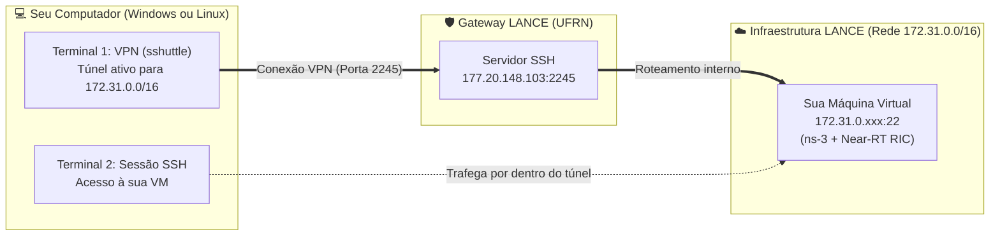
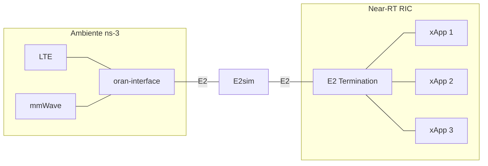

# Bootcamp: Integração ns-3 e O-RAN (OSC RIC Release E)

Bem-vindo ao repositório do Bootcamp de integração entre o simulador de redes **ns-3** e o **Near-RT RIC** (O-RAN Software Community - Release E).

Este repositório fornece o ambiente, os roteiros e as configurações necessárias para provisionar o **Near-RT RIC**, conectar uma simulação do **ns-3** via interface E2 e executar um xApp de monitoramento.

---

## 🌐 1. Conexão ao Laboratório Remoto (VPN LANCE e Acesso SSH)

As atividades práticas deste bootcamp são desenvolvidas em **Máquinas Virtuais (VMs) dedicadas** hospedadas na infraestrutura de servidores do laboratório **LANCE (UFRN)**. Cada participante conta com uma VM privativa alocada na sub-rede `172.31.0.0/16`.

Para acessar esse ambiente a partir do seu computador pessoal, é necessário iniciar um túnel VPN transparente com o utilitário **`sshuttle`**. Essa ferramenta encaminha exclusivamente as requisições destinadas à faixa de rede interna do laboratório através do servidor gateway do LANCE, preservando sua conexão de internet local para as demais tarefas.



---

### 1.1 Resumo dos Parâmetros e Credenciais de Acesso

| Serviço | Parâmetro | Valor | Descrição |
| :--- | :--- | :--- | :--- |
| **VPN LANCE (`sshuttle`)** | **Servidor e Porta** | `177.20.148.103:2245` | Gateway de acesso externo do laboratório |
| | **Usuário do Gateway** | `bootcampns3` | Conta utilizada para estabelecer o túnel |
| | **Senha da VPN** | `<SENHA_FORNECIDA>` | Senha de autenticação fornecida pela organização do evento |
| | **Sub-rede Tunelada** | `172.31.0.0/16` | Faixa de endereçamento das VMs dos alunos |
| **Sua Máquina Virtual (SSH)** | **Endereço IP (Host)** | `172.31.0.xxx` | Substitua `xxx` pelo número atribuído a você |
| | **Porta** | `22` | Porta padrão do serviço OpenSSH |
| | **Usuário** | `bootcamp` | Usuário de trabalho configurado na VM |
| | **Senha do Usuário** | `aluno` | Senha de login e privilégios administrativos (`sudo`) |
| **Interface Gráfica (RDP)** | **Porta** | `3389` | Porta de acesso à Área de Trabalho Remota (XFCE) |
| | **Usuário / Senha** | `bootcamp` / `aluno` | Mesmas credenciais do acesso via terminal |

---

### 1.2 Instruções de Acesso para Linux (Começando do Zero)

Siga os passos abaixo em distribuições Ubuntu, Debian e seus derivados.

#### Passo 1: Instalação das Ferramentas Essenciais
Abra o terminal do seu sistema operacional e instale o Python 3, o gerenciador de pacotes `pip`, o cliente SSH e o utilitário `sshuttle`:

```bash
sudo apt update
sudo apt install -y python3 python3-pip openssh-client sshuttle
```

> [!TIP]
> Caso o pacote `sshuttle` não esteja disponível no repositório nativo da sua distribuição, você pode instalá-lo diretamente pelo `pip`:
> ```bash
> pip3 install sshuttle
> ```

#### Passo 2: Estabelecer o Túnel VPN (Terminal 1)
O `sshuttle` gerencia as rotas locais de rede no kernel via `iptables` ou `nftables`, exigindo privilégios administrativos (`sudo`):

```bash
sudo python3 -m sshuttle -r bootcampns3@177.20.148.103:2245 -x 177.20.148.103 172.31.0.0/16
```

1. Digite a senha do `sudo` da sua própria máquina caso o sistema solicite autorização.
2. Quando for solicitado o password de `bootcampns3@177.20.148.103:2245`, informe a senha da VPN fornecida pela organização do evento.
3. Assim que a conexão for autenticada, o utilitário exibirá o status operacional (`Connected.`).
4. **Mantenha este terminal aberto!** Ele deve permanecer em execução para sustentar a rota até a rede do laboratório.

#### Passo 3: Conectar via SSH à sua Máquina Virtual (Terminal 2)
Abra um **segundo terminal** (ou uma nova aba) e inicie a sessão SSH direcionada à sua VM:

```bash
ssh -p22 bootcamp@172.31.0.xxx
```
*(Substitua `xxx` pelo número do IP da sua VM alocada).*

Quando for solicitada a senha do usuário `bootcamp`, digite:
```text
aluno
```

---

### 1.3 Instruções de Acesso para Windows (Começando do Zero)

Para usuários de Windows, o acesso é realizado de forma nativa através do **PowerShell**:

1. **Instalar o Python 3 no Windows:**
   * Baixe o instalador oficial em [python.org](https://www.python.org/downloads/).
   * **ATENÇÃO:** Na primeira tela do instalador, marque a opção obrigatória **"Add Python to PATH"** antes de clicar em "Install Now".

2. **Verificar o Cliente OpenSSH:**
   * O Windows 10 e Windows 11 trazem o cliente OpenSSH ativo por padrão.
   * Para confirmar, abra o PowerShell e digite `ssh`. Caso não seja reconhecido, instale em: *Configurações > Aplicativos > Recursos Opcionais > Adicionar um recurso > Cliente OpenSSH*.

3. **Instalar o `sshuttle` e o driver `pydivert`:**
   * No ambiente Windows nativo, o `sshuttle` utiliza a biblioteca `pydivert` (que traz embarcado o driver WinDivert para captura e roteamento de pacotes TCP).
   * Abra o PowerShell ou Prompt de Comando e execute:
     ```powershell
     pip install sshuttle pydivert
     ```

4. **Terminal 1: Iniciar a VPN como Administrador:**
   * No menu Iniciar, pesquise por **PowerShell**, clique com o botão direito e selecione **"Executar como Administrador"** (exigência indispensável para acionar o driver de rede WinDivert).
   * Execute o comando do túnel:
     ```powershell
     python -m sshuttle -r bootcampns3@177.20.148.103:2245 -x 177.20.148.103 172.31.0.0/16
     ```
     *(Se a sua versão do sshuttle requerer a seleção explícita do driver de captura no Windows, utilize: `python -m sshuttle --method windivert -r bootcampns3@177.20.148.103:2245 -x 177.20.148.103 172.31.0.0/16`)*.
   * Ao ser solicitado, digite a senha da VPN fornecida pela organização do evento.
   * Mantenha esta janela aberta durante a execução das práticas.

5. **Terminal 2: Conectar à Máquina Virtual:**
   * Abra uma janela comum do PowerShell, Prompt de Comando ou seu cliente SSH preferido (como PuTTY ou MobaXterm).
   * Conecte-se com o comando:
     ```powershell
     ssh -p22 bootcamp@172.31.0.xxx
     ```
   * Informe a senha: `aluno`

---

### 1.4 Acesso via Interface Gráfica (GUI / Área de Trabalho Remota)

Caso prefira interagir com a máquina virtual através de um ambiente desktop visual (XFCE), o serviço de **Área de Trabalho Remota (RDP / XRDP)** está disponível na porta `3389`.

#### Opção A: Conexão Direta (com VPN / sshuttle ativa)
* **No Windows:**
  1. Pressione `Win + R`, digite `mstsc` e pressione **Enter** (ou abra o aplicativo **Conexão de Área de Trabalho Remota**).
  2. No campo **Computador**, insira o IP da sua VM:
     ```text
     172.31.0.xxx
     ```
  3. Clique em **Conectar**.
  4. Quando a tela de autenticação do XRDP carregar (sessão `Xorg`), informe:
     * **username:** `bootcamp`
     * **password:** `aluno`

* **No Linux:**
  1. Utilize o cliente **Remmina** (ou qualquer outro cliente RDP):
     ```bash
     sudo apt install -y remmina remmina-plugin-rdp
     ```
  2. Crie uma nova conexão do tipo **RDP**, aponte para `172.31.0.xxx:3389`, usuário `bootcamp` e senha `aluno`.

---

#### Opção B: Conexão via Túnel SSH (Recomendado se a porta 3389 estiver inacessível)
Caso a VPN não roteie a porta 3389 diretamente ou você receba erro de timeout/desconexão:

1. No terminal do seu computador (PowerShell, CMD ou terminal Linux), abra um túnel SSH:
   ```bash
   ssh -L 3390:localhost:3389 bootcamp@172.31.0.xxx
   ```
   *(Informe a senha `aluno` e mantenha este terminal aberto durante o uso).*

2. No Windows, abra o `mstsc` e conecte em:
   ```text
   localhost:3390
   ```
3. Autentique-se com o usuário `bootcamp` e a senha `aluno`.

---

<details>
<summary>🛠️ <strong>Nota para Administradores: Como provisionar o XRDP na VM Base (Proxmox)</strong></summary>

Caso esteja preparando a imagem/template base no Proxmox antes de clonar para as VMs dos alunos, execute este bloco no terminal da máquina base:

```bash
# 1. Atualizar repositórios e instalar XRDP e XFCE
sudo apt update && sudo apt install -y xrdp xfce4 xfce4-goodies

# 2. Adicionar o usuário xrdp ao grupo de certificados
sudo adduser xrdp ssl-cert

# 3. Configurar a sessão XFCE para o usuário atual e novos usuários criados (/etc/skel)
echo "xfce4-session" > ~/.xsession
chmod +x ~/.xsession
echo "xfce4-session" | sudo tee /etc/skel/.xsession

# 4. Inserir correção do D-Bus no /etc/xrdp/startwm.sh (evita tela preta)
sudo sed -i '0,/test -x \/etc\/X11\/Xsession/s//unset DBUS_SESSION_BUS_ADDRESS\nunset XDG_RUNTIME_DIR\n&/' /etc/xrdp/startwm.sh

# 5. Habilitar o serviço para iniciar com o sistema
sudo systemctl enable --now xrdp
```

</details>

---

### 1.5 Dicas de Operação e Resolução de Problemas

* **Como encerrar a VPN com segurança:**
  Ao finalizar as atividades, vá até o Terminal 1 (onde o `sshuttle` está rodando) e pressione `Ctrl + C`. O túnel será desfeito e o roteamento da sua máquina voltará ao estado inicial.
* **Teste de Conectividade:**
  Com o túnel do Terminal 1 ativo, você pode verificar a resposta da sua máquina remota a partir do Terminal 2 através do utilitário de ping:
  ```bash
  ping -c 3 172.31.0.xxx
  ```
* **Aviso de chave de host alterada (*Host key verification failed*):**
  Caso a VM tenha sido redefinida e o cliente SSH recuse a conexão por divergência de assinatura digital, limpe o registro antigo com o comando:
  ```bash
  ssh-keygen -R 172.31.0.xxx
  ```
* **Erro de autorização ao inicializar o túnel:**
  Certifique-se de executar o `sshuttle` com privilégios de superusuário (`sudo` no Linux e `Executar como Administrador` no PowerShell do Windows).

---

## 📋 2. Especificações da VM e Arquitetura do Ambiente

Cada participante opera em uma Máquina Virtual (VM) dedicada, dimensionada para acomodar tanto o cluster Kubernetes *single-node* quanto os processos de compilação C++ e simulação do ns-3.

### Especificações Mínimas da Máquina Virtual:
* **Sistema Operacional:** Ubuntu 20.04 LTS
* **Memória RAM:** Mínimo de 4GB (Recomendado: 8GB)
* **Processador:** Dual-core (Recomendado: 4 vCPUs)
* **Armazenamento:** Pelo menos 50 GB de espaço em disco

### Arquitetura do Ambiente Integrado

O diagrama abaixo ilustra a integração entre os componentes do ecossistema ns-3 e a plataforma Near-RT RIC:



### Dependências de Software Pré-instaladas na VM
Caso precise verificar ou reproduzir as dependências do simulador e da infraestrutura na máquina virtual, os pacotes essenciais são instalados com:
```bash
sudo apt update -y && sudo apt upgrade -y
sudo apt install -y python3-pip git curl cmake tree vim net-tools build-essential nfs-common openssh-server libsctp-dev lksctp-tools autoconf automake libtool bison flex libboost-all-dev apt-utils
```

---

## 🚀 3. Roteiro do Bootcamp

O bootcamp está dividido em etapas práticas sequenciais. Acesse os roteiros de cada laboratório para consultar os conceitos teóricos, as instruções passo a passo e os códigos-fonte:

| Laboratório | Descrição | Status |
| :--- | :--- | :---: |
| 🌐 [**Lab 1: Fundamentos da Arquitetura O-RAN e Deploy do Near-RT RIC**](./labs/lab01-setup-RIC.md) | Fundamentos da Arquitetura O-RAN, orquestração Cloud-Native (Kubernetes e Helm), configuração da RECIPE e deploy dos microsserviços do RIC | ✅ Disponível |
| ⚙️ [**Lab 2: Fundamentos do ns-3, Arquitetura ns-O-RAN e Preparação do Ambiente**](./labs/lab02-setup-ns3.md) | Fundamentos do ns-3, pilha 5G mmWave/DC, arquitetura ns-O-RAN, aplicação do patch do bootcamp e compilação com Waf | ✅ Disponível |
| 🔄 [**Lab 3: Validação da Integração ns-3 e Near-RT RIC**](./labs/lab03-validacao-e2setup.md) | Protocolo E2AP, transporte SCTP, barramento RMR, execução do cenário de simulação e validação via REST API | ✅ Disponível |
| 📦 [**Lab 4: Fundamentos de xApps, Arquitetura Cloud-Native e Onboarding**](./labs/lab04-fundamentos-xapps-onboarding.md) | O que é um xApp, loops de controle (rApp vs xApp vs dApp), arquitetura com `xapp-frame`, descritores (`config.json`/`schema.json`) e deploy via `dms_cli` | ✅ Disponível |
| 📊 [**Lab 5: Fundamentos de E2AP/E2SM e Telemetria com KPIMon xApp**](./labs/lab05-e2ap-e2sm-ricindication.md) | Fundamentos de E2AP e E2SM-KPM, ciclo de vida da RIC Indication (Construção, Codificação, Envio e Decodificação), ASN.1 APER e observabilidade em tempo real | ✅ Disponível |
| 🔁 [**Lab 6: Controle em Malha Fechada (Closed-Loop) com E2SM-RC e ns-3**](./labs/lab06-closed-loop-ran-control.md) | Norma O-RAN E2SM-RC (WG3), PDU `RICcontrolRequest`, DRB Split Ratio Control, princípio do design agnóstico e atuação dinâmica em tempo real no ns-3 | ✅ Disponível |

---

### [Lab 1: Fundamentos da Arquitetura O-RAN e Deploy do Near-RT RIC](./labs/lab01-setup-RIC.md)
Nesta etapa, exploramos a fundamentação teórica da Arquitetura O-RAN (desagregação da RAN, loops de controle temporal, SMO, RICs e interfaces abertas) e os princípios de infraestrutura Cloud-Native com Kubernetes e Helm. Em seguida, realizamos o provisionamento prático de um cluster Kubernetes *single-node*, a customização da receita de deploy (*RECIPE*) e a implantação completa dos microsserviços do Near-RT RIC da O-RAN SC.

### [Lab 2: Fundamentos do ns-3, Arquitetura ns-O-RAN e Preparação do Ambiente](./labs/lab02-setup-ns3.md)
Neste laboratório, aprofundamos a teoria do simulador ns-3 (versão 3.33), o funcionamento de simulações de eventos discretos versus tempo real com `RealtimeSimulatorImpl`, e a pilha de protocolos de ondas milimétricas do módulo `ns3-mmwave` com Conectividade Dupla (LTE + mmWave). Exploramos a arquitetura do arcabouço `ns-O-RAN`, detalhando a comunicação multi-threaded via `E2sim`, os modelos de serviço E2SM-KPM e E2SM-RC, a aplicação do patch de customizações do bootcamp (`patch_bootcamp.patch`) e o processo prático de compilação com o sistema Waf.

### [Lab 3: Validação da Integração ns-3 e Near-RT RIC (O Caminho do E2 Setup)](./labs/lab03-validacao-e2setup.md)
Neste laboratório, o foco é validar e dissecar a comunicação fim-a-fim entre o ns-3 e o Near-RT RIC através do procedimento de E2 Setup. O roteiro aprofunda a especificação do protocolo E2AP (Procedimentos Elementares e codificação ASN.1 APER), a camada de transporte SCTP (multi-streaming e RFC 4960), a mensageria interna RMR e o armazenamento na Shared Data Layer (SDL/Redis). Guiamos o aluno pela parametrização do cenário de Conectividade Dupla (`scenario-trainning.cc`), observabilidade em tempo real nos pods do `e2term` e homologação definitiva dos nós com status CONNECTED via API REST do E2 Manager.

### [Lab 4: Fundamentos de xApps, Arquitetura Cloud-Native e Onboarding no Near-RT RIC](./labs/lab04-fundamentos-xapps-onboarding.md)
O quarto laboratório introduz formalmente o conceito e os blocos construtivos de um xApp na O-RAN. O roteiro aborda os loops temporais de controle (rApp vs. xApp vs. dApp), os pilares de desenvolvimento de microsserviços Cloud-Native com o framework `xapp-frame`, suas interfaces (RMR, SDL/Redis, A1, métricas Prometheus) e os arquivos descritores padronizados (`config.json` e `schema.json`). O aluno executa na prática o pipeline de onboarding local com Docker Registry, ChartMuseum e `dms_cli`, auditando a inicialização do Pod no namespace `ricxapp`.

### [Lab 5: Fundamentos de E2AP/E2SM e Telemetria com KPIMon xApp](./labs/lab05-e2ap-e2sm-ricindication.md)
O quinto laboratório realiza o fechamento completo do loop de monitoramento da arquitetura O-RAN (Simulador ↔ Near-RT RIC ↔ xApp). O roteiro aprofunda os fundamentos dos protocolos E2AP e E2SM (especificamente o E2SM-KPM v1), dissecando a PDU `RICindication` (Procedimento de Classe 2), a desmistificação do ASN.1 e da codificação binária APER em C++ no ns-3, o transporte SCTP/RMR e a decodificação em Go no xApp KPIMON. O aluno dispara a simulação e homologa a extração contínua de métricas de rádio (Throughput, Latência, SINR, PRB usage) em tempo real.

### [Lab 6: Controle em Malha Fechada (Closed-Loop) com E2SM-RC e ns-3](./labs/lab06-closed-loop-ran-control.md)
O sexto laboratório consolida o ciclo completo de controle em malha fechada (*Closed-Loop RAN Control*: Sense $\to$ Decide $\to$ Act) no Near-RT RIC. O roteiro aprofunda a norma O-RAN E2SM-RC (WG3 v1.0), dissecando o serviço de Controle de Portadora de Rádio (*Radio Bearer Control* - Style 1, Action ID 6: DRB Split Ratio Control) e a PDU `RICcontrolRequest` (Procedimento de Classe 1). O aluno compreende o princípio do design agnóstico da O-RAN, analisa como a mensagem é codificada no xApp RC em Go e traduzida no ns-3 para reprogramar o ponto de bifurcação de pacotes no `McEnbPdcp` em tempo real, executando testes dinâmicos de migração de tráfego entre LTE e mmWave via `split_command.sh`.

---

## 📂 4. Estrutura do Repositório e xApps

```text
ns3-oran-bootcamp/
├── labs/                     # Roteiros didáticos passo a passo (Labs 1 a 6)
├── patches/                  # Patches de adaptação (patch_bootcamp.patch para o ns-3)
├── scenarios/                # Cenários de simulação em C++ (scenario-trainning.cc)
└── xapps/                    # Código-fonte e descritores dos xApps O-RAN
    ├── README.md             # Guia de compilação e deploy dos xApps
    ├── start_repo.sh         # Inicializador do Registry (:5000) e ChartMuseum (:8090)
    ├── base-image/           # Imagens base pré-compiladas (oran-xapp-base / runtime)
    │   ├── Dockerfile.base
    │   └── build_base.sh     # Compilação única das libs ASN.1 CGO (libe2proto)
    ├── kpimon/               # xApp KPIMon (Monitoramento E2SM-KPM v1.0)
    │   ├── cmd/
    │   ├── control/
    │   ├── xapp-descriptor/  # config.json e schema.json
    │   ├── Dockerfile.fast   # Build utilizando a imagem base
    │   ├── launch_app_fast.sh# Script de deploy utilizando a imagem base
    │   └── launch_app.sh     # Automação de build tradicional
    └── rc/                   # xApp RC (Controle de RAN E2SM-RC v1.0)
        ├── cmd/
        ├── control/
        ├── xapp-descriptor/  # config_dev.json e schema.json
        ├── Dockerfile.fast   # Build utilizando a imagem base
        ├── launch_app_fast.sh# Script de deploy utilizando a imagem base
        ├── launch_app.sh     # Automação de build tradicional
        └── split_command.sh  # Script de injeção de comandos de split ratio
```

> [!IMPORTANT]
> ### ⚠️ Observação sobre Privilégios de Execução (`sudo -i`) e Build dos xApps
> Os ciclos de vida dos xApps (construção de imagens via Docker, publicação no registro local `:5000`, publicação de pacotes Helm no ChartMuseum `:8090` e operações com o `dms_cli`) exigem acesso ao socket do Docker e privilégios administrativos.
> 
> Execute sempre em sessão de superusuário:
> ```bash
> sudo -i
> 
> # 1. Compilação das imagens base (feita uma única vez):
> cd /home/bootcamp/ns3-oran-bootcamp/xapps/base-image
> ./build_base.sh
> 
> # 2. Deploy dos xApps utilizando a imagem base:
> cd /home/bootcamp/ns3-oran-bootcamp/xapps/kpimon && ./launch_app_fast.sh
> cd /home/bootcamp/ns3-oran-bootcamp/xapps/rc && ./launch_app_fast.sh
> ```
