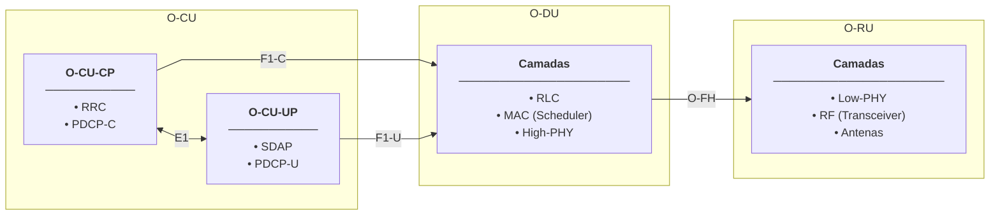
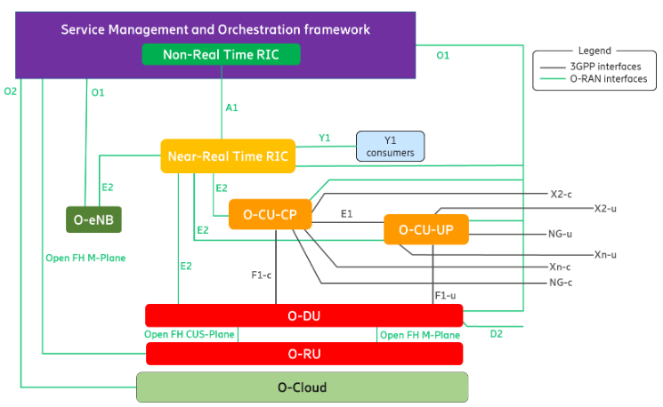
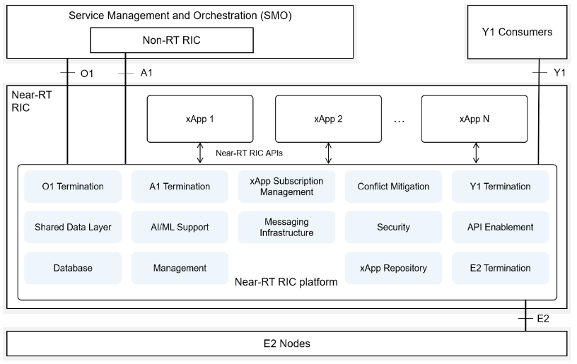
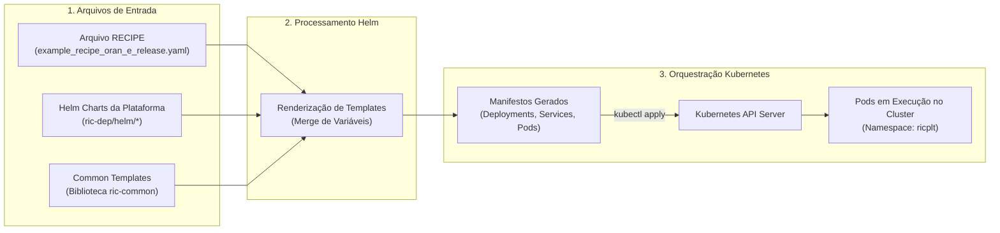
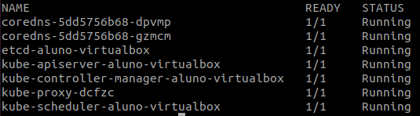
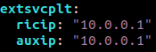
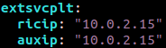
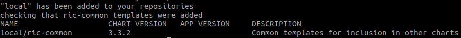
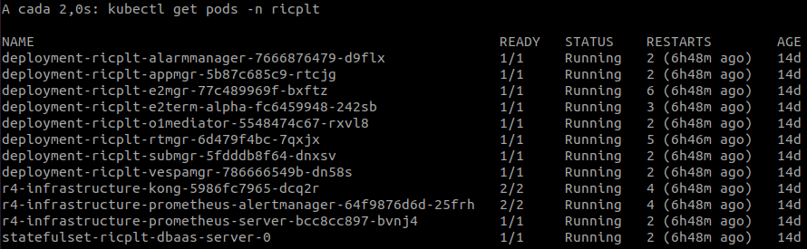

# Laboratório 1: Fundamentos da Arquitetura O-RAN e Deploy do Near-RT RIC

Este laboratório aborda os princípios da **Arquitetura O-RAN**, o papel do **Near-RT RIC** (*Near-Real-Time RAN Intelligent Controller*) e a infraestrutura de computação nativa em nuvem (*Cloud-Native*) que suporta essas funções de rede. Em seguida, é conduzido o provisionamento prático de um cluster **Kubernetes**, a configuração do gerenciador de pacotes **Helm** e o deploy automatizado dos microsserviços da plataforma O-RAN Software Community (OSC - Release E).

---

## 🎯 Objetivos de Aprendizagem

Ao final deste laboratório, você será capaz de:
1. Compreender a evolução e desagregação da arquitetura de redes móveis (de redes proprietárias legadas para o ecossistema O-RAN aberto).
2. Identificar os blocos funcionais e interfaces da arquitetura O-RAN (SMO, Non-RT RIC, Near-RT RIC, O-CU, O-DU, O-RU e interfaces A1, E2, O1, O2).
3. Descrever os microsserviços internos do Near-RT RIC e seus mecanismos de comunicação de alto desempenho (RMR, SDL/Redis).
4. Compreender os conceitos fundamentais do **Kubernetes** (Pods, Deployments, Services, Namespaces, Probes de integridade) e do **Helm** (Charts, Templates, Values e Releases).
5. Provisionar um cluster Kubernetes *single-node* com CNI Flannel e motor de orquestração Helm.
6. Customizar a receita de deploy (*RECIPE*) com as configurações de rede do seu ambiente.
7. Realizar o deploy declarativo do Near-RT RIC, auditar o status dos microsserviços e aplicar correções de configuração (*troubleshooting* em templates Helm e probes do Kubernetes).

---

## 📚 1. Fundamentos Teóricos: A Arquitetura O-RAN

### 1.1 Da RAN Tradicional (Fechada) para a O-RAN (Aberta e Desagregada)

Historicamente, as Redes de Acesso Rádio (RAN - *Radio Access Network*) do 2G ao 4G foram implantadas como **caixas-pretas (*black boxes*) proprietárias**. Em uma RAN clássica:
* O hardware de rádio (RRU - *Remote Radio Unit*) e o hardware de processamento em banda base (BBU - *Baseband Unit*) provinham de um único fabricante (*vendor lock-in*).
* As interfaces entre os elementos (por exemplo, a interface CPRI entre BBU e RRU) eram proprietárias ou fechadas, impedindo a coexistência de equipamentos de fornecedores distintos.
* A adição de novos recursos, inteligência analítica ou algoritmos de otimização de rádio dependia exclusivamente dos ciclos de lançamento fechados de cada fornecedor.

A **O-RAN Alliance** (consórcio global fundado por grandes operadoras e indústrias de telecomunicações) transformou esse paradigma ao definir os princípios da **Open RAN**:
1. **Desagregação de Hardware e Software:** O software da RAN é desacoplado do hardware subjacente, podendo ser executado sobre servidores comerciais de uso geral (COTS - *Commercial Off-The-Shelf*), comumente em arquitetura x86 ou ARM.
2. **Interfaces Abertas e Padronizadas:** Todas as interfaces internas e externas da RAN possuem especificações públicas abertas, permitindo a interoperabilidade entre múltiplos fornecedores (*multi-vendor*).
3. **Inteligência e Automação Orientadas por Dados:** Introdução de controladores inteligentes de RAN programáveis (RICs) capazes de incorporar algoritmos de Inteligência Artificial e Aprendizado de Máquina (IA/ML) para gerenciar recursos em tempo quase real e não-tempo real.

---

### 1.2 Divisão Funcional da RAN (Functional Split 7.2x)

No padrão 5G NR e O-RAN, a estação rádio (gNB) foi desagregada em três entidades lógicas principais:



* **O-CU (Open Central Unit):** Hospeda os protocolos das camadas superiores da pilha de protocolos. É subdividida em duas entidades desacopladas:
  * **O-CU-CP (*Control Plane*):** Gerencia a sinalização de controle, mobilidade e controle de recursos de rádio através das camadas **RRC** (*Radio Resource Control*) e **PDCP-C** (*Packet Data Convergence Protocol - Control*).
  * **O-CU-UP (*User Plane*):** Processa os pacotes de dados do usuário em alta velocidade, executando as camadas **SDAP** (*Service Data Adaptation Protocol*) e **PDCP-U** (*PDCP - User*).
  * **Interface E1:** Interface padronizada pelo 3GPP que conecta o O-CU-CP ao O-CU-UP, permitindo a separação estrita entre plano de controle e plano de dados.
* **O-DU (Open Distributed Unit):** Executa o processamento em tempo real crítico das camadas:
  * **RLC** (*Radio Link Control*): segmentação e retransmissão ARQ;
  * **MAC** (*Medium Access Control*): multiplexação e escalonador (*scheduler*) de pacotes;
  * **High-PHY**: processamento digital superior da camada física (codificação de canal, embaralhamento e modulação).
  * **Interfaces F1-C e F1-U:** Conectam a O-CU à O-DU, divididas em **F1-C** (sinalização de controle entre O-CU-CP e O-DU) e **F1-U** (tráfego de dados de usuário entre O-CU-UP e O-DU).
* **O-RU (Open Radio Unit):** Realiza o processamento digital da porção inferior da camada física (**Low-PHY**: FFT/iFFT, extração de PRACH e beamforming digital), conversão digital-analógica, amplificação e filtragem de radiofrequência (**RF**) e transmissão através das **Antenas**.
* **O-FH (Open Fronthaul - Divisão 7.2x):** A separação entre O-DU e O-RU adota a divisão funcional 7.2x padronizada pela O-RAN Alliance. Ela transporta amostras I/Q no domínio da frequência através de pacotes Ethernet/eCPRI, reduzindo a largura de banda de transporte necessária em comparação com a interface CPRI tradicional.

---

### 1.3 Visão Geral da Arquitetura O-RAN e o Papel dos RICs

A inteligência de rede na O-RAN é hierárquica e distribuída com base no tempo de resposta (*control loops*):

<div align="center">
  
</div>

A hierarquia de controle atua em três escalas temporais:
1. **Loop Não-Tempo Real (Non-RT - $\ge 1\text{ s}$):**
   * Hospedado dentro do **SMO** (*Service Management and Orchestration*).
   * O **Non-RT RIC** executa aplicações chamadas **rApps**. Realiza orquestração de rede em larga escala, treinamento e retreinamento de modelos de Machine Learning, governança de políticas orientadas a intenção (*intent-based networking*) e faturamento.
   * Comunica-se com o Near-RT RIC através da **Interface A1** para impor políticas e diretrizes operacionais.
2. **Loop Quase em Tempo Real (Near-RT - $10\text{ ms} \text{ a } 1\text{ s}$):**
   * Hospedado no **Near-RT RIC**, posicionado próximo à borda da rede (*Edge/Regional Cloud*).
   * Executa aplicações chamadas **xApps**.
   * Realiza controle em malha fechada (*closed-loop control*): controle de admissão de usuários, gerenciamento de mobilidade/handover, alocação de largura de banda, controle de interferência e fatiamento dinâmico (*network slicing*).
   * Comunica-se diretamente com as estações rádio através da **Interface E2**.
3. **Loop em Tempo Real (Real-Time - $< 10\text{ ms}$):**
   * Executado internamente nas próprias O-DUs e O-CUs (escalonamento de slots MAC, *beamforming* digital, modulação e controle de potência).

---

### 1.4 As Interfaces Principais da O-RAN

| Interface | Conexão | Protocolo / Transporte | Finalidade Principal |
| :--- | :--- | :--- | :--- |
| **E2** | Near-RT RIC $\leftrightarrow$ Nós E2| SCTP, E2AP, ASN.1 | Coleta de telemetria da RAN (KPM) e envio de ações de controle (RC). |
| **A1** | Non-RT RIC $\leftrightarrow$ Near-RT RIC | HTTP/REST, JSON | Envio de políticas de alto nível, diretrizes de QoS e consultas de status. |
| **O1** | SMO $\leftrightarrow$ Nós E2 / Near-RT RIC | NETCONF/YANG, RESTCONF | Operação, Administração e Manutenção (OAM), coleta de logs e alarmes. |
| **O2** | SMO $\leftrightarrow$O-Cloud | REST APIs | Gerenciamento do ciclo de vida da infraestrutura de nuvem e alocação de recursos. |

---

## 🧩 2. Anatomia Interna do Near-RT RIC (O-RAN Software Community)

O Near-RT RIC da **O-RAN Software Community (OSC)** foi projetado como uma **plataforma baseada em microsserviços conteinerizados**. Cada função elementar é executada como um serviço independente dentro do cluster Kubernetes:

<div align="center">
  
</div>


### Principais Componentes da Plataforma:

1. **E2 Termination (`e2term`):**
   * Ponto de terminação das conexões SCTP vindas das estações base (porta padrão `36422`).
   * Decodifica mensagens binárias ASN.1 PER do protocolo **E2AP** (*E2 Application Protocol*).
   * Encapsula as mensagens recebidas em envelopes **RMR** e as envia aos componentes internos pertinentes.
2. **E2 Manager (`e2mgr`):**
   * Responsável por manter o estado global da relação entre o RIC e os nós E2 conectados.
   * Processa procedimentos de controle como `E2 Setup`, `E2 Reset` e remoção de nós, persistindo o estado na base de dados.
3. **Subscription Manager (`submgr`):**
   * Centraliza as solicitações de assinatura (*E2 Subscriptions*) criadas pelos xApps.
   * Consolida assinaturas idênticas para evitar duplicação de tráfego na interface E2 com as estações rádio.
4. **A1 Mediator (`a1mediator`):**
   * Expõe endpoints RESTful HTTP para a interface A1.
   * Converte políticas e diretrizes vindas do SMO em mensagens RMR para os xApps correspondentes.
5. **App Manager (`appmgr`):**
   * Orquestra o ciclo de vida dos xApps (implantação, consulta de status, remoção) no namespace `ricxapp`.
6. **Routing Manager (`rtmgr`):**
   * Calcula e distribui dinamicamente as tabelas de roteamento de mensagens RMR para todos os componentes e xApps, garantindo que mensagens identificadas por códigos de evento (ex: `12011`, `12012`) encontrem seus destinos corretos.
7. **Shared Data Layer (SDL) & DBAAS (Redis):**
   * Camada de abstração que unifica o acesso a dados compartilhados com baixíssima latência.
   * Utiliza uma instância do **Redis** em memória para armazenar a lista de nós conectados, métricas de RAN e configurações globais.
8. **RIC Message Router (RMR):**
   * Barramento de mensageria ponto-a-ponto sem broker centralizado, otimizado para o tráfego ultra-rápido entre microsserviços na camada de controle da RAN.

---

## ☁️ 3. A Infraestrutura Cloud-Native: Kubernetes e Helm

A arquitetura da O-RAN especifica que as funções de controle (Near-RT RIC e Non-RT RIC) e as funções de processamento da RAN virtualizada (vCU e vDU) sejam implantadas em uma **O-Cloud** (*O-RAN Cloud Platform*). Essa plataforma adota o modelo **Cloud-Native**, baseado em contêineres e orquestração automatizada.

### 3.1 Por que utilizar o Kubernetes (K8s)?

Em sistemas de telecomunicações modernos, executar serviços diretamente em sistemas operacionais ou máquinas virtuais convencionais gera sobrecarga (*overhead*), dificulta a escalabilidade elástica e torna a recuperação de falhas lenta. 

O **Kubernetes** é a plataforma de orquestração de contêineres de código aberto padrão na indústria (mantida pela Cloud Native Computing Foundation - CNCF). No contexto do Near-RT RIC, o Kubernetes oferece:
* **Alta Disponibilidade e Autorrecuperação (*Self-Healing*):** Se o processo do `e2term` falhar criticamente, o Kubernetes identifica a falha e reinicia o contêiner em milissegundos.
* **Isolamento de Recursos:** Cada microsserviço roda com limites definidos de CPU e memória RAM.
* **Isolamento de Rede e Domínios lógicos:** Permite particionar a plataforma e as aplicações de terceiros através de **Namespaces**.
* **Gerenciamento Declarativo:** O estado da rede é declarado em arquivos YAML e o Kubernetes trabalha continuamente para convergir o estado real com o estado desejado.

#### Conceitos-Chave do Kubernetes no Near-RT RIC:


* **Pod:** A menor unidade executável no Kubernetes. Agrupa um ou mais contêineres que compartilham a mesma pilha de rede (endereço IP e portas) e volumes de armazenamento.
* **Deployment & ReplicaSet:** Controladores responsáveis por manter réplicas dos Pods em execução.
* **Service:** Cria um endereço IP virtual estável (`ClusterIP`) para comunicação interna entre pods ou expõe portas para a rede física externa (`NodePort`), essencial para o recebimento do tráfego SCTP externo no `e2term`.
* **Namespace:** Divisão lógica do cluster. O deploy do RIC utiliza:
  * `kube-system`: Componentes do núcleo do cluster (DNS, API server, CNI Flannel).
  * `ricplt`: Componentes da plataforma Near-RT RIC.
  * `ricxapp`: Namespace dedicado à execução dos xApps.
* **Probes de Saúde (Liveness e Readiness Probes):**
  * *Liveness Probe:* Testa se a aplicação dentro do contêiner está viva. Se falhar, o contêiner é reiniciado.
  * *Readiness Probe:* Testa se a aplicação está pronta para processar requisições. Se falhar, o pod é mantido em execução, mas marcado como `Ready: 0/1` e retirado do balanceador de carga (comportamento abordado no *Troubleshooting* deste laboratório).

---

### 3.2 O que é o Helm e por que ele é Indispensável?

O Near-RT RIC é composto por mais de 10 microsserviços interconectados. Para implantar a plataforma apenas com comandos puros do Kubernetes (`kubectl apply`), seriam necessários mais de **40 arquivos de manifesto YAML** individuais (Deployments, Services, ConfigMaps, Secrets, RBAC, Ingress), com centenas de linhas contendo IPs e configurações que teriam de ser alteradas manualmente em dezenas de locais.

O **Helm** é o **gerenciador de pacotes (*Package Manager*)** do Kubernetes (análogo ao `apt` no Ubuntu ou `pip` no Python):
* **Helm Chart:** Um pacote que reúne todos os templates de manifestos do Kubernetes de um microsserviço em uma estrutura de diretórios padronizada.
* **Templates:** Arquivos de manifesto parametrizados com a linguagem de *template* Go (exemplo: `{{ .Values.ricip }}`), permitindo gerar dinamicamente manifestos completos.
* **Values (`values.yaml`):** Arquivo de variáveis que fornece os dados para preencher os templates.
* **Release:** Uma instância específica de um Chart implantada no cluster Kubernetes sob um determinado nome.



### 3.3 A Relação entre os Scripts de Automação e a Infraestrutura

Para simplificar a implantação, a comunidade O-RAN SC disponibilizou scripts que orquestram essas etapas:
* **`install_k8s_and_helm.sh`:** Prepara o sistema operacional, desativa a área de troca (*swap*), instala o Docker como *Container Runtime*, instala as ferramentas `kubeadm`, `kubelet`, `kubectl`, inicializa o cluster Kubernetes *single-node*, aplica a malha de rede de contêineres CNI **Flannel** e instala o cliente **Helm 3**.
* **`install_common_templates_to_helm.sh`:** Compila e instala a biblioteca de templates compartilhados (`ric-common`) no repositório local do Helm. Essa biblioteca define convenções de nomes, portas e namespaces utilizadas por todos os charts dos microsserviços.
* **`RECIPE` (`example_recipe_oran_e_release.yaml`):** Arquivo de parametrização global (*values override*). Ele centraliza os endereços IP da sua máquina (`ricip`, `auxip`), portas e tags das imagens Docker, dispensando a edição manual de cada um dos charts.
* **`install`:** Lê o arquivo `RECIPE`, resolve a ordem de dependências entre os componentes e dispara os comandos `helm install` sequencialmente para levantar a plataforma completa.

---

## 🛠️ 4. Roteiro Prático: Instalação e Deploy Passo a Passo

> [!IMPORTANT]
> Todo o procedimento a seguir deve ser realizado com privilégios de superusuário (`root`).
> Abra o terminal e execute:
> ```bash   
> sudo -i
> ```

---

### Passo 1: Clonando o Repositório do Near-RT RIC

O primeiro passo consiste em obter o código-fonte da infraestrutura de deploy disponibilizado pela O-RAN Software Community. Nele estão contidos os scripts de automação, os Helm charts de cada componente e os modelos de receitas de configuração (*recipes*).

Clone o repositório **ric-plt/ric-dep** do OSC:
```bash
git clone "https://gerrit.o-ran-sc.org/r/ric-plt/ric-dep"
```

Em seguida, acerte o diretório de execução para a pasta de utilitários e scripts:
```bash
cd ~/ric-dep/bin 
```

---

### Passo 2: Provisionamento do Cluster Kubernetes e Helm

O script `install_k8s_and_helm.sh` automatiza a instalação do ambiente de virtualização nativo em nuvem. Ele realiza:
1. Configuração dos repositórios oficiais e desativação do *swap* no Linux (obrigatório para a estabilidade do Kubelet).
2. Instalação e inicialização do motor Docker.
3. Instalação do `kubelet`, `kubeadm` e `kubectl`.
4. Inicialização do cluster *single-node* via `kubeadm init`, removendo a restrição de isolamento (*taint*) do nó de controle para permitir a execução de Pods da RAN na mesma máquina.
5. Instalação do CNI de rede Flannel (responsável pela malha de comunicação IP entre os Pods).
6. Instalação do utilitário Helm 3.

Execute o script:
```bash
./install_k8s_and_helm.sh
```

> [!NOTE]
> Esse processo pode levar alguns minutos, pois realiza o download dos pacotes do Kubernetes e das imagens base de contêiner.

Ao término da execução, valide se todos os componentes internos do Kubernetes estão operacionais no namespace do sistema (`kube-system`):
```bash
kubectl get pods -n kube-system
```

Todos os pods (como `coredns`, `etcd`, `kube-apiserver`, `kube-flannel-ds`, `kube-proxy`) devem apresentar o status **`Running`**:

<div align="center">
  
</div>

---

### Passo 3: Configuração da Receita de Deploy (*RECIPE*)

A plataforma Near-RT RIC utiliza uma receita em formato YAML para definir as configurações de rede do cluster. O repositório fornece exemplos prontos no diretório `ric-dep/RECIPE_EXAMPLE`. Para este laboratório, utilizaremos o arquivo `example_recipe_oran_e_release.yaml` (correspondente à Release E da O-RAN SC).

É fundamental que os parâmetros `ricip` e `auxip` apontem para o **endereço IP real da interface de rede da sua máquina host**, permitindo que simuladores externos (como o ns-3) e xApps consigam estabelecer conexões com o `e2term`.

1. Consulte o endereço IP da máquina:
   ```bash
   hostname -I | awk '{print $1}'
   ```

2. Abra o arquivo de receita para edição:
   ```bash
   nano ~/ric-dep/RECIPE_EXAMPLE/example_recipe_oran_e_release.yaml
   ```

3. Localize os campos `ricip` e `auxip` (que por padrão contêm `10.0.0.1`) e substitua pelo IP retornado no comando anterior:

<div align="center">
  
  &nbsp; &#10140; &nbsp;
  
</div>

Salve o arquivo (`Ctrl + O`, `Enter` e `Ctrl + X` no `nano`).

---

### Passo 4: Preparação e Instalação de Dependências do Helm

Os charts individuais dos microsserviços do Near-RT RIC (`e2mgr`, `e2term`, `a1mediator`, etc.) herdam definições compartilhadas de rede, formatação e bibliotecas auxiliares de template.

Antes de iniciar a instalação principal, execute o script que empacota e registra a biblioteca de *common templates* no Helm:
```bash
./install_common_templates_to_helm.sh
```

Este comando assegura que o Helm consiga resolver as dependências cruzadas entre os charts durante a renderização dos manifestos do Kubernetes:

<div align="center">
  
</div>

---

### Passo 5: Deploy dos Microsserviços do Near-RT RIC

Com as dependências resolvidas e a receita parametrizada, execute o script de instalação do RIC:
```bash
./install -f ../RECIPE_EXAMPLE/example_recipe_oran_e_release.yaml
```

O script realizará uma sequência ordenada de comandos `helm install`, criando o namespace `ricplt` e subindo cada microsserviço com suas respectivas configurações de portas e variáveis de ambiente.

---

### Passo 6: Verificação e Auditoria dos Microsserviços

Acompanhe a inicialização dos pods da plataforma no namespace `ricplt` utilizando o comando:
```bash
kubectl get pods -n ricplt
```

> [!TIP]
> Você pode adicionar o comando `watch` no início para atualizar a visualização a cada 2 segundos em tempo real:
> ```bash
> watch kubectl get pods -n ricplt
> ```
> Para sair da tela de monitoramento, pressione `Ctrl + C`.

O download das imagens Docker e a inicialização de todos os serviços pode levar alguns minutos. Ao final do procedimento, os pods devem atingir os seguintes estados:

<div align="center">
  
</div>

#### Relação dos Microsserviços do Near-RT RIC no Cluster:

| Pod no Kubernetes | Função no Near-RT RIC | Portas / Protocolos Relevantes |
| :--- | :--- | :--- |
| `deployment-ricplt-e2term-*` | E2 Termination: Terminação SCTP dos nós E2 (estação rádio / ns-3) | `36422/SCTP`, `38000/TCP (RMR)` |
| `deployment-ricplt-e2mgr-*` | E2 Manager: Gestão do ciclo de vida dos nós E2 | `3801/TCP (HTTP REST)`, `38011/TCP (RMR)` |
| `deployment-ricplt-submgr-*` | Subscription Manager: Gestão de assinaturas de xApps | `3802/TCP (HTTP)`, `4560/TCP (RMR)` |
| `deployment-ricplt-appmgr-*` | App Manager: Deploy e catálogo de xApps | `8080/TCP (HTTP REST)` |
| `deployment-ricplt-rtmgr-*` | Routing Manager: Distribuição de rotas de mensageria RMR | `4561/TCP (RMR Route Distribution)` |
| `deployment-ricplt-a1mediator-*` | A1 Mediator: Término da interface A1 (políticas do SMO) | `10000/TCP (HTTP REST)` |
| `statefulset-ricplt-dbaas-server-*` | DBAAS: Base de dados em memória Redis / SDL | `6379/TCP` |
| `r4-infrastructure-kong-*` | Ingress Controller da plataforma | `80/TCP`, `443/TCP` |

---

### Passo 7: Desinstalação da Plataforma (*Undeploy*)

Se for necessário reiniciar o ambiente ou desinstalar os componentes do Near-RT RIC do cluster, utilize o script `uninstall` presente no diretório `~/ric-dep/bin`:
```bash
./uninstall
```

Este script executa o `helm uninstall` em cada uma das releases ativas no namespace `ricplt`, limpando os recursos alocados sem remover o cluster Kubernetes base.

---

## 🔧 5. Troubleshooting: Diagnóstico e Correção de Falhas

### Falha Conhecida: A1 Mediator com Status "Running", mas "Ready 0/1"

Na Release E da O-RAN Software Community, o componente **A1 Mediator** apresenta um erro de configuração conhecido em seus templates Helm. Quando o pod é iniciado, o contêiner entra em execução (`Running`), mas o Kubernetes nunca o marca como pronto (`Ready 0/1`).

#### Por que isso acontece? Análise Técnica:
1. **Falha nas Probes de Verificação de Saúde do Kubernetes (*Readiness & Liveness Probes*):** O template de deployment do A1 Mediator foi empacotado configurado para consultar o endpoint legado `/A1-P/v2/healthcheck`. No entanto, na imagem Docker da Release E, o servidor HTTP interno responde no caminho padronizado `/a1-p/healthcheck`. Como a rota não respondia com sucesso (código HTTP 200), o Kubelet concluiu que a aplicação não estava pronta para receber tráfego.
2. **Escopo Incorreto de Variável no Helm:** O arquivo `config.yaml` procurava o parâmetro `.Values.loglevel`, enquanto o arquivo `values.yaml` o definia sob o escopo `.Values.a1mediator.loglevel`.

#### Procedimento de Correção (Patch):

1. Crie o arquivo de correção `fix_a1mediator.patch`:
   ```bash
   cat << 'EOF' > ~/ric-dep/helm/a1mediator/fix_a1mediator.patch
   diff -ruN ./templates/config.yaml /root/ric-plt-ric-dep/helm/a1mediator/templates/config.yaml
   --- ./templates/config.yaml	2024-07-06 15:04:40.941990000 -0300
   +++ /root/ric-plt-ric-dep/helm/a1mediator/templates/config.yaml	2024-07-06 16:30:01.342419312 -0300
   @@ -33,4 +33,4 @@
        rte|20012|{{ include "common.servicename.a1mediator.rmr" . }}.{{ include "common.namespace.platform" . }}:{{ include "common.serviceport.a1mediator.rmr.data" . }}
        newrt|end
      loglevel.txt: |
   -    log-level: {{ .Values.loglevel }}
   +    log-level: {{ .Values.a1mediator.loglevel }}
   diff -ruN ./templates/deployment.yaml /root/ric-plt-ric-dep/helm/a1mediator/templates/deployment.yaml
   --- ./templates/deployment.yaml	2024-07-06 15:04:40.941990000 -0300
   +++ /root/ric-plt-ric-dep/helm/a1mediator/templates/deployment.yaml	2024-07-06 16:30:01.342419312 -0300
   @@ -71,11 +71,11 @@
                  protocol: TCP
              livenessProbe:
                httpGet:
   -              path: /A1-P/v2/healthcheck
   +              path: /a1-p/healthcheck
                  port: http
              readinessProbe:
                httpGet:
   -              path: /A1-P/v2/healthcheck
   +              path: /a1-p/healthcheck
                  port: http
          volumes:
            - name: "a1conf"
   diff -ruN ./templates/ingress-a1mediator.yaml /root/ric-plt-ric-dep/helm/a1mediator/templates/ingress-a1mediator.yaml
   --- ./templates/ingress-a1mediator.yaml	2024-07-06 15:04:40.941990000 -0300
   +++ /root/ric-plt-ric-dep/helm/a1mediator/templates/ingress-a1mediator.yaml	2024-07-06 16:30:01.342419312 -0300
   @@ -6,8 +6,8 @@
      rules:
      - http:
          paths:
   -      - path: {{ include "common.kongpath.ric.a1mediator" . }}
   -        pathType: Prefix
   +      - pathType: Prefix
   +        path: {{ include "common.kongpath.ric.a1mediator" . }}
            backend:
              service:
                name: {{ include "common.servicename.a1mediator.http" . }}
   diff -ruN ./values.yaml /root/ric-plt-ric-dep/helm/a1mediator/values.yaml
   --- ./values.yaml	2024-07-06 15:04:40.941990000 -0300
   +++ /root/ric-plt-ric-dep/helm/a1mediator/values.yaml	2024-07-06 16:30:01.342419312 -0300
   @@ -38,4 +38,4 @@
        a1_rcv_retry_times: 20
        ins_del_no_resp_ttl: 5
        ins_del_resp_ttl: 10
   -  loglevel: "INFO"
   +  loglevel: "DEBUG"
   EOF
   ```

2. Navegue até a pasta do chart do A1 Mediator:
   ```bash
   cd ~/ric-dep/helm/a1mediator
   ```

3. Aplique o patch:
   ```bash
   patch -p1 < fix_a1mediator.patch
   ```

4. Reinstale a plataforma executando o `./install` novamente a partir de `~/ric-dep/bin`:
   ```bash
   cd ~/ric-dep/bin
   ./install -f ../RECIPE_EXAMPLE/example_recipe_oran_e_release.yaml
   ```

5. Verifique se o pod do `a1mediator` agora atinge o status `Ready 1/1`:
   ```bash
   kubectl get pods -n ricplt | grep a1mediator
   ```

---

## 🧠 6. Questões de Fixação e Autoavaliação

Para consolidar os conceitos teóricos e práticos explorados neste laboratório, responda às seguintes perguntas:

1. **Arquitetura de Controle:** Qual é a diferença fundamental entre as escalas temporais de atuação do **Non-RT RIC** e do **Near-RT RIC**, e que tipo de aplicações (rApps vs. xApps) executa em cada um?
2. **Interfaces da O-RAN:** Quais são as funções desempenhadas respectivamente pelas interfaces **E2** e **A1**? Por que o protocolo de transporte adotado na interface E2 é o SCTP em vez de TCP puro?
3. **Orquestração e Helm:** Por que uma plataforma complexa de telecomunicações como o Near-RT RIC adota o **Helm** em vez de aplicar diretamente manifestos YAML isolados com `kubectl`? Qual é o papel do arquivo `RECIPE` no processo de parametrização?
4. **Resolução de Problemas no Kubernetes:** No diagnóstico do **A1 Mediator**, o pod apresentava status `Running`, porém `Ready 0/1`. Explique a diferença entre o contêiner estar em execução e o Pod ser considerado pronto (*Ready*) pelo Kubernetes, correlacionando com o funcionamento das *Readiness Probes*.

---

## ⏭️ Próximos Passos

Com a infraestrutura do **Near-RT RIC** devidamente implantada e operacional no cluster Kubernetes, o próximo passo consiste em preparar o ambiente de simulação de estações rádio.

No [**Laboratório 2: Instalação do ns-3 e ns-O-RAN**](./lab02-setup-ns3.md), realizaremos a compilação da biblioteca `E2sim` e a integração do módulo O-RAN ao simulador de redes `ns-3`, preparando o terreno para a validação da conexão fim-a-fim via interface E2.