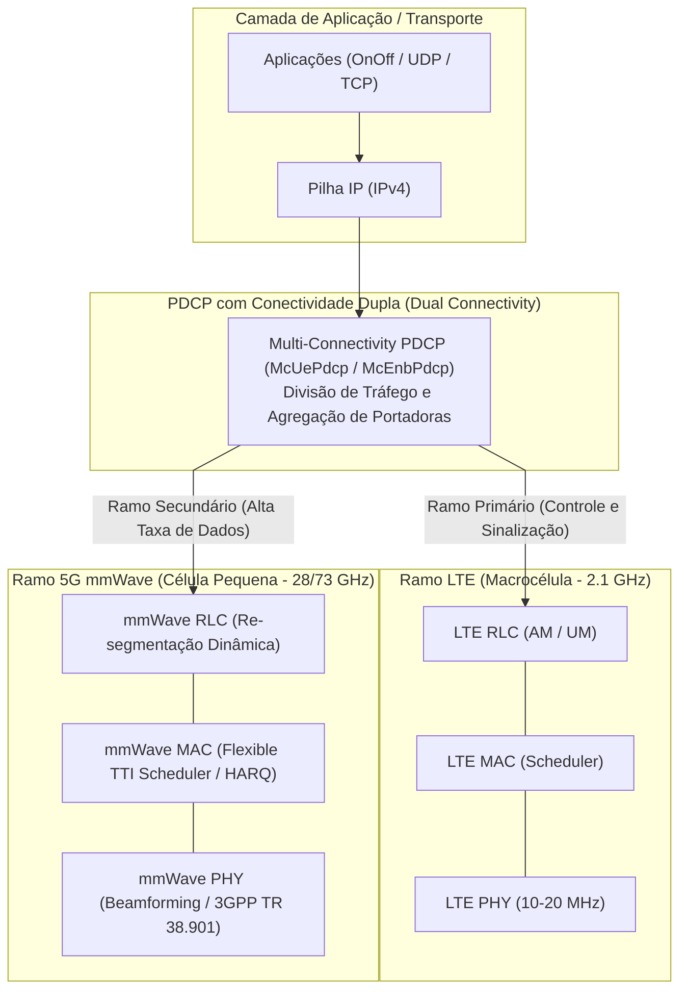
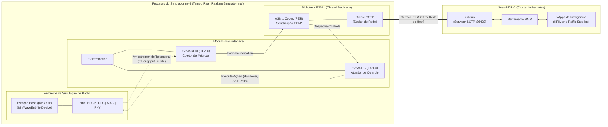
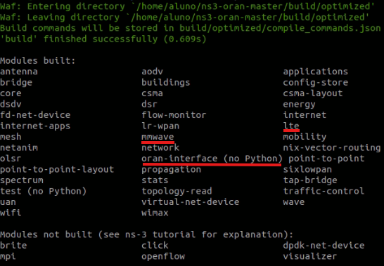

# Laboratório 2: Fundamentos do ns-3, Arquitetura ns-O-RAN e Preparação do Ambiente de Simulação

Este laboratório aborda os princípios teóricos e práticos para a construção do ambiente de simulação 5G integrado ao ecossistema Open RAN. Exploramos o funcionamento interno do simulador de redes **ns-3** (versão 3.33) em modo de tempo real (*Real-Time Simulation*), a pilha de protocolos de ondas milimétricas do módulo **ns3-mmWave** e o arcabouço de integração do **ns-O-RAN** (`oran-interface` e biblioteca `E2sim`). Em seguida, realizamos a compilação de dependências, a construção da biblioteca de emulação E2 e a configuração nativa do simulador com o compilador **Waf**.

---

## 🎯 Objetivos de Aprendizagem

Ao final deste laboratório, você será capaz de:
1. Compreender o funcionamento de um simulador de eventos discretos (*Discrete-Event Simulator* - DES) e a necessidade da sincronização em tempo real (*Real-Time Emulation*) para integração com controladores de rede reais.
2. Descrever a pilha de protocolos 5G New Radio (NR) do módulo **ns3-mmWave** (PHY, MAC, RLC, PDCP) e o paradigma de Conectividade Dupla (*Dual Connectivity* / *Non-Standalone* - NSA entre LTE e mmWave).
3. Entender a arquitetura do **ns-O-RAN**: como a classe `E2Termination` do módulo `oran-interface` e a biblioteca `E2sim` transformam nós simulados em estações rádio O-RAN (*E2 Nodes*).
4. Diferenciar os modelos de serviço O-RAN suportados: **E2SM-KPM** (telemetria de métricas de desempenho) e **E2SM-RC** (controle de rádio e direcionamento de tráfego / *Traffic Steering*).
5. Compilar, empacotar (.deb) e registrar as bibliotecas C++ da `E2sim` com suporte à codificação binária ASN.1 PER e sockets SCTP.
6. Integrar o módulo `oran-interface` à árvore de código do `ns3-mmwave` e configurar a suíte de compilação com o motor **Waf** utilizando perfis de alta performance (*optimized*).
7. Validar a compilação do simulador e preparar os binários para o procedimento de conexão (*E2 Setup*) com o Near-RT RIC.

---

## 📚 1. Fundamentos Teóricos: Simulação de Redes com ns-3 (v3.33)

### 1.1 O Modelo de Eventos Discretos do ns-3

O **ns-3** (*Network Simulator 3*) é um simulador de redes de computadores modular e de código aberto voltado para pesquisa e desenvolvimento acadêmico e industrial. Diferente de emuladores baseados em contêineres ou máquinas virtuais (que executam pilhas reais de sistemas operacionais), o ns-3 modela o comportamento de cada protocolo e canal através de um **Simulador de Eventos Discretos** (*Discrete-Event Simulator* - DES).

Em um modelo DES:
* O tempo da simulação avança aos "saltos": o relógio virtual pula instantaneamente de um evento agendado para o próximo evento na fila de prioridades (`ns3::Simulator::Schedule`).
* Durante a execução pura, não há correlação necessária com o tempo do relógio da parede (*wall-clock time*). Um cenário complexo de 10 segundos virtuais pode levar minutos para ser calculado pela CPU, enquanto um cenário vazio pode rodar em milissegundos.

#### Abstrações Centrais do ns-3:
* **`Node`:** Representa a entidade computacional básica (análogo a um computador, roteador, smartphone UE ou estação base gNB).
* **`Application`:** Processos de software que residem nos nós, responsáveis por produzir ou consumir fluxos de dados (exemplo: `OnOffApplication` para rajadas UDP/CBR e `PacketSink` como receptor).
* **`NetDevice`:** Abstração da interface de rede física e das camadas de enlace/rádio (exemplo: `MmWaveEnbNetDevice`, `LteEnbNetDevice`, `McUeNetDevice`).
* **`Channel`:** Modela o meio físico de transmissão (cabos ponto-a-ponto, ar livre, reflexões e atenuações do canal sem fio).
* **`MobilityModel`:** Rastreia e calcula a posição espacial tridimensional (3D) e a velocidade dos nós ao longo do tempo (modelos estáticos, constantes ou com trajetórias em waypoints).
* **`Packet`:** Estrutura de dados serializada contendo os bytes reais de carga útil (*payload*) e pilhas de cabeçalhos/trailers protocolados.

---

### 1.2 O Desafio da Integração Externa: O Modo Tempo Real (`RealtimeSimulatorImpl`)

Em simulações científicas convencionais, o ns-3 roda isolado em seu próprio universo temporal. Contudo, o objetivo deste bootcamp é conectar nós simulados no ns-3 a um **Near-RT RIC real em execução no Kubernetes**. 

O Near-RT RIC opera no mundo real: seus temporizadores internos, sondas de saúde do Kubernetes, barramentos de mensageria RMR e sockets SCTP esperam que o tempo avance em segundos físicos reais. Se o ns-3 executasse em tempo livre, as mensagens de telemetria seriam disparadas rápido demais (sobrecarregando o cluster) ou demorariam tanto que as conexões SCTP seriam terminadas por *timeout*.

Para solucionar esse problema, o ns-3 oferece a implementação de relógio em tempo real:
```cpp
GlobalValue::Bind("SimulatorImplementationType", StringValue("ns3::RealtimeSimulatorImpl"));
```

#### Como funciona o `RealtimeSimulatorImpl`?
1. **Sincronização Monotônica:** O agendador de eventos amarra o relógio da simulação diretamente ao relógio monotônico do sistema operacional (`CLOCK_MONOTONIC`).
2. **Espera Ativa e Soneca (*Sleep*):** Se o próximo evento virtual do ns-3 estiver agendado para $t = 2.0\text{ s}$ e o relógio real da máquina ainda marcar $t = 1.8\text{ s}$, o motor do simulador suspende a thread principal por $200\text{ ms}$, disparando o evento no instante exato do mundo físico.
3. **Interação com Sockets Reais:** Isso permite que o ns-3 atue no modo **Hardware/Software-in-the-Loop**, estabelecendo conexões de rede reais com processos externos via pilha TCP/IP ou SCTP do sistema operacional Linux.

---

## 📡 2. A Pilha 5G New Radio: O Módulo `ns3-mmwave`

O módulo **`ns3-mmwave`** foi desenvolvido em uma colaboração entre a **NYU WIRELESS** (Universidade de Nova Iorque) e a **Universidade de Padova** (Itália) para preencher a lacuna da simulação de redes móveis em frequências extremamente altas (ondas milimétricas, de 28 GHz a 73 GHz).

### 2.1 Camadas da Pilha de Protocolos do `ns3-mmwave`

As bandas milimétricas oferecem larguras de banda sem precedentes (de 100 MHz a 1 GHz por portadora), mas sofrem de forte atenuação por espaço livre e suscetibilidade a bloqueios físicos (árvores, edifícios, corpos humanos). Para lidar com essas características, o módulo implementa uma pilha completa de protocolos modelada segundo o 3GPP:



#### 1. Camada Física (PHY):
* **Beamforming Analógico e Digital:** Implementa conjuntos de matrizes de antenas direcionais (*Antenna Arrays*) na estação base (gNB) e nos dispositivos móveis (UE). Isso permite concentrar a potência de radiofrequência em feixes estreitos (*beams*), compensando a alta atenuação do canal.
* **Modelos de Canal Espaciais 3GPP:** Integração dos modelos 3GPP TR 38.901 (cenários Urban Micro - *UMi* e Urban Macro - *UMa*), distinguindo condições de Linha de Visada (*Line-of-Sight* - LOS) e Não-Linha de Visada (*Non-LOS* - NLOS).
* **Numerologias Flexíveis:** Suporte a diferentes espaçamentos entre subportadoras (SCS de 60 kHz e 120 kHz) e estruturas de quadro TDD (*Time Division Duplexing*).

#### 2. Camada MAC:
* **Escalonador de Intervalo Flexível (`MmWaveFlexTtiMacScheduler`):** Aloca dinamicamente blocos de recursos de rádio (PRBs) e símbolos OFDM tanto para tráfego de subida (uplink) quanto de descida (downlink), além de gerenciar processos de retransmissão **HARQ**.

#### 3. Camada RLC (Radio Link Control):
* Opera nos modos **UM** (*Unacknowledged Mode*) e **AM** (*Acknowledged Mode*). No módulo mmWave, o RLC incorpora **re-segmentação dinâmica** de pacotes, garantindo que grandes blocos de dados possam ser fragmentados para se ajustar às mudanças bruscas de canal causadas por bloqueio de feixes.

#### 4. Camada PDCP e Conectividade Dupla (*Dual Connectivity* - DC):
* O módulo adota uma arquitetura **Não-Autônoma (*Non-Standalone* - NSA)**, onde o dispositivo do usuário (`McUeNetDevice`) comunica-se simultaneamente com uma macrocélula LTE tradicional (âncora de controle) e com uma célula de ondas milimétricas 5G (transferência massiva de dados).
* O protocolo `McUePdcp` atua como o ponto de decisão, permitindo direcionar pacotes dinamicamente entre os dois ramos de rádio (*traffic steering*).

---

## 🌐 3. A Integração ns-O-RAN: Conectando o ns-3 ao Near-RT RIC

Para permitir que a inteligência de controle da O-RAN atue sobre simulações em larga escala, pesquisadores do *Institute for the Wireless Internet of Things* (WIoT) da Northeastern University propuseram e implementaram o arcabouço **ns-O-RAN** (apresentado nos artigos de Lacava et al., 2022 e 2023).

### 3.1 Anatomia da Arquitetura de Comunicação

O ecossistema ns-O-RAN constrói uma ponte robusta entre o núcleo em C++ do simulador e o Near-RT RIC em execução no cluster Kubernetes:



### 3.2 O Papel da Biblioteca `E2sim` (`ns-o-ran-e2-sim`)

A biblioteca **`E2sim`** é uma versão adaptada da implementação de referência de emulação de nós E2 da O-RAN Software Community (`sim/e2-interface`). Suas funções essenciais são:
1. **Serialização e Desserialização ASN.1 PER:** O protocolo E2AP transmite dados binários altamente compactados de acordo com as regras de empacotamento alinhadas PER (*Packed Encoding Rules*). O E2sim realiza a conversão de estruturas de dados C++ para bytes PER e vice-versa.
2. **Camada de Transporte SCTP:** Abre sockets clientes SCTP (*Stream Control Transmission Protocol*) que se conectam ao pod `e2term` do RIC na porta `36422`.
3. **Execução Multi-threaded Desacoplada:** O E2sim executa sua rotina principal (`E2Sim::run_loop()`) em uma **thread POSIX independente** da thread principal do ns-3. Isso impede que esperas de rede no socket SCTP causem travamentos ou atrasos no processamento de eventos do simulador.

---

### 3.3 O Módulo `oran-interface` (`sim-ns3-o-ran-e2`)

Localizado no diretório `contrib/oran-interface` do simulador, o módulo provê a camada de abstração necessária para conectar as classes de rede do ns-3 à biblioteca E2sim:
* **Classe `E2Termination`:** Cada estação rádio instanciada no cenário (`MmWaveEnbNetDevice` ou `LteEnbNetDevice`) incorpora um objeto `E2Termination`. Esse objeto identifica o nó perante o Near-RT RIC através de um identificador global (*Global E2 Node ID*, combinando PLMN ID e `gnbId`/`enbId`).
* **Modelos de Serviço (E2 Service Models - E2SM):**
  * **E2SM-KPM (*Key Performance Metrics*, RAN Function ID 200):** Inscreve-se em fontes de rastreamento (*trace sources*) do ns-3. Em intervalos regulares (`E2Periodicity`), captura estatísticas de tráfego (taxas de transferência de DL/UL, atraso de entrega de pacotes, BLER, utilização de buffers de transmissão RLC e ocupação espectral) e gera mensagens `RIC Indication` que alimentam xApps de monitoramento (como o `kpimon`).
  * **E2SM-RC (*RAN Control*, RAN Function ID 300):** Escuta mensagens `RIC Control Request` vindas de xApps decisores. Ao receber um comando de controle, a interface dispara métodos internos da simulação para:
    * Executar comutação de célula (*handover*) forçada para determinados UEs;
    * Alterar dinamicamente a divisão de tráfego (*split ratio*) entre os ramos LTE e mmWave em UEs multi-conectados (essência do artigo de *Traffic Steering* da WIoT).

---

## ⚙️ 4. O Sistema de Compilação Waf do ns-3

Diferente de sistemas baseados em CMake ou GNU Make puro, o ns-3.33 utiliza o **Waf**, um sistema de compilação ágil baseado em Python, projetado para detectar automaticamente módulos opcionais e dependências externas instaladas no sistema operacional.

### Análise das Flags de Configuração:

| Flag de Configuração | Finalidade Técnica |
| :--- | :--- |
| `--enable-examples` | Compila os cenários de exemplo contidos no núcleo e nos módulos instalados em `contrib/`, permitindo testes de validação rápidos. |
| `--enable-tests` | Constrói a suíte de testes unitários e de integração do ns-3 para auditoria de regressão. |
| `--disable-werror` | Instrui o compilador C++ (g++) a **não** tratar avisos (*compiler warnings*) como erros fatais. Como módulos externos de pesquisa utilizam código ASN.1 gerado automaticamente que pode conter advertências de depreciação de tipos, essa flag impede que a compilação seja abortada prematuramente. |
| `--build-profile=optimized` | Ativa flags agressivas de otimização de código (`-O3`), desativa macros de verificação interna (`NS_ASSERT`) e minimiza logs nativos. **Essencial para simulações em tempo real**, reduzindo a carga da CPU em até 10 vezes em comparação com o perfil `debug`. |
| `--out=build/optimized` | Redireciona os arquivos objeto compilados (`.o`, bibliotecas dinâmicas e executáveis) para um diretório específico, permitindo alternar entre versões de depuração e otimizadas sem recompilar o código do zero. |

---

## 🛠️ 5. Roteiro Prático Passo a Passo

### Passo 1: Instalação de Dependências do Sistema

O simulador ns-3 e a biblioteca E2Sim exigem ferramentas essenciais de compilação C++, bibliotecas de comunicação SCTP para a interface E2, cabeçalhos do Boost e utilitários de interface gráfica.

Abra o terminal e execute a atualização dos repositórios seguida da instalação dos pacotes necessários:
```bash
sudo apt-get update
sudo apt-get install -y build-essential git cmake libsctp-dev autoconf automake libtool bison flex libboost-all-dev
sudo apt-get install -y g++ python3 qtbase5-dev qtchooser qt5-qmake qtbase5-dev-tools
```

---

### Passo 2: Compilação e Instalação da Biblioteca E2Sim

A biblioteca `E2sim` é compilada a partir do código-fonte e empacotada no formato `.deb` para ser registrada globalmente no sistema operacional.

> [!IMPORTANT]
> A compilação e instalação de pacotes no sistema exige privilégios de administrador:
> ```bash
> sudo -i
> ```

1. Clone o repositório da biblioteca mantido pelo laboratório WIoT:
   ```bash
   git clone -b develop https://github.com/wineslab/ns-o-ran-e2-sim ~/e2sim
   ```

2. Crie a pasta de compilação isolada (*out-of-source build*) e navegue até ela:
   ```bash
   mkdir -p ~/e2sim/e2sim/build
   cd ~/e2sim/e2sim/build
   ```

3. Configure a compilação com o `cmake`. É possível especificar o nível de detalhamento dos logs através da variável `-DLOG_LEVEL`:
   * `0` (`LOG_LEVEL_UNCOND`): Somente mensagens incondicionais.
   * `1` (`LOG_LEVEL_ERROR`): Apenas registros de erros críticos.
   * `2` (`LOG_LEVEL_INFO`): Informações de fluxo operacional.
   * `3` (`LOG_LEVEL_DEBUG`): Rastreamento detalhado de cada pacote ASN.1 processado.

   Execute a configuração:
   ```bash
   cmake .. -DDEV_PKG=1 -DLOG_LEVEL=3
   ```

4. Empacote os binários e cabeçalhos em um arquivo Debian utilizando o `make`:
   ```bash
   make package
   ```

5. Instale o pacote `.deb` gerado no sistema operacional e atualize o cache de bibliotecas dinâmicas do Linux (`ldconfig`):
   ```bash
   dpkg --install ./e2sim-dev_1.0.0_amd64.deb
   ldconfig
   ```

6. Saia da sessão de superusuário:
   ```bash
   exit
   ```

Com isso, as bibliotecas compartilhadas `libe2sim.so` e seus respectivos cabeçalhos ASN.1 ficam disponíveis no diretório `/usr/local/lib` e `/usr/local/include`, acessíveis por qualquer compilador do sistema.

---

### Passo 3: Obtenção do Simulador `ns3-mmwave` e do Módulo `oran-interface`

> [!NOTE]
> As etapas a seguir devem ser executadas com o seu **usuário comum**, sem privilégios de superusuário (`sudo`).

1. Clone o repositório do simulador ns-3 modificado com suporte nativo a ondas milimétricas:
   ```bash
   git clone -b release https://github.com/wineslab/ns-o-ran-ns3-mmwave ~/ns3-mmwave-oran
   ```
   *Esta versão integra o núcleo do ns-3.33 com a pilha 5G mmWave de alta capacidade.*

2. Clone o módulo oficial da interface O-RAN (`sim-ns3-o-ran-e2`) diretamente dentro da pasta `contrib/oran-interface` do simulador:
   ```bash
   git clone -b h-release https://github.com/o-ran-sc/sim-ns3-o-ran-e2 ~/ns3-mmwave-oran/contrib/oran-interface
   ```

---

### Passo 4: Configuração e Compilação do Simulador com Waf

Com todo o código-fonte posicionado e a biblioteca E2sim registrada no sistema, configuramos o ambiente de compilação com as flags de otimização de alta performance.

1. Acesse o diretório raiz do simulador:
   ```bash
   cd ~/ns3-mmwave-oran
   ```

2. Execute a etapa de configuração do Waf:
   ```bash
   ./waf configure --enable-examples --enable-tests --disable-werror --build-profile=optimized --out=build/optimized
   ```

   O Waf inspecionará o sistema e confirmará que as bibliotecas `E2Sim`, `SCTP`, `pthread` e os módulos `mmwave` e `oran-interface` estão prontos para compilação.

3. Inicie o processo de compilação:
   ```bash
   ./waf build
   ```

> [!TIP]
> A compilação do ns-3 envolve centenas de arquivos C++ e modelos matemáticos de canal complexos. Dependendo do número de núcleos de processamento (CPU) e da memória RAM da sua máquina, esse processo pode levar entre 5 e 20 minutos.

Ao término da compilação bem-sucedida, o Waf exibirá a mensagem de confirmação:

<div align="center">
  
</div>

---

## 🧠 5. Questões de Fixação e Autoavaliação

Para consolidar os conceitos teóricos e práticos explorados neste laboratório, responda às seguintes perguntas:

1. **Simulação em Tempo Real:** Por que uma simulação convencional baseada em eventos discretos (*DES*) não pode ser conectada diretamente a um Near-RT RIC em execução no Kubernetes sem o uso da classe `RealtimeSimulatorImpl`? Qual o impacto nos temporizadores do protocolo SCTP?
2. **Conectividade Dupla e mmWave:** No módulo `ns3-mmwave`, qual é o papel do protocolo `McUePdcp` ao operar em modo Não-Autônomo (*Non-Standalone* - NSA) entre as tecnologias LTE e mmWave?
3. **Mecanismo de Desacoplamento:** Por que a biblioteca `E2sim` precisa executar sua rotina `run_loop()` em uma *thread* separada do sistema operacional em vez de rodar dentro do laço principal de eventos do ns-3?
4. **Modelos de Serviço:** Qual é a diferença fundamental entre as mensagens transportadas pelo modelo **E2SM-KPM** (ID 200) e pelo modelo **E2SM-RC** (ID 300) na interação entre as estações base simuladas e as aplicações inteligentes (*xApps*)?
5. **Otimização de Compilação:** Por que o perfil `--build-profile=optimized` é expressamente recomendado em relação ao perfil `debug` ao executar cenários do ns-O-RAN com múltiplos UEs e tráfego de alta taxa?

---

## ⏭️ Próximos Passos

Com a infraestrutura do **Near-RT RIC** implantada no Kubernetes ([Laboratório 1](./lab01-setup-RIC.md)) e o simulador **ns-3** compilado com suporte nativo à biblioteca `E2sim` e ao módulo `oran-interface`, o cenário está pronto para a integração fim-a-fim.

No [**Laboratório 3: Validação da Integração ns-3 e Near-RT RIC (O Caminho do E2 Setup)**](./lab03-validacao-e2setup.md), executaremos o cenário de simulação (`scenario-trainning.cc`), monitoraremos os logs de tráfego do `e2term` e acompanharemos em tempo real o handshake ASN.1/SCTP que oficializa o registro dos nós de rádio no controlador.