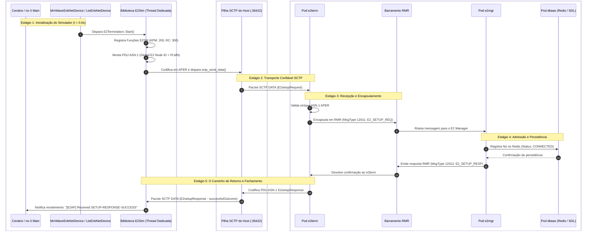
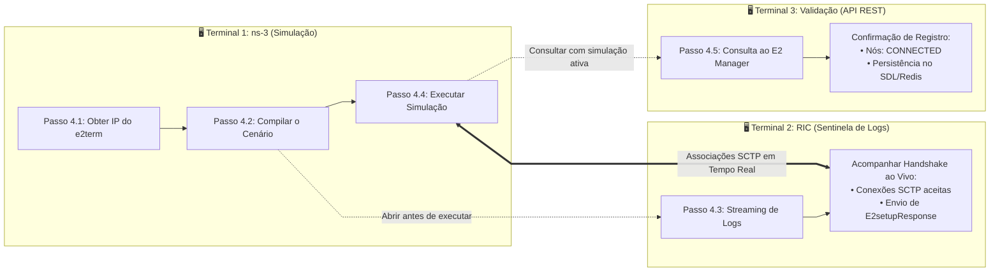

# Laboratório 3: Validação da Integração ns-3 e Near-RT RIC (O Caminho do E2 Setup)

No [Laboratório 1](./lab01-setup-RIC.md), realizamos a implantação completa do Near-RT RIC no cluster Kubernetes. No [Laboratório 2](./lab02-setup-ns3.md), exploramos os fundamentos de simulação em tempo real do ns-3 (v3.33), a pilha 5G mmWave e compilamos o simulador com a biblioteca `E2sim` e o módulo `oran-interface`.

Agora, surge a questão central da integração Open RAN: **como garantir que o simulador de rádio e o controlador inteligente realmente dialogam em conformidade com as normas da O-RAN Alliance?**

Em vez de uma execução mecânica, este laboratório foi projetado para dissecar **o ciclo de vida completo e o caminho exato percorrido por uma mensagem E2AP**: desde a sua instanciação em C++ no ns-3, passando pela codificação binária ASN.1 PER e pelo transporte via socket SCTP em tempo real, até a sua recepção pelo `e2term`, roteamento via barramento RMR, processamento pelo E2 Manager e persistência na base de dados distribuída (SDL/Redis) do RIC.

---

## 🎯 Objetivos de Aprendizagem

Ao final deste laboratório, você será capaz de:
1. Compreender a especificação do protocolo **E2AP** (*E2 Application Protocol*) e o conceito de Procedimentos Elementares (EPs) de Classe 1 e Classe 2.
2. Analisar a estrutura de uma PDU (*Packet Data Unit*) de **E2 Setup Request** e **E2 Setup Response**, identificando identidades globais de nós (*Global E2 Node ID*) e a lista de Modelos de Serviço (*RAN Functions* E2SM-KPM e E2SM-RC).
3. Explicar por que o protocolo **SCTP** (*Stream Control Transmission Protocol*, RFC 4960) é a camada de transporte mandatória na O-RAN, diferenciando suas propriedades de *multi-streaming* e *multi-homing* em relação ao TCP e UDP.
4. Descrever a arquitetura interna de mensageria do Near-RT RIC baseada no **RMR** (*RIC Message Router*) e nas tabelas de roteamento dinâmicas sem broker central.
5. Identificar a função de cada componente do RIC no handshake: `e2term` (terminação externa), `e2mgr` (máquina de estados e admissão) e `dbaas` (Shared Data Layer / Redis).
6. Configurar e parametrizar o cenário de Conectividade Dupla LTE + mmWave (`scenario-trainning.cc`), gerenciando opções de linha de comando (`CommandLine`) e diferenciando modos de operação *online* e *offline*.
7. Executar a simulação e realizar observabilidade em múltiplos níveis: correlacionando logs do simulador, logs do pod `e2term` e consultando a API REST do E2 Manager para homologação do status `CONNECTED`.

---

## 📚 1. Fundamentos Teóricos da Interface E2 e do Handshake E2 Setup

### 1.1 O Protocolo E2AP (E2 Application Protocol) e os Procedimentos Elementares

O protocolo **E2AP** (definido pelo Grupo de Trabalho 3 da O-RAN Alliance - *WG3: Near-Real-time RIC and E2 Interface*) padroniza a troca de mensagens de sinalização, telemetria e controle entre o Near-RT RIC e os nós da rede de acesso (gNB, eNB ou suas entidades desagregadas O-CU e O-DU).

As operações do E2AP são organizadas em **Procedimentos Elementares (EPs - *Elementary Procedures*)**, divididos em duas classes fundamentais:

* **Procedimentos de Classe 1 (Com Resposta Obrigatória):** Iniciados por uma mensagem de requisição (*Initiating Message*) e concluídos por uma mensagem de confirmação de sucesso (*Successful Outcome*) ou falha (*Unsuccessful Outcome*).
  * Exemplo principal: **E2 Setup (EP 1)**, *E2 Reset*, *RIC Service Update*.
* **Procedimentos de Classe 2 (Sem Resposta / Não-Confirmados):** Mensagens unidirecionais de notificação ou controle imediato.
  * Exemplo principal: **RIC Indication (EP 5)** (transmissão de telemetria do nó para o RIC).

| PDU do Procedimento E2 Setup | Tipo ASN.1 | Finalidade Técnica |
| :--- | :--- | :--- |
| **`E2setupRequest`** | `initiatingMessage` | Disparada pelo nó de rádio (E2 Node) para solicitar conexão e anunciar suas capacidades operacionais ao Near-RT RIC. |
| **`E2setupResponse`** | `successfulOutcome` | Retornada pelo Near-RT RIC quando a requisição é aceita, homologando o registro e autorizando a subscrição de xApps. |
| **`E2setupFailure`** | `unsuccessfulOutcome` | Retornada pelo Near-RT RIC caso os parâmetros sejam inválidos ou as capacidades declaradas não sejam suportadas. |

#### Anatomia da PDU `E2setupRequest`
Uma requisição de E2 Setup transporta três conjuntos críticos de informações estruturadas em ASN.1:
1. **`GlobalE2node-ID`:** Identificador universal e exclusivo da estação rádio perante todo o núcleo móvel e o RIC. É composto por:
   * **PLMN Identity:** Código móvel do operador (MCC - *Mobile Country Code* + MNC - *Mobile Network Code*), codificado em BCD (ex: `313131`).
   * **Node ID:** Identificador numérico da estação base (`gnbId` para 5G NR ou `enbId` para 4G LTE).
2. **`RANfunctions-List`:** Catálogo de modelos de serviço (E2SM) que o nó sabe executar:
   * **`RANfunctionID = 200` (E2SM-KPM):** Informa que o nó suporta telemetria periódica de métricas de rádio (*Key Performance Metrics*).
   * **`RANfunctionID = 300` (E2SM-RC):** Informa que o nó aceita comandos de controle e direcionamento de tráfego (*RAN Control* / *Traffic Steering*).
   * Para cada função, acompanha uma estrutura `RANfunctionDefinition` contendo o esquema formal binário que dita quais parâmetros podem ser coletados ou alterados.
3. **`E2nodeComponentConfigAddition-List`:** Declara os componentes arquiteturais internos presentes no nó (interfaces F1-C, F1-U, E1, X2 ou Xn).

#### O que é o ASN.1 e por que utilizá-lo no E2AP?

A especificação de mensagens do protocolo E2AP não utiliza formatos baseados em texto comuns da Web moderna (como JSON ou XML), mas sim **ASN.1** com regras de codificação **APER**.

##### 1. O que é o ASN.1 (*Abstract Syntax Notation One*)?
Padronizado pela ITU-T (X.680) e ISO/IEC, o **ASN.1** é uma linguagem formal e rigorosa utilizada para definir tipos de dados e estruturas de mensagens de forma totalmente independente de:
* Linguagem de programação (C, C++, Go, Python);
* Arquitetura de hardware e sistema operacional (processadores x86 vs. ARM, arquiteturas de 32 vs. 64 bits);
* Ordem de bytes na memória (*Endianness*, Little-Endian vs. Big-Endian).

No ASN.1, a especificação técnica descreve apenas a **estrutura abstrata** das informações utilizando tipos formais (como `INTEGER`, `BOOLEAN`, `OCTET STRING`, `SEQUENCE` e `CHOICE`).

A grande vantagem prática é que, a partir desse arquivo de especificação textual (ex: `e2ap-v01.01.asn`), ferramentas automáticas como o compilador **`asn1c`** geram diretamente as estruturas de dados (`struct`) e as rotinas de serialização em linguagem C/C++. Isso assegura que diferentes fabricantes (como Ericsson, Nokia e bibliotecas de código aberto como a `E2sim`) conversem entre si sem qualquer discrepância na interpretação de campos.

##### 2. Por que o ASN.1 é o Padrão em Redes Móveis e na O-RAN?
Desde o início das redes celulares (2G GSM, 3G, 4G LTE e agora no 5G 3GPP e O-RAN), o ASN.1 é o padrão consagrado devido a características indispensáveis para telecomunicações:
* **Garantia de Interoperabilidade Multi-Fabricante:** Impede que variações de sintaxe quebrem a comunicação entre estações rádio de marcas diferentes e o controlador de rede.
* **Desacoplamento entre Estrutura e Transferência:** A representação dos dados é separada das regras com que esses dados são codificados para envio pelo fio (*wire format*). O mesmo modelo abstrato pode ser inspecionado visualmente ou empacotado de forma ultracompacta.

##### 3. A Regra de Codificação Binária APER (*Aligned Packed Encoding Rules*)
Para o transporte de mensagens na interface E2, a O-RAN Alliance padronizou o uso das regras **APER** (*Aligned Packed Encoding Rules*):
* **Densidade Extrema de Bits:** Em formatos como JSON, uma propriedade como `{"connectionStatus": "CONNECTED"}` consome dezenas de bytes repetindo chaves e aspas em texto claro. No APER, um campo booleano é codificado em exatamente 1 bit, e inteiros ocupam estritamente o número mínimo de bits necessário para representar seu valor, alinhados em limites de octetos. Como resultado, uma mensagem `E2setupRequest` completa frequentemente ocupa menos de 200 bytes.
* **Baixíssima Latência e Determinismo de CPU:** A serialização e decodificação binária em C/C++ consome frações de microssegundo do processador. Isso é mandatório para estações rádio da RAN, que operam sob restrições severas de tempo real com intervalos de transmissão de subquadro de $1\text{ ms}$ (TTI).

---

### 1.2 A Camada de Transporte SCTP (RFC 4960)

A O-RAN Alliance adotou o **SCTP** (*Stream Control Transmission Protocol*) como o protocolo mandatário da camada de transporte para todas as conexões da interface E2. 

A tabela abaixo compara o SCTP com os protocolos de transporte tradicionais da Internet:

| Propriedade de Rede | UDP (RFC 768) | TCP (RFC 793) | SCTP (RFC 4960 - Adotado na O-RAN) |
| :--- | :--- | :--- | :--- |
| **Orientação** | Datagramas (Mensagens) | Fluxo Contínuo de Bytes (*Byte Stream*) | **Orientado a Mensagens com Delimitação de PDU** |
| **Confiabilidade** | Nenhuma (perda tolerada) | Confiável (ACK e retransmissões) | **Confiável (ACK seletivo SACK e controle de congestionamento)** |
| **Prevenção de Head-of-Line Blocking** | Nula (sem ordenação) | Não (uma perda bloqueia todo o fluxo) | **Sim (Multi-Streaming Independente)** |
| **Redundância de Rede** | Nenhuma | Monocanal (1 IP origem $\leftrightarrow$ 1 IP destino) | **Multi-Homing Nativo (Múltiplos IPs/Interfaces físicas)** |
| **Proteção contra Ataques de Negação de Serviço** | Inexistente | Vulnerável a *SYN Flood* | **Handshake de 4 Vias com Cookie Assinado (Proteção contra SYN Flood)** |

#### O Mecanismo de *Multi-Streaming* no E2AP:
No TCP, se um pacote é perdido na rede, todos os bytes subsequentes ficam retidos no buffer do sistema operacional até que a retransmissão chegue, gerando o fenômeno de **Head-of-Line (HoL) Blocking**. 

No SCTP, uma única associação física pode conter até 65.535 **streams lógicas independentes**:
* Uma stream pode ser dedicada à telemetria de métricas em alta frequência (E2SM-KPM).
* Outra stream pode ser reservada para comandos críticos de controle de mobilidade e *handover* (E2SM-RC).
* Se um pacote da stream de métricas sofrer atraso, **a stream de controle crítico continua fluindo instantaneamente**, sem qualquer travamento.

As portas padrão na interface E2 são:
* **Porta de Destino (Servidor `e2term`):** `36422` (porta oficial registrada na IANA para o serviço E2AP).
* **Porta de Origem (Cliente E2Sim no ns-3):** Porta local configurável (padrão do bootcamp: `38470`).

---

### 1.3 O Barramento Interno RMR (*RIC Message Router*) e os Microsserviços do Near-RT RIC

Quando uma mensagem atinge o cluster Kubernetes do Near-RT RIC, ela transita por um ecossistema interno de alta performance:

```mermaid
%%{ init: { 'flowchart': { 'curve': 'linear' } } }%%
flowchart LR
    subgraph EXT["Rede Externa (Host / ns-3)"]
        NS3_NODE["Nó Simulado ns-3<br/>(E2 Agent / SCTP Client)"]
    end

    subgraph K8S["Plataforma Near-RT RIC (Namespace ricplt)"]
        subgraph E2T_BOX["Porta de Entrada (SCTP)"]
            E2TERM["Pod e2term<br/>• Termina Socket SCTP :36422<br/>• Decodifica ASN.1 PER<br/>• Cria Envelope RMR"]
        end

        subgraph BUS["Barramento de Roteamento"]
            RMR["RMR Message Bus<br/>(Roteamento por MsgType via NNG)"]
        end

        subgraph CORE["Lógica de Gerenciamento"]
            E2MGR["Pod e2mgr<br/>• Máquina de Estados do Nó<br/>• Controle de Admissão<br/>• API REST :3800"]
        end

        subgraph STORAGE["Camada de Dados Compartilhada"]
            DBAAS["Pod dbaas (Redis / SDL)<br/>• Inventário da RAN<br/>• Status: CONNECTED<br/>• Funções RAN (200, 300)"]
        end
    end

    NS3_NODE <==>|"Interface E2 (SCTP Data)"| E2TERM
    E2TERM -->|"RMR MsgType 12011 (E2_SETUP_REQ)"| RMR
    RMR --> E2MGR
    E2MGR <-->|"Consulta / Persiste Estado"| DBAAS
    E2MGR -->|"RMR MsgType 12012 (E2_SETUP_RESP)"| RMR
    RMR --> E2TERM
```



1. **RMR (RIC Message Router):**
   * É uma biblioteca C/C++ de mensageria assíncrona peer-to-peer desenvolvida para a O-RAN Software Community, baseada na biblioteca de transporte **NNG (*Nanomsg Next Generation*)**.
   * Diferente de brokers centralizados pesados (como Apache Kafka ou RabbitMQ), o RMR entrega latências no nível de microssegundos porque os pods se comunicam diretamente entre si através de **Tabelas de Roteamento Dinâmicas (*Routing Tables*)** distribuídas periodicamente pelo componente `rtmgr`.
   * As mensagens são despachadas com base no seu **Message Type (MsgType)**:
     * `MsgType = 12011`: `RIC_E2_SETUP_REQ` (encaminhamento da requisição para o E2 Manager).
     * `MsgType = 12012`: `RIC_E2_SETUP_RESP` (retorno da confirmação de sucesso para o `e2term`).
     * `MsgType = 12021`: `RIC_E2_SETUP_FAILURE` (notificação de rejeição).
2. **Pod `e2term` (E2 Termination):**
   * Atua como a ponte entre o mundo externo (sockets SCTP brutos da rede de telecomunicações) e o mundo interno Cloud-Native (mensageria RMR entre contêineres).
   * Ele não toma decisões de negócio; apenas valida a integridade do ASN.1, extrai os metadados do nó e repassa ao barramento.
3. **Pod `e2mgr` (E2 Manager):**
   * É o "cérebro" de admissão de nós do Near-RT RIC.
   * Mantém a **máquina de estados** de cada estação rádio (`CONNECTING`, `CONNECTED`, `SHUTTING_DOWN`, `DISCONNECTED`).
   * Valida as funções de rádio declaradas pelo nó e registra sua existência no repositório persistente.
4. **Pod `dbaas` e a SDL (*Shared Data Layer*):**
   * Instância otimizada do banco de dados em memória **Redis**.
   * A biblioteca **SDL** provê uma camada de abstração de dados compartilhados para toda a plataforma O-RAN.
   * Ao armazenar o estado `CONNECTED` de uma gNB/eNB e suas funções RAN no SDL, qualquer aplicação inteligente (*xApp*) que seja implantada no cluster pode descobrir imediatamente a topologia da rede ativa.

---

## 🔄 2. A Jornada da Mensagem: O Handshake E2 Setup em Detalhes

O diagrama de sequência abaixo ilustra a troca exata de mensagens entre os processos do simulador e os microsserviços do Near-RT RIC:



---

## ⚙️ 3. Estrutura e Parametrização do Cenário (`scenario-trainning.cc`)

Para testar e validar o handshake em condições realistas, utilizamos o script [`scenario-trainning.cc`](../scenarios/scenario-trainning.cc).

### 3.1 A Topologia de Conectividade Dupla (Dual Connectivity - DC)
O cenário emula uma arquitetura de rede móvel heterogênea composta por:
* **1 Estação Base LTE (`eNB`):** Opera em frequência sub-6 GHz (2.1 GHz) como célula âncora de cobertura e sinalização de controle.
* **1 Estação Base mmWave 5G NR (`gNB`):** Opera em 30 GHz com largura de banda de 100 MHz para prover alta vazão aos dispositivos móveis.
* **Usuários Móveis (UEs):** Equipados com dispositivo multi-conectividade (`McUeNetDevice`).

> [!IMPORTANT]
> **Por que vemos DUAS conexões SCTP simultâneas?**  
> Tanto a `eNB` (LTE) quanto a `gNB` (mmWave NR) possuem sua própria instância independente da classe `E2Termination`. Portanto, o ns-3 atua como um ambiente multi-nó, disparando **duas conexões SCTP concorrentes** e registrando dois identificadores de nó distintos perante o Near-RT RIC:
> * `gnb_131_133_31000000` (representando a estação LTE);
> * `gnb_131_133_32000000` (representando a estação mmWave NR).

---

### 3.2 Decodificação dos Parâmetros de Configuração

O ns-3 gerencia atributos através dos mecanismos globais `GlobalValue::Bind` e `Config::SetDefault`. A tabela a seguir explica a função de cada diretiva aplicada no cenário:

| Atributo / Configuração no ns-3 | Tipo | Efeito na Integração com o RIC |
| :--- | :--- | :--- |
| `GlobalValue::Bind("SimulatorImplementationType", ...)` | `String` (`"ns3::RealtimeSimulatorImpl"`) | **Sincronização em Tempo Real (CRÍTICO):** Conecta a teoria do [Laboratório 2](./lab02-setup-ns3.md#12-o-desafio-da-integração-externa-o-modo-tempo-real-realtimesimulatorimpl) à prática. Trava o relógio do simulador ao relógio monotônico do SO (`CLOCK_MONOTONIC`). Sem isso, o ns-3 rodaria em tempo virtual livre, estourando os temporizadores do SCTP e do Kubernetes no RIC. |
| `ns3::MmWaveHelper::E2TermIp` | `String` | **Endereço IP de Destino:** Define o IP do pod ou serviço `e2term` para onde o cliente SCTP do ns-3 direcionará as requisições. |
| `ns3::MmWaveHelper::E2Port` | `Uinteger` | **Porta do Servidor:** Fixada na porta padrão do protocolo E2AP (`36422`). |
| `ns3::MmWaveHelper::E2LocalPort` | `Uinteger` | **Porta de Origem:** Primeira porta local usada para o `bind` do socket SCTP (padrão: `38470`). O segundo nó utilizará a porta subsequente (`38471`). |
| `ns3::MmWaveHelper::E2ModeLte`<br>`ns3::MmWaveHelper::E2ModeNr` | `Boolean` | **Habilitação de Rádio:** Ativa a criação de objetos `E2Termination` nas estações LTE e mmWave NR, respectivamente. |
| `ns3::LteEnbNetDevice::EnableE2FileLogging`<br>`ns3::MmWaveEnbNetDevice::EnableE2FileLogging` | `Boolean` | **Chave Liga/Desliga da Rede (CRÍTICO):**<br>• Se `true` (modo offline): O simulador salva métricas apenas em arquivos de texto locais e **NUNCA abre sockets SCTP de rede**.<br>• Se `false` (modo online): Ativa a comunicação real com o Near-RT RIC via rede. |
| `ns3::MmWaveEnbNetDevice::EnableDuReport`<br>`ns3::MmWaveEnbNetDevice::EnableCuUpReport`<br>`ns3::MmWaveEnbNetDevice::EnableCuCpReport` | `Boolean` | **Desagregação O-RAN:** Habilita a geração de relatórios de métricas para as entidades funcionais O-DU, O-CU-UP e O-CU-CP nas mensagens de telemetria periódicas. |
| `ns3::LteEnbNetDevice::E2Periodicity`<br>`ns3::MmWaveEnbNetDevice::E2Periodicity` | `Double` | **Periodicidade das Métricas:** Intervalo em segundos com que o E2SM-KPM coleta métricas dos rádios para envio ao RIC (ex: `0.1` = a cada 100 ms). |
| `ns3::MmWaveEnbNetDevice::ReducedPmValues` | `Boolean` | **Otimização de Pacotes:** Quando `true`, seleciona apenas o subconjunto de métricas essenciais, evitando fragmentação e estouro de buffer nos pacotes SCTP. |

---

### 3.3 Inspeção do Código C++ (`scenario-trainning.cc`)

Observe como a sincronização em tempo real e os parâmetros acima são associados no início da função `main()`:

```cpp
// 0. Sincronização em Tempo Real (Hardware/Software-in-the-Loop)
// Vincula o avanço dos eventos do ns-3 diretamente ao relógio físico do SO (wall-clock)
GlobalValue::Bind ("SimulatorImplementationType", StringValue ("ns3::RealtimeSimulatorImpl"));

// 1. Definição de variáveis com valores padrão e captura via CLI
std::string e2TermIp = "10.244.0.50";
bool enableE2FileLogging = false;
double simTime = 30.0;

CommandLine cmd;
cmd.AddValue ("simTime", "Tempo de simulação em segundos", simTime);
cmd.AddValue ("e2TermIp", "Endereço IP do pod e2term do Near-RT RIC", e2TermIp);
cmd.AddValue ("enableE2FileLogging", "false para conectar ao RIC via SCTP (online)", enableE2FileLogging);
cmd.Parse (argc, argv);

// 2. Apontamento do endereço IP de destino da terminação E2
Config::SetDefault ("ns3::MmWaveHelper::E2TermIp", StringValue (e2TermIp));

// 3. Ativação da interface E2 para ambas as estações (LTE e NR)
Config::SetDefault ("ns3::MmWaveHelper::E2ModeLte", BooleanValue (true));
Config::SetDefault ("ns3::MmWaveHelper::E2ModeNr", BooleanValue (true));

// 4. Habilitação das entidades desagregadas (DU, CU-UP e CU-CP)
Config::SetDefault ("ns3::MmWaveEnbNetDevice::EnableDuReport", BooleanValue (true));
Config::SetDefault ("ns3::MmWaveEnbNetDevice::EnableCuUpReport", BooleanValue (true));
Config::SetDefault ("ns3::LteEnbNetDevice::EnableCuUpReport", BooleanValue (true));
Config::SetDefault ("ns3::MmWaveEnbNetDevice::EnableCuCpReport", BooleanValue (true));
Config::SetDefault ("ns3::LteEnbNetDevice::EnableCuCpReport", BooleanValue (true));

// 5. Periodicidade das métricas e contêineres reduzidos
Config::SetDefault ("ns3::LteEnbNetDevice::E2Periodicity", DoubleValue (0.1));
Config::SetDefault ("ns3::MmWaveEnbNetDevice::E2Periodicity", DoubleValue (0.1));
Config::SetDefault ("ns3::MmWaveEnbNetDevice::ReducedPmValues", BooleanValue (true));
Config::SetDefault ("ns3::LteEnbNetDevice::ReducedPmValues", BooleanValue (true));

// 6. Ativação da pilha de rede SCTP (modo online)
Config::SetDefault ("ns3::LteEnbNetDevice::EnableE2FileLogging", BooleanValue (enableE2FileLogging));
Config::SetDefault ("ns3::MmWaveEnbNetDevice::EnableE2FileLogging", BooleanValue (enableE2FileLogging));
```

---

## 🛠️ 4. Roteiro Prático Passo a Passo: Observabilidade em Tempo Real

A melhor forma de compreender o funcionamento de sistemas distribuídos complexos é monitorar os eventos nos dois lados da conexão simultaneamente. Para isso, estruturamos a execução prática utilizando **três terminais distintos**, garantindo uma ordem lógica clara de operação e observabilidade:



---

### Passo 4.1: Descobrir o Endereço IP do E2 Termination (`e2term`) [Terminal 1]

No **Terminal 1**, execute o comando do Kubernetes para listar o pod do `e2term` e identificar seu endereço IP interno:

```bash
kubectl get pods -n ricplt -o wide | grep e2term
```

Exemplo de retorno:
```text
deployment-ricplt-e2term-alpha-fc6459948-bs4mk   1/1   Running   0   14d   10.244.0.50   node1   <none>   <none>
```

Anote o valor presente na coluna `IP` (no exemplo acima: `10.244.0.50`).

> [!TIP]
> * **Simulador no mesmo nó/VM do Kubernetes:** O IP interno do pod (`10.244.0.x`) é diretamente acessível pela pilha de roteamento local do Linux.
> * **Simulador em máquina ou VM externa:** Você deve utilizar o IP público/físico do host Kubernetes e a porta mapeada pelo serviço NodePort (`kubectl get svc -n ricplt | grep e2term-sctp`).

---

### Passo 4.2: Compilar o Cenário no ns-3 [Terminal 1]

Ainda no **Terminal 1**, copie o código do cenário para a pasta de desenvolvimento do simulador e execute a compilação com o Waf:

```bash
# 1. Copia o cenário para a pasta scratch do ns-3
cp ~/ns3-oran-bootcamp/scenarios/scenario-trainning.cc ~/ns3-mmwave-oran/scratch/

# 2. Navega até o diretório do simulador
cd ~/ns3-mmwave-oran

# 3. Compila o novo cenário
./waf build
```

---

### Passo 4.3: Abrir a Janela de Observação do E2Term [Terminal 2]

Agora, abra um **segundo terminal** (Terminal 2) para atuar como a janela de observação do Near-RT RIC. Inicie o *streaming* contínuo de logs do pod `e2term`:

```bash
kubectl logs -f -n ricplt -l app=ricplt-e2term-alpha
```

Mantenha esse terminal aberto ao lado do Terminal 1. É aqui que você assistirá à chegada das conexões SCTP no exato milissegundo em que o simulador iniciar o handshake.

---

### Passo 4.4: Disparar a Simulação e Acompanhar o Handshake [Terminal 1]

De volta ao **Terminal 1**, crie o diretório de destino dos logs/traces gerados e dispare a execução da simulação:

```bash
# 1. Cria a pasta de saída para traces e logs
mkdir -p ./outputs/teste

# 2. Executa a simulação apontando para o IP do e2term
./waf --run "scratch/scenario-trainning --e2TermIp=10.244.0.50 --simTime=30" --cwd=./outputs/teste
```

*(Lembre-se de substituir `10.244.0.50` pelo IP real obtido no Passo 4.1).*

> [!IMPORTANT]
> A simulação continuará em execução bloqueando o Terminal 1 pelo tempo configurado em `--simTime` (ex: 30 segundos), mantendo os nós E2 ativos e conectados ao Near-RT RIC.

---

### Passo 4.5: Validação Conclusiva via API REST do E2 Manager [Terminal 3]

Como o **Terminal 1** está ocupado executando ativamente a simulação do ns-3 e o **Terminal 2** está dedicado ao streaming contínuo de logs do `e2term`, abra um **terceiro terminal** (Terminal 3).

No **Terminal 3**, enquanto a simulação ainda estiver rodando no Terminal 1, consulte o serviço REST do E2 Manager (porta `3800`) para verificar se as estações rádio foram formalmente homologadas e salvas na camada de dados compartilhados (**SDL / Redis**) do Near-RT RIC:

```bash
# 1. Coleta o nome do pod do e2mgr
E2MGR_POD=$(kubectl get pods -n ricplt -l app=ricplt-e2mgr -o jsonpath='{.items[0].metadata.name}')

# 2. Consulta o status de todos os nós conectados formatando a saída com jq
kubectl exec -it -n ricplt $E2MGR_POD -- curl -s http://localhost:3800/v1/nodeb/states | jq .
```

---

## 🔍 5. Análise e Correlação dos Registros (Logs e API)

Agora, correlacione as informações exibidas nos três terminais com os conceitos teóricos do handshake:

### 5.1 No Terminal 1: Saída do E2 Agent (ns-3)
Ao iniciar a simulação ($t = 0\text{ s}$), a thread da `E2sim` no simulador anuncia os modelos de serviço e dispara o handshake:

```text
[INFO ] %%about to register e2sm func desc for 200
[INFO ] %%about to register callback for subscription for func_id 200
[INFO ] %%about to register e2sm func desc for 300
[INFO ] %%about to register callback for e2sm for func_id 300
Simulation start time: ...

[UNCON] Start E2 Agent (E2 Simulator)
[INFO ] [SCTP] Binding client socket with source port 38470
[INFO ] [SCTP] Connecting to server at 10.244.0.50:36422 ...
[SCTP] Sent E2-SETUP-REQUEST
[E2AP] Received SETUP-RESPONSE-SUCCESS
```

* **`Binding client socket with source port 38470`:** Confirma que o socket cliente SCTP local foi criado e vinculado.
* **`Sent E2-SETUP-REQUEST`:** A PDU ASN.1 foi codificada em APER e despachada para o `e2term` na porta `36422` (Estágio 1 da jornada).
* **`Received SETUP-RESPONSE-SUCCESS`:** O simulador decodificou a mensagem `E2setupResponse` (resultado `successfulOutcome`). O nó está formalmente registrado (Estágio 5 da jornada)!

---

### 5.2 No Terminal 2: Entrada do Near-RT RIC (Pod `e2term`)
No mesmo instante, o pod `e2term` registrará as conexões recebidas e a devolução das respostas aos nós:

```json
{"ts":1791489942055,"crit":"INFO","id":"E2Terminator","mdc":{"PID":"139818063345408","POD_NAME":"deployment-ricplt-e2term-alpha-fc6459948-bs4mk","CONTAINER_NAME":"container-ricplt-e2term","SERVICE_NAME":"RIC_E2_TERM","HOST_NAME":"mastervm","SYSTEM_NAME":"SEP"},"msg":"New connection request from sctp network "}
{"ts":1791489942055,"crit":"INFO","id":"E2Terminator","mdc":{"PID":"139818063345408","POD_NAME":"deployment-ricplt-e2term-alpha-fc6459948-bs4mk","CONTAINER_NAME":"container-ricplt-e2term","SERVICE_NAME":"RIC_E2_TERM","HOST_NAME":"mastervm","SYSTEM_NAME":"SEP"},"msg":"New connection request from sctp network "}
{"ts":1791489942068,"crit":"INFO","id":"E2Terminator","mdc":{"PID":"139818063345408","POD_NAME":"deployment-ricplt-e2term-alpha-fc6459948-bs4mk","CONTAINER_NAME":"container-ricplt-e2term","SERVICE_NAME":"RIC_E2_TERM","HOST_NAME":"mastervm","SYSTEM_NAME":"SEP"},"msg":"send message to gnb_131_133_32000000 address"}
{"ts":1791489942085,"crit":"INFO","id":"E2Terminator","mdc":{"PID":"139818054952704","POD_NAME":"deployment-ricplt-e2term-alpha-fc6459948-bs4mk","CONTAINER_NAME":"container-ricplt-e2term","SERVICE_NAME":"RIC_E2_TERM","HOST_NAME":"mastervm","SYSTEM_NAME":"SEP"},"msg":"send message to gnb_131_133_31000000 address"}
```

* **Duas entradas `"New connection request from sctp network"`:** Confirmam a chegada independente de duas associações SCTP (uma correspondente à estação LTE `eNB` e a outra à estação mmWave NR `gNB`).
* **Mensagens `"send message to gnb_... address"`:** Confirmam que o E2 Manager processou as solicitações e instruiu o `e2term` a devolver o `E2setupResponse` para as duas estações de rádio (`gnb_131_133_31000000` e `gnb_131_133_32000000`).

---

### 5.3 No Terminal 3: Confirmação do Inventário na API REST
A chamada realizada no Passo 4.5 retornará o JSON consolidado do estado dos nós:

```json
[
  {
    "inventoryName": "gnb_131_133_31000000",
    "globalNbId": {
      "plmnId": "313131",
      "nbId": "0011000100000000000000000000"
    },
    "connectionStatus": "CONNECTED"
  },
  {
    "inventoryName": "gnb_131_133_32000000",
    "globalNbId": {
      "plmnId": "313131",
      "nbId": "0011001000000000000000000000"
    },
    "connectionStatus": "CONNECTED"
  }
]
```

> [!NOTE]
> **Inspeção Detalhada de RAN Functions:**  
> Se desejar inspecionar o registro individual de um dos nós e comprovar que o Near-RT RIC catalogou as funções **E2SM-KPM (200)** e **E2SM-RC (300)** anunciadas pelo simulador, execute:
> ```bash
> kubectl exec -it -n ricplt $E2MGR_POD -- curl -s http://localhost:3800/v1/nodeb/gnb_131_133_32000000 | jq .
> ```
> O retorno conterá a lista `ranFunctions` estruturada, comprovando que o RIC está pronto para direcionar subscrições de xApps para este nó!

---

## ⚠️ 6. Guia de Diagnóstico e Resolução de Problemas (Troubleshooting)

| Sintoma Observado | Causa Mais Provável | Ação de Correção Recomendada |
| :--- | :--- | :--- |
| **`[SCTP] Connection refused` ou `timeout` no ns-3** | O IP apontado em `--e2TermIp` está incorreto ou o pod `e2term` reiniciou com novo IP. | Execute `kubectl get pods -n ricplt -o wide \| grep e2term` e verifique se o IP bate com o argumento informado no `./waf --run`. |
| **O ns-3 roda mas não exibe logs do SCTP nem conecta ao RIC** | O parâmetro `enableE2FileLogging` está setado como `true` (modo offline ativado). | Certifique-se de passar `--enableE2FileLogging=false` ou omitir o argumento para usar o valor padrão *online*. |
| **Waf falha com erro de diretório inexistente** | A pasta especificada na flag `--cwd` não foi criada previamente. | Crie a pasta de saída manualmente antes de rodar o comando: `mkdir -p ./outputs/teste`. |
| **A API do E2 Manager retorna array vazio `[]`** | A simulação já encerrou e o tempo de desconexão expirou, ou o E2 Setup falhou. | Inicie a simulação com um tempo maior (`--simTime=120`) e execute a consulta REST enquanto o ns-3 ainda estiver em execução ativa. |
| **Pod `e2term` em estado `CrashLoopBackOff`** | Problema de alocação de memória ou conflito de rotas RMR. | Verifique os logs do pod com `kubectl logs <pod_name> -n ricplt` e confira se a RECIPE do Lab 1 foi aplicada corretamente. |

---

## 🧠 7. Questões de Fixação e Autoavaliação

Para consolidar os conceitos teóricos e práticos explorados neste laboratório, responda às seguintes questões:

1. **Procedimentos Elementares do E2AP:** Por que o procedimento de **E2 Setup** é classificado como um Procedimento de Classe 1, enquanto a transmissão de métricas **RIC Indication** é classificada como de Classe 2? Qual o impacto arquitetural dessa distinção na robustez da rede?
2. **SCTP vs TCP:** Em um cenário de rede móvel congestionada onde um nó E2 transmite telemetria em alta frequência e comandos esporádicos de *handover*, qual benefício prático a propriedade de *Multi-Streaming* do SCTP traz em relação ao protocolo TCP?
3. **Barramento RMR:** Por que o Near-RT RIC utiliza uma biblioteca de mensageria baseada em NNG (RMR) em vez de um sistema de mensageria tradicional baseado em broker (como RabbitMQ ou Apache Kafka)? Como as mensagens são roteadas internamente?
4. **Armazenamento de Estado no RIC:** Qual é a função da *Shared Data Layer* (SDL/Redis) no Near-RT RIC e por que é fundamental que o status das estações simuladas esteja gravado como `CONNECTED` antes do lançamento de qualquer xApp?
5. **Conectividade Dupla:** No cenário `scenario-trainning.cc`, por que observamos duas requisições de conexão SCTP distintas e dois registros (`gnb_131_133_31000000` e `gnb_131_133_32000000`) na API do E2 Manager?

---

## ⏭️ 8. Próximos Passos: O Fechamento do Loop no Laboratório 4

Com o cluster **Near-RT RIC** operacional ([Laboratório 1](./lab01-setup-RIC.md)), o simulador **ns-3** devidamente compilado ([Laboratório 2](./lab02-setup-ns3.md)) e a comunicação E2 plenamente homologada através do **E2 Setup** neste laboratório, alcançamos o alicerce fundamental da arquitetura Open RAN.

No **Laboratório 4: Onboarding do KPIMon xApp e Execução da Simulação**, daremos o passo final da jornada:
* Faremos o *onboarding* e o lançamento de uma aplicação inteligente real (**xApp KPIMon**) no Near-RT RIC;
* Acompanharemos o envio da mensagem `RIC Subscription Request` do xApp para o nó simulado no ns-3;
* Coletaremos e visualizaremos a telemetria periódica de rádio (**E2SM-KPM / RIC Indication**) fechando o ciclo completo de inteligência da O-RAN!
