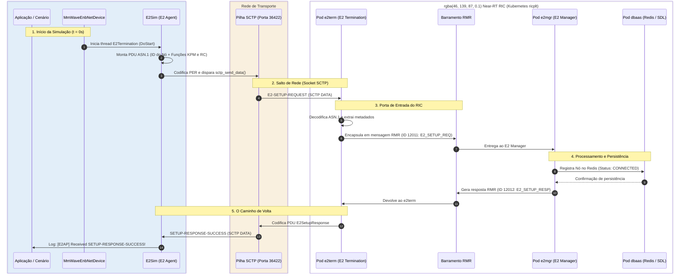

# Laboratório 3: Validação da Integração ns-3 e Near-RT RIC (O Caminho do E2 Setup)

No [Laboratório 1](./lab01-setup-RIC.md), realizamos o deploy do Near-RT RIC no cluster Kubernetes. No [Laboratório 2](./lab02-setup-ns3.md), construímos o simulador ns-3 com suporte à biblioteca E2Sim e ao módulo `oran-interface`.

Agora, surge a pergunta fundamental: **como temos certeza de que essas duas pontas realmente conversam entre si?**

Em vez de apenas rodar um comando mecânico, este laboratório foi desenhado para você compreender **o caminho exato que uma mensagem percorre desde o código C++ do simulador até os bancos de dados do RIC e o caminho de volta**. A prova material de que essa integração funciona é o procedimento de **E2 Setup**.

---

## 1. A Jornada da Mensagem: Anatomia do Handshake E2 Setup

No padrão O-RAN (especificação O-RAN WG3 E2AP - *E2 Application Protocol*), antes de qualquer métrica (KPM) ser coletada ou qualquer comando de controle (RC) ser executado por um xApp, a estação rádio (E2 Node) precisa se apresentar oficialmente ao Near-RT RIC.

Veja abaixo o caminho percorrido pela mensagem entre os componentes:



---

### O Que Acontece em Cada Estágio?

#### Estágio 1: No interior do ns-3 (Criação da Mensagem)
1. No início da simulação, o dispositivo de rede da estação base (`MmWaveEnbNetDevice` ou `LteEnbNetDevice`) dispara o método `E2Termination::Start()`.
2. Uma *thread* dedicada de segundo plano executa a rotina `E2Sim::run_loop()`.
3. A biblioteca `E2Sim` monta uma mensagem ASN.1 de **`E2SetupRequest`**:
   * **Identidade Global do Nó (*Global E2 Node ID*):** Combinação de PLMN ID (`001-01` ou similar) com o ID da célula (`gnbId` ou `enbId`).
   * **Lista de Funções Suportadas (*RAN Functions*):** Anuncia quais modelos de serviço a estação base suporta.
     * Função `200` (E2SM-KPM) para telemetria de métricas;
     * Função `300` (E2SM-RC) para controle de RAN.
4. A mensagem ASN.1 é serializada em binário usando regras de codificação alinhada **PER** (*Packed Encoding Rules*).
5. O E2Sim abre um socket cliente SCTP e faz a transmissão com `sctp_send_data()`.

#### Estágio 2: Na Rede do Sistema Operacional (A Ponte SCTP)
* **Por que SCTP e não TCP ou UDP?** A O-RAN Alliance adotou o **SCTP** (*Stream Control Transmission Protocol*) porque ele combina a confiabilidade do TCP (garantia de entrega e controle de congestionamento) com a orientação a mensagens do UDP (evitando problemas de fragmentação de stream) e adiciona *multi-streaming* independente para evitar bloqueios de cabeça de fila (*head-of-line blocking*).
* O pacote sai pela porta local efêmera do host (ex: `38470`) com destino à porta **36422** do componente `e2term`.

#### Estágio 3: Na Porta de Entrada do RIC (Pod `e2term`)
* O componente **E2 Termination (`e2term`)** atua como um "porteiro" da plataforma. Ele mantém o servidor SCTP escutando conexões externas.
* Ao receber o pacote do ns-3, o `e2term` valida a sintaxe ASN.1.
* Como o `e2term` cuida apenas da terminação da conexão e não toma decisões de negócio, ele empacota a requisição em um envelope **RMR** (*RIC Message Router*, o barramento interno de mensageria de alto desempenho do RIC) sob o código `12011 (E2_SETUP_REQ)` e a despacha internamente no cluster.

#### Estágio 4: No "Cérebro" do RIC (Pod `e2mgr` e `dbaas`)
* O **E2 Manager (`e2mgr`)** recebe a mensagem `E2_SETUP_REQ`.
* Ele processa as informações da estação rádio e acessa o banco de dados da plataforma (**DBAAS / Redis / SDL - *Shared Data Layer***).
* O nó é salvo no banco com o status **`CONNECTED`**, acompanhado de todas as funções RAN que ele declarou suportar.
* O `e2mgr` gera a resposta de aceite `E2_SETUP_RESP (ID 12012)` e a envia de volta ao `e2term` via RMR.

#### Estágio 5: O Caminho de Volta e o Fechamento no ns-3
* O `e2term` codifica a PDU de resposta ASN.1 `E2SetupResponse` com o resultado `successfulOutcome`.
* A resposta viaja pelo socket SCTP de volta para o ns-3.
* A thread do `E2Sim` no simulador recebe os bytes no método `sctp_receive_data()`, decodifica a resposta e imprime:
  ```text
  [E2AP] Received SETUP-RESPONSE-SUCCESS
  ```
* **A partir deste momento, a estação rádio do ns-3 está oficialmente registrada no Near-RT RIC.**

---

## 2. Decodificando os Parâmetros do ns-3: O que Cada Linha Faz?

Para que toda a jornada descrita acima aconteça, o ns-3 precisa ser informado sobre onde o RIC está e como a interface deve se comportar.

Observe a tabela abaixo com o significado prático de cada configuração:

| Parâmetro no ns-3 | Tipo | Papel na Jornada da Mensagem |
| :--- | :--- | :--- |
| `ns3::MmWaveHelper::E2TermIp` | `String` | **O Endereço de Destino:** Informa ao cliente SCTP do simulador para qual endereço IP o pacote `E2SetupRequest` deve ser enviado. |
| `ns3::MmWaveHelper::E2Port` | `Uinteger` | **A Porta de Destino:** Porta padrão do protocolo E2AP no Near-RT RIC (`36422`). |
| `ns3::MmWaveHelper::E2LocalPort` | `Uinteger` | **A Porta de Origem:** Primeira porta local usada pelo host para fazer o `bind` do socket SCTP (padrão: `38470`). |
| `ns3::MmWaveHelper::E2ModeLte`<br>`ns3::MmWaveHelper::E2ModeNr` | `Boolean` | **Ativação da Interface:** Instrui o helper a criar instâncias da classe `E2Termination` nas estações base LTE (macro) e NR (mmWave). |
| `ns3::LteEnbNetDevice::EnableE2FileLogging`<br>`ns3::MmWaveEnbNetDevice::EnableE2FileLogging` | `Boolean` | **Chave Liga/Desliga da Rede (CRÍTICO):**<br>• Se `true` (modo offline): O simulador gera métricas apenas em arquivos `.txt`/`.csv` locais e **NUNCA abre o socket de rede**.<br>• Se `false` (modo online): Ativa o cliente SCTP real que dispara a mensagem para o RIC. |
| `ns3::MmWaveEnbNetDevice::EnableDuReport`<br>`ns3::MmWaveEnbNetDevice::EnableCuUpReport`<br>`ns3::MmWaveEnbNetDevice::EnableCuCpReport` | `Boolean` | **Habilitação das Entidades Desagregadas:** Especifica quais contêineres de métricas da arquitetura desagregada O-RAN (O-DU, O-CU-UP e O-CU-CP) farão parte dos reportes periódicos. |
| `ns3::LteEnbNetDevice::E2Periodicity`<br>`ns3::MmWaveEnbNetDevice::E2Periodicity` | `Double` | **Frequência de Envio:** Intervalo em segundos com que as métricas de rádio (E2 Indication) serão transmitidas após o setup (ex: `0.1` = 100 ms). |
| `ns3::MmWaveEnbNetDevice::ReducedPmValues` | `Boolean` | **Otimização de Pacote:** Quando ativado (`true`), filtra as métricas para um subconjunto enxuto, reduzindo a fragmentação no SCTP. |

---

## 3. Estrutura do Cenário de Simulação

Para realizarmos este teste, utilizamos o script [`scenario-trainning.cc`](../scenarios/scenario-trainning.cc). 

A simulação está estruturada em uma topologia de **Dupla Conectividade (DC - *Dual Connectivity*)**, composta por:
* **1 Macro-célula LTE (`eNB`)**
* **1 Célula mmWave NR (`gNB`)**
* Nós de usuário (UEs) com pilha dupla associados à rede.

> [!IMPORTANT]
> **O Ponto-Chave da Integração:** Tanto a eNB (LTE) quanto a gNB (NR) estão configuradas para ativar a terminação E2. Isso significa que **ambas as tecnologias de acesso de rádio iniciarão conexões independentes e se registrarão junto ao Near-RT RIC**, permitindo validar o processo de E2 Setup em múltiplos nós simultaneamente (o que observaremos em tempo real nos logs a seguir).

Para trazer praticidade e simplicidade ao bootcamp, o script foi preparado com **flexibilidade de linha de comando** (`CommandLine`). Dessa forma, parâmetros como o endereço IP da terminação E2 (`--e2TermIp`) e o modo de operação online/offline (`--enableE2FileLogging`) podem ser informados diretamente na execução da simulação, sem a necessidade de editar o código-fonte ou recompilar o simulador a cada novo teste.

### Aplicação dos Parâmetros no Código C++

Observe no trecho abaixo como os parâmetros apresentados na seção anterior são aplicados no script:

```cpp
// 1. Definições com valores padrão e captura via linha de comando (CLI)
std::string e2TermIp = "10.244.0.50";
bool enableE2FileLogging = false;

CommandLine cmd;
cmd.AddValue ("simTime", "Tempo de simulação em segundos", simTime);
cmd.AddValue ("e2TermIp", "IP do componente E2 Termination do RIC", e2TermIp);
cmd.AddValue ("enableE2FileLogging", "false para conectar ao RIC via SCTP (online)", enableE2FileLogging);
cmd.Parse (argc, argv);

// 2. Apontamento do endereço IP de destino da terminação E2
Config::SetDefault ("ns3::MmWaveHelper::E2TermIp", StringValue (e2TermIp));

// 3. Ativação da interface E2 para AMBAS as tecnologias (LTE e NR)
Config::SetDefault ("ns3::MmWaveHelper::E2ModeLte", BooleanValue (true));
Config::SetDefault ("ns3::MmWaveHelper::E2ModeNr", BooleanValue (true));

// 4. Habilitação dos relatórios das entidades desagregadas (DU, CU-UP e CU-CP)
Config::SetDefault ("ns3::MmWaveEnbNetDevice::EnableDuReport", BooleanValue (true));
Config::SetDefault ("ns3::MmWaveEnbNetDevice::EnableCuUpReport", BooleanValue (true));
Config::SetDefault ("ns3::LteEnbNetDevice::EnableCuUpReport", BooleanValue (true));
Config::SetDefault ("ns3::MmWaveEnbNetDevice::EnableCuCpReport", BooleanValue (true));
Config::SetDefault ("ns3::LteEnbNetDevice::EnableCuCpReport", BooleanValue (true));

// 5. Periodicidade das métricas e contêineres reduzidos
Config::SetDefault ("ns3::LteEnbNetDevice::E2Periodicity", DoubleValue (0.1));
Config::SetDefault ("ns3::MmWaveEnbNetDevice::E2Periodicity", DoubleValue (0.1));
Config::SetDefault ("ns3::MmWaveEnbNetDevice::ReducedPmValues", BooleanValue (true));
Config::SetDefault ("ns3::LteEnbNetDevice::ReducedPmValues", BooleanValue (true));

// 6. Desativação do modo offline para abertura real do socket SCTP
Config::SetDefault ("ns3::LteEnbNetDevice::EnableE2FileLogging", BooleanValue (enableE2FileLogging));
Config::SetDefault ("ns3::MmWaveEnbNetDevice::EnableE2FileLogging", BooleanValue (enableE2FileLogging));
```

---

## 4. Passo a Passo Prático: Acompanhando a Mensagem em Tempo Real

Em vez de apenas rodar a simulação e esperar que ela termine, vamos preparar o ambiente para **ver a mensagem atravessando cada etapa descrita no diagrama**.

### Passo 4.1: Descobrir o IP de Destino do E2 Termination (`e2term`)

No cluster Kubernetes do Near-RT RIC, precisamos descobrir em qual IP o serviço de terminação E2 está escutando conexões SCTP:

```bash
kubectl get pods -n ricplt -o wide | grep e2term
```

Exemplo de saída:
```text
deployment-ricplt-e2term-alpha-fc6459948-242sb   1/1   Running   0   14d   10.244.0.50   node1   <none>   <none>
```

Anote o IP listado na coluna `IP` (no exemplo acima: `10.244.0.50`).

> [!TIP]
> * **Se o ns-3 roda no mesmo host do Kubernetes:** O IP interno do pod (`10.244.x.x`) é diretamente acessível pela pilha de rede local.
> * **Se o ns-3 roda em outra máquina ou VM separada:** Consulte o serviço NodePort com `kubectl get svc -n ricplt | grep e2term` e utilize o IP da máquina física (`ricip` configurado na sua RECIPE) apontando para a porta NodePort mapeada.

---

### Passo 4.2: Preparar a Janela de Observação do E2Term

Abra um **segundo terminal** na sua máquina para monitorar os logs do componente `e2term` do RIC antes de disparar o ns-3. Assim, você verá as conexões SCTP chegando no exato momento da transmissão:

* **Terminal 2 (Sentinela E2Term):**
  ```bash
  kubectl logs -f -n ricplt -l app=ricplt-e2term-alpha
  ```

> [!NOTE]
> Os logs contínuos do pod `e2mgr` são excessivamente volumosos e poluídos com traces internos. Por isso, em vez de acompanhar os logs brutos do E2 Manager, validaremos o processamento e a persistência dos nós de forma muito mais direta e limpa através de uma consulta à sua API REST no terminal após a simulação.

*(Opcional para curiosos de redes)*: Se você quiser ver os pacotes brutos do SCTP trafegando na interface de rede, em um terceiro terminal com permissão `sudo`:
```bash
sudo tcpdump -i any sctp -nn
```

---

### Passo 4.3: Compilar o Cenário no ns-3

De volta ao **Terminal 1**, copie o cenário para o diretório `scratch/` do simulador e execute a compilação:

```bash
# Copia o cenário do repositório do bootcamp para o ns-3
cp ~/ns3-oran-bootcamp/scenarios/scenario-trainning.cc ~/ns3-mmwave-oran/scratch/

# Navega até o diretório do simulador e compila
cd ~/ns3-mmwave-oran
./waf build
```

---

### Passo 4.4: Disparar a Simulação e Assistir ao Handshake

Antes de iniciar a simulação, crie um diretório de saída para armazenar os arquivos de log e traces gerados pelo ns-3, evitando poluir o diretório raiz do simulador.

Utilizamos a flag `--cwd` para direcionar a execução para essa pasta de saída. **Atenção:** é essencial criar a pasta com antecedência, caso contrário o comando falhará com erro de diretório inexistente.

```bash
# Cria o diretório de destino dos logs/traces
mkdir -p ./outputs/teste

# Executa a simulação apontando para o IP da terminação E2
./waf --run "scratch/scenario-trainning --e2TermIp=<E2_Term_IP> --simTime=30" --cwd=./outputs/teste
```
*(Substitua `<E2_Term_IP>` pelo IP real do seu pod `e2term` obtido no Passo 4.1, por exemplo: `10.244.0.50`).*

---

## 5. Correlacionando os Logs com a Jornada da Mensagem

Agora, observe como os registros nos terminais confirmam precisamente cada etapa do handshake:

### 1. No Terminal 1 (ns-3 - Saída do E2 Agent):
Durante a inicialização da simulação, o simulador registra as funções RAN, inicia o cliente SCTP e recebe a confirmação de sucesso:

```text
[INFO ] %%about to register e2sm func desc for 200
[INFO ] %%about to register callback for subscription for func_id 200
[INFO ] %%about to register e2sm func desc for 300
[INFO ] %%about to register callback for e2sm for func_id 300
Simulation start time: ...

[UNCON] Start E2 Agent (E2 Simulator)
[INFO ] [SCTP] Binding client socket with source port 38470
[INFO ] [SCTP] Connecting to server at <E2_Term_IP>:36422 ...
[SCTP] Sent E2-SETUP-REQUEST
[E2AP] Received SETUP-RESPONSE-SUCCESS
```
> [!IMPORTANT]
> A linha **`[SCTP] Sent E2-SETUP-REQUEST`** marca a partida da mensagem da estação rádio (Estágio 1).  
> A linha **`[E2AP] Received SETUP-RESPONSE-SUCCESS`** marca a conclusão da jornada de retorno (Estágio 5).

---

### 2. No Terminal 2 (Pod `e2term` - Porta de Entrada do RIC):
No exato segundo do início da simulação, o pod `e2term` registrará as novas conexões e o envio das respostas:

```json
{"ts":1791489942055,"crit":"INFO","id":"E2Terminator","mdc":{"PID":"139818063345408","POD_NAME":"deployment-ricplt-e2term-alpha-fc6459948-bs4mk","CONTAINER_NAME":"container-ricplt-e2term","SERVICE_NAME":"RIC_E2_TERM","HOST_NAME":"mastervm","SYSTEM_NAME":"SEP"},"msg":"New connection request from sctp network "}
{"ts":1791489942055,"crit":"INFO","id":"E2Terminator","mdc":{"PID":"139818063345408","POD_NAME":"deployment-ricplt-e2term-alpha-fc6459948-bs4mk","CONTAINER_NAME":"container-ricplt-e2term","SERVICE_NAME":"RIC_E2_TERM","HOST_NAME":"mastervm","SYSTEM_NAME":"SEP"},"msg":"New connection request from sctp network "}
{"ts":1791489942068,"crit":"INFO","id":"E2Terminator","mdc":{"PID":"139818063345408","POD_NAME":"deployment-ricplt-e2term-alpha-fc6459948-bs4mk","CONTAINER_NAME":"container-ricplt-e2term","SERVICE_NAME":"RIC_E2_TERM","HOST_NAME":"mastervm","SYSTEM_NAME":"SEP"},"msg":"send message to gnb_131_133_32000000 address"}
{"ts":1791489942085,"crit":"INFO","id":"E2Terminator","mdc":{"PID":"139818054952704","POD_NAME":"deployment-ricplt-e2term-alpha-fc6459948-bs4mk","CONTAINER_NAME":"container-ricplt-e2term","SERVICE_NAME":"RIC_E2_TERM","HOST_NAME":"mastervm","SYSTEM_NAME":"SEP"},"msg":"send message to gnb_131_133_31000000 address"}
```

Note a correlação direta com a topologia do nosso cenário:
* **Duas novas conexões detectadas:** As duas entradas `"New connection request from sctp network"` comprovam a chegada das duas associações SCTP independentes vindas do ns-3: uma originada pela estação LTE (`eNB`) e a outra pela estação mmWave NR (`gNB`).
* **Respostas encaminhadas:** As mensagens `"send message to gnb_... address"` confirmam que o `e2term` recebeu a resposta do `e2mgr` e transmitiu o `E2SetupResponse` de volta a cada uma das estações.

---

### 3. A Prova Conclusiva: Consulta de Estado via REST API do E2 Manager

Como as saídas de log do pod `e2mgr` são extremamente extensas e repletas de traces de depuração interna, a validação mais limpa, elegante e conclusiva é verificar a persistência dos nós diretamente na **API REST** do E2 Manager (porta 3800).

Para que a saída JSON seja exibida formatada, colorida e indentada no terminal, canalizamos o resultado com o utilitário `jq`:

```bash
E2MGR_POD=$(kubectl get pods -n ricplt -l app=ricplt-e2mgr -o jsonpath='{.items[0].metadata.name}') #Esse comando coleta e salva o Ip do pod em uma variável do sistema.
kubectl exec -it -n ricplt $E2MGR_POD -- curl -s http://localhost:3800/v1/nodeb/states | jq .
```

A saída retornará a lista completa e estruturada das estações base registradas com seus respectivos identificadores globais (`globalNbId`) e status de conexão:

```json
[
  {
    "inventoryName": "gnb_131_133_31000000",
    "globalNbId": {
      "plmnId": "313131",
      "nbId": "0011000100000000000000000000"
    },
    "connectionStatus": "CONNECTED"
  },
  {
    "inventoryName": "gnb_131_133_32000000",
    "globalNbId": {
      "plmnId": "313131",
      "nbId": "0011001000000000000000000000"
    },
    "connectionStatus": "CONNECTED"
  }
]
```

O status **`CONNECTED`** para ambos os nós confirma em definitivo que o Near-RT RIC aceitou, validou e integrou com sucesso as estações simuladas no ns-3!

---

## 7. Conclusão

Ao concluir este laboratório, você não apenas executou um script com parâmetros de IP, mas **rastreou o ciclo de vida completo de uma mensagem da interface E2 da O-RAN**:
1. Gerada em C++ pelo ns-3;
2. Codificada em ASN.1 PER;
3. Transportada via socket SCTP confiável;
4. Despachada pelo barramento RMR do Near-RT RIC;
5. Processada e persistida no banco Redis do E2 Manager;
6. E confirmada com sucesso de volta ao simulador.

Com a interface de comunicação E2 plenamente operacional e homologado!
