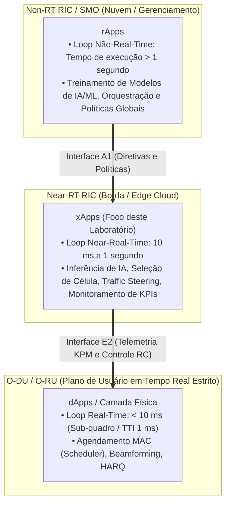
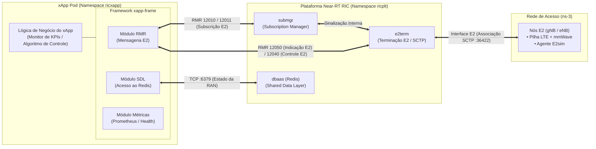
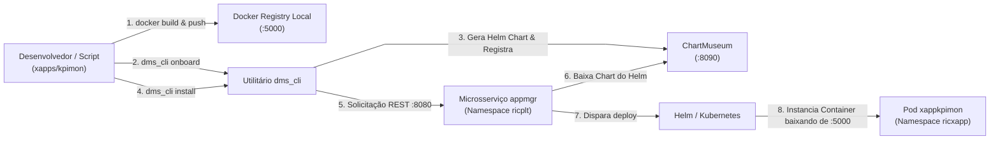

# Laboratório 4: Fundamentos de xApps, Arquitetura Cloud-Native e Onboarding no Near-RT RIC

No [Laboratório 1](./lab01-setup-RIC.md), provisionamos o Near-RT RIC no cluster Kubernetes. No [Laboratório 2](./lab02-setup-ns3.md), preparamos o simulador de rede ns-3 com a biblioteca `E2sim`. No [Laboratório 3](./lab03-validacao-e2setup.md), validamos o handshake de **E2 Setup**, assegurando que os nós de rádio LTE e mmWave se registram com sucesso perante o controlador O-RAN.

Até este momento, construímos e validamos toda a infraestrutura de comunicação da rede. Porém, surge a questão central: **quem efetivamente toma as decisões inteligentes de controle, mobilidade e otimização na O-RAN?**

Na arquitetura aberta da O-RAN Alliance, a inteligência da rede de acesso não reside em códigos proprietários estáticos embutidos nas estações rádio, mas sim em aplicações modulares, interoperáveis e orientadas a microsserviços chamadas **xApps**.

Neste laboratório, exploramos os fundamentos teóricos e práticos dos **xApps**: seus loops temporais de controle, sua arquitetura interna de microsserviço baseada no framework `xapp-frame`, a interação direta com a **Interface E2** via mensageria de alta performance (**RMR** conectando com `submgr` e `e2term`), a camada de persistência (**SDL/Redis**), bem como o processo formal de empacotamento, descritores (`config.json`/`schema.json`) e *onboarding* via ferramenta `dms_cli` no Near-RT RIC.

---

## 🎯 Objetivos de Aprendizagem

Ao final deste laboratório, você será capaz de:

1. Compreender o que é um **xApp** na arquitetura O-RAN e diferenciá-lo funcionalmente dos **rApps** (Non-RT RIC) e **dApps** (O-DU).
2. Explicar o conceito de **Loops de Controle Temporal** (*Control Loops*), posicionando o xApp no loop de tempo quase-real (**Near-Real-Time: $10\text{ ms}$ a $1\text{ s}$**).
3. Identificar os principais casos de uso de xApps na indústria orientados à **Interface E2** (Monitoramento de KPIs via E2SM-KPM, *Traffic Steering* via E2SM-RC, Otimização de Handover e Balanceamento de Carga).
4. Analisar os blocos arquiteturais de um xApp na O-RAN Software Community (OSC): o framework **`xapp-frame`** e seu papel de orquestrador da comunicação com a **Interface E2** através do barramento **RMR** (despachando subscrições para o `submgr` e recebendo telemetria do `e2term`).
5. Explicar por que os xApps são projetados como microsserviços **stateless** (sem estado local persistente) e qual o papel do **DBAAS** (Shared Data Layer / Redis) no armazenamento do inventário e estado da RAN.
6. Dissecagem dos descritores de um xApp: compreender os papéis dos arquivos **`config.json`** (metadados, portas RMR e mensagens E2 aceitas/emitidas) e **`schema.json`** (validação formal).
7. Compreender a cadeia de ferramentas de orquestração local: instalar e configurar a ferramenta **`dms_cli`** (*Deployment Management Service CLI*) a partir do componente `xapp_onboarder` do `appmgr`, ajustando a política de imagem (`image_pull_policy: Always`) para desenvolvimento ágil.
8. Configurar a infraestrutura de apoio: o registro Docker local (`:5000`) e o repositório de pacotes Helm **ChartMuseum** (`:8090`).
9. Executar na prática o ciclo de vida completo de um xApp: compilação de imagem Docker, publicação local, *onboarding*, deploy no namespace `ricxapp` do Kubernetes e auditoria de logs de inicialização via `kubectl`.

---

## 📚 1. Fundamentos Teóricos: O que é um xApp?

### 1.1 A Inteligência Desacoplada: Loops de Controle na O-RAN

Nas redes celulares tradicionais legadas (2G, 3G e a maioria das implementações 4G/5G clássicas), a lógica de controle da rede de rádio — como algoritmos de *handover*, balanceamento de carga e alocação de recursos — vem gravada de fábrica no software fechado de um único fabricante (como Ericsson, Huawei ou Nokia). Atualizar ou modificar um algoritmo exigia aguardar anos por novos lançamentos de firmware do fornecedor.

A **O-RAN Alliance** rompeu esse modelo ao introduzir a **Controlabilidade Aberta por Software** dividida em **três loops de controle temporal**:



| Categoria | Entidade O-RAN | Escala Temporal | Finalidade Típica | Exemplo Prático |
| :--- | :--- | :--- | :--- | :--- |
| **rApp** | Non-RT RIC (no SMO) | $> 1\text{ s}$ (minutos a horas) | Análise de longo prazo, treinamento de IA/ML, orquestração e definição de políticas de rede (*Intents*). | Treinar um modelo de rede neural para prever padrões de mobilidade com base no tráfego da cidade. |
| **xApp** | **Near-RT RIC** | **$10\text{ ms}$ a $1\text{ s}$** | **Controle quase-real da RAN, inferência de modelos treinados, detecção de anomalias e condução de tráfego.** | **KPIMON (coleta métricas a cada segundo); Traffic Steering (transfere usuários congestionados do LTE para o mmWave).** |
| **dApp** | O-DU (Distributed Unit) | $< 10\text{ ms}$ | Decisões ultra-rápidas ao nível de símbolo e sub-quadro de rádio. | Agendamento de blocos de recursos (MAC Scheduler), adaptação de modulação rápida (MCS) e retransmissões HARQ. |

---

### 1.2 Anatomia Interna de um xApp e a Centralidade da Interface E2

Um **xApp** nada mais é do que um **microsserviço Cloud-Native** empacotado como um container Docker e gerenciado pelo Kubernetes no namespace `ricxapp`.

A razão de existir de um xApp no Near-RT RIC é **interagir diretamente com as estações rádio da rede de acesso através da Interface E2**: coletando métricas contínuas de desempenho ou emitindo comandos de controle em tempo quase-real.

Para padronizar o desenvolvimento e evitar que cada desenvolvedor reinvente a comunicação com o controlador, a O-RAN Software Community disponibiliza a biblioteca **`xapp-frame`** (disponível para linguagens como Go, C++ e Python). 

O diagrama abaixo ilustra como o xApp se comunica com os nós da RAN através dos microsserviços da plataforma Near-RT RIC:



#### Os Pilares Funcionais de um xApp:

1. **A Conexão com a Interface E2 via RMR (A Razão de Ser do xApp):**
   * O **RMR (*RIC Message Router*)** é o barramento de mensageria de ultra-baixa latência do RIC. É através do RMR que o xApp opera a interface E2 por meio de três fluxos fundamentais:
     * **Fluxo de Subscrição E2 (com o `submgr`):** Para receber dados de uma antena, o xApp despacha uma mensagem `RIC_SUB_REQ` (Mtype 12010). O Subscription Manager valida a requisição, envia para a antena via `e2term` e retorna a confirmação `RIC_SUB_RESP` (Mtype 12011) para o xApp.
     * **Fluxo de Telemetria e Monitoramento E2 (com o `e2term`):** Uma vez subscrito, o nó de rádio envia periodicamente relatórios de medição. O `e2term` recebe os pacotes SCTP e os entrega ao xApp como mensagens `RIC_INDICATION` (Mtype 12050), transportando os KPIs de rádio (modelo **E2SM-KPM**).
     * **Fluxo de Atuação e Controle E2 (com o `e2term`):** Caso o xApp seja de controle (como o *Traffic Steering*), ele toma decisões e despacha mensagens `RIC_CONTROL_REQ` (Mtype 12040). O `e2term` converte a mensagem e a transmite para o nó E2 executar o *handover* do usuário (modelo **E2SM-RC**).

2. **SDL (*Shared Data Layer* / Redis) — A Memória da RAN:**
   * Uma regra de ouro da arquitetura Cloud-Native da O-RAN é que **os xApps devem ser o mais *stateless* (sem estado volátil) possível**.
   * Se um pod de xApp travar ou for reiniciado pelo Kubernetes para balanceamento de carga, ele não deve perder o histórico da rede. O estado global (como a lista de estações base conectadas, inventário de células e identificadores de UEs) é mantido centralizado no pod `dbaas` (Redis). A biblioteca SDL fornece métodos simples de chave-valor (`Set`, `Get`, `FindKeys`) para que o xApp acesse essa base distribuída sem complexidade.

3. **Métricas e Diagnóstico do Microsserviço (HTTP / Prometheus):**
   * O `xapp-frame` expõe automaticamente rotas HTTP padrão na porta 8080:
     * `/ric/v1/health/alive` e `/ric/v1/health/ready`: *Endpoints* consultados continuamente pelo Kubernetes (*Liveness* e *Readiness probes*) para assegurar que o processo do xApp está vivo e apto a receber tráfego.
     * `/metrics`: Exportador nativo de telemetria no formato Prometheus para visualização de desempenho do xApp em painéis do Grafana.

> [!NOTE]
> **E a Interface A1?**
> Em arquiteturas completas com gerenciamento centralizado (SMO / Non-RT RIC), um xApp também pode, opcionalmente, receber diretrizes de alto nível baseadas em intenção (*intent-based policies*) através da interface A1 (gerenciada pelo pod `a1mediator`). No entanto, **todo o escopo operacional em tempo quase-real do Near-RT RIC se dá sobre as estações rádio conectadas à Interface E2**. Por isso, o foco deste bootcamp é dominar o ciclo de subscrição, telemetria e controle na interface E2.

---

### 1.3 Principais Casos de Uso de xApps na Indústria

| Caso de Uso | Modelo de Serviço (E2SM) | Ação Executada pelo xApp |
| :--- | :--- | :--- |
| **KPIMON (*KPI Monitor*)** | **E2SM-KPM** | Subscreve telemetria periódica dos nós E2 (ns-3) para monitorar vazão (Throughput), atraso (Latency), SINR e ocupação de PRBs por usuário e por célula em tempo real. |
| **Traffic Steering (TS)** | **E2SM-KPM + E2SM-RC** | Monitora a qualidade de enlace dos usuários. Quando detecta que uma conexão mmWave sofreu atenuação severa (*beam failure* por bloqueio de obstáculo), comanda o *handover* imediato do usuário para a camada LTE de cobertura ampla. |
| **Anomaly Detection (AD)** | **E2SM-KPM** | Utiliza técnicas de aprendizado de máquina não-supervisionado para detectar comportamentos anômalos de tráfego, como tempestades de sinalização ou ataques de negação de serviço (DoS) direcionados à estação base. |
| **QoE Prediction** | **E2SM-KPM** | Prevê a degradação da Qualidade de Experiência (QoE) em transmissões de vídeo ao vivo (ex: YouTube/Netflix) antes que ocorra congelamento de tela (*buffering*), acionando o nó de rádio para elevar a prioridade do agendador. |

---

## 📦 2. O Processo de Empacotamento: Descritores `config.json` e `schema.json`

Para que a plataforma Near-RT RIC possa admitir, instalar e rotear tráfego para um xApp, ele não pode ser apenas uma imagem Docker comum. Ele deve ser acompanhado de **arquivos descritores padronizados**.

No diretório do xApp KPIMON no repositório do bootcamp ([`xapps/kpimon/xapp-descriptor/`](../xapps/kpimon/xapp-descriptor/)), encontramos dois arquivos fundamentais:

### 2.1 O Arquivo `config.json` (A Carteira de Identidade do xApp)

O arquivo [`config.json`](../xapps/kpimon/xapp-descriptor/config.json) informa ao Near-RT RIC quais são os recursos, portas e mensagens que o xApp necessita:

```json
{
  "xapp_name": "xappkpimon",
  "version": "1.0.0",
  "containers": [
    {
      "name": "xappkpimon",
      "image": {
        "registry": "127.0.0.1:5000",
        "name": "kpimon_dev",
        "tag": "1.0.0"
      }
    }
  ],
  "messaging": {
    "ports": [
      {
        "name": "rmr-data",
        "container": "xappkpimon",
        "port": 4560,
        "rxMessages": ["RIC_SUB_RESP", "RIC_INDICATION"],
        "txMessages": ["RIC_SUB_REQ"],
        "description": "rmr receive data port for xappkpimon"
      },
      {
        "name": "rmr-route",
        "container": "xappkpimon",
        "port": 4561,
        "description": "rmr route port for xappkpimon"
      }
    ]
  },
  "rmr": {
    "protPort": "tcp:4560",
    "maxSize": 2072,
    "numWorkers": 1,
    "rxMessages": ["RIC_SUB_RESP", "RIC_INDICATION"],
    "txMessages": ["RIC_SUB_REQ"]
  }
}
```

> [!IMPORTANT]
> **Campos Críticos do `config.json`:**
> * **`image`:** Aponta para o registro local do Docker (`127.0.0.1:5000`), indicando o repositório (`kpimon_dev`) e a tag da versão (`1.0.0`).
> * **`rxMessages` (Mensagens que o xApp escuta):** Informa ao gerenciador de rotas (`rtmgr`) que as mensagens do tipo `RIC_SUB_RESP` (tipo 12011) e `RIC_INDICATION` (tipo 12050) devem ser encaminhadas para a porta RMR `4560` deste xApp.
> * **`txMessages` (Mensagens que o xApp emite):** Informa que o xApp está autorizado a emitir mensagens de subscrição `RIC_SUB_REQ` (tipo 12010).

---

### 2.2 O Arquivo `schema.json` (A Validação de Conformidade)

O arquivo [`schema.json`](../xapps/kpimon/xapp-descriptor/schema.json) é um validador estrutural baseado no padrão internacional **JSON Schema**. 

Ele assegura que os parâmetros de configuração personalizados fornecidos ao xApp (como parâmetros de frequência de amostragem, IDs de células padrão e chaves de controle) estejam em estrita conformidade com os tipos exigidos antes que o Kubernetes tente criar o Pod. Se um parâmetro obrigatório estiver ausente ou tiver um tipo inválido, o processo de *onboarding* é abortado imediatamente com uma mensagem de erro clara.

---

## 🛠️ 3. A Cadeia de Onboarding no Near-RT RIC

Para implantar um xApp no cluster, o Near-RT RIC utiliza uma cadeia automatizada de orquestração:



1. **Docker Registry Local (`127.0.0.1:5000`):** Armazena as imagens de containers compiladas localmente, permitindo que os nós do Kubernetes baixem as imagens sem necessidade de acesso à Internet externa.
2. **ChartMuseum (`http://0.0.0.0:8090`):** É um repositório HTTP de pacotes **Helm Charts**. Quando executamos o *onboard*, os descritores do xApp são transformados em um pacote Helm (`.tgz`) armazenado no ChartMuseum.
3. **App Manager (`appmgr`):** É o microsserviço do Near-RT RIC responsável por gerenciar o ciclo de vida dos xApps (admissão, implantação, atualização e remoção).
4. **`dms_cli` (*Deployment Management Service CLI*):** É a ferramenta de linha de comando oficial da O-RAN Software Community utilizada pelos operadores para automatizar os comandos de `onboard`, `install` e `uninstall`.

---

## 💻 4. Prática Guiada: Onboarding e Deploy do xApp KPIMON Passo a Passo

Agora realizaremos o ciclo prático de implantação do xApp no ambiente.

### Pré-requisitos
Certifique-se de que o cluster Kubernetes do Near-RT RIC está ativo (concluído no [Lab 1](./lab01-setup-RIC.md)).

---

### Passo 1: Verificar os Microsserviços de Gerenciamento do RIC

Abra o terminal e verifique se o **App Manager (`appmgr`)** e os componentes de roteamento do RIC estão em execução no namespace `ricplt`:

```bash
kubectl get pods -n ricplt | grep -E "appmgr|submgr|rtmgr|dbaas"
```

*Saída esperada (todos com status `Running`):*
```text
deployment-ricplt-appmgr-xxxxxxxxxx-xxxxx   1/1     Running   0          1d
deployment-ricplt-submgr-xxxxxxxxxx-xxxxx   1/1     Running   0          1d
deployment-ricplt-rtmgr-xxxxxxxxxx-xxxxx    1/1     Running   0          1d
statefulset-ricplt-dbaas-server-0           1/1     Running   0          1d
```

---

### Passo 2: Instalação e Configuração da Ferramenta `dms_cli` (`xapp_onboarder`)

A ferramenta de linha de comando **`dms_cli`** (*Deployment Management Service CLI*) faz parte do projeto **`appmgr`** da O-RAN Software Community. Ela automatiza a validação dos descritores (`config.json` e `schema.json`), empacota os arquivos como um Helm Chart e comunica-se com o repositório **ChartMuseum** e com a API REST do App Manager.

> [!IMPORTANT]
> O processo de instalação da ferramenta deve ser realizado com privilégios de superusuário no diretório **`/root`** (`sudo -i`).

Siga o procedimento abaixo para a instalação:

#### 1. Acessar o shell de superusuário (root)
Abra uma sessão interativa como root:
```bash
sudo -i
```
*(Você estará logado no diretório `/root`)*.

#### 2. Clonar o repositório do App Manager
No diretório `/root`, faça o clone do repositório oficial do `appmgr`:
```bash
git clone "https://gerrit.o-ran-sc.org/r/ric-plt/appmgr"
cd appmgr/xapp_orchestrater/dev/xapp_onboarder
```

#### 3. Configurar a política de atualização de imagem para desenvolvimento
Por padrão, o gerador de charts do `xapp_onboarder` define a política de download de imagens (`image_pull_policy`) do Kubernetes como `IfNotPresent`. Em um ambiente de desenvolvimento e testes, isso é problemático, pois o Kubernetes não baixará a nova imagem se você recompilar o código do xApp mantendo a mesma tag (`1.0.0`).

Para facilitar o ciclo de desenvolvimento e assegurar que o Kubernetes sempre baixe a imagem mais recente compilada localmente, alteramos essa política para **`Always`**:

```bash
sed -i 's/image_pull_policy: IfNotPresent/image_pull_policy: Always/g' xapp_onboarder/resources/xapp-std/values.yaml
```

*(Ou edite manualmente o arquivo `xapp_onboarder/resources/xapp-std/values.yaml` alterando o campo `image_pull_policy` de `IfNotPresent` para `Always`).*

#### 4. Instalar o pacote Python do `dms_cli`
Instale o gerenciador `pip3` (caso necessário) e execute a instalação do pacote no sistema:
```bash
apt update && apt install -y python3-pip
pip3 install ./
```

#### 5. Validar a instalação e retornar ao usuário de trabalho
Verifique se o binário foi instalado globalmente no sistema:
```bash
which dms_cli
```
*Saída esperada:*
```text
/usr/local/bin/dms_cli
```

Após confirmar a instalação com sucesso, encerre a sessão de superusuário para retornar ao seu usuário de trabalho (`bootcamp` ou `ns3`):
```bash
exit
```

---

### Passo 3: Inicializar os Serviços de Repositório Local (Docker Registry e ChartMuseum)

O ecossistema de onboarding necessita de dois serviços locais ativos no host:
1. **Docker Registry (porta 5000):** Armazena a imagem Docker compilada localmente (`127.0.0.1:5000/kpimon_dev:1.0.0`).
2. **ChartMuseum (porta 8090):** Servidor HTTP que armazena os pacotes Helm Charts gerados pelo `dms_cli`.

> [!IMPORTANT]
> **Por que usar a porta 8090 para o ChartMuseum?**
> A porta padrão do ChartMuseum é a 8080, porém, no Near-RT RIC, a porta 8080 já é amplamente utilizada pelo próprio App Manager (`appmgr`) e por outros serviços REST. Para evitar conflitos de portas, configuramos o ChartMuseum explicitamente na porta **`8090`** do host.

> [!NOTE]
> **Permissões de Execução (Superusuário `sudo -i`):**
> As operações a seguir envolvem gerenciamento de containers no daemon do Docker (`docker run`, `docker build`, `docker push`) e interação com o cluster Kubernetes e `dms_cli`. Para garantir acesso irrestrito ao socket do Docker e aos recursos do sistema (especialmente caso o ambiente utilize montagens bindfs a partir de `/root`), execute as etapas abaixo com sessão de superusuário:
> ```bash
> sudo -i
> ```

1. Navegue até o diretório do xApp KPIMON dentro do repositório do bootcamp:
   ```bash
   cd /home/ns3/ns3-oran-bootcamp/xapps/kpimon
   ```
2. Inspecione o script auxiliar [`start_repo.sh`](../xapps/kpimon/start_repo.sh):
   ```bash
   cat start_repo.sh
   ```
   *Note que o script inicia o ChartMuseum mapeando a porta do container `8080` para a porta do host `8090`, além de exportar a variável de ambiente necessária:*
   ```bash
   export CHART_REPO_URL=http://0.0.0.0:8090
   ```
3. Execute o script para inicializar os dois serviços:
   ```bash
   ./start_repo.sh
   ```
4. Confirme que os dois containers estão em execução:
   ```bash
   docker ps | grep -E "registry|chartmuseum"
   ```
5. Exporte a variável de ambiente no seu terminal atual:
   ```bash
   export CHART_REPO_URL=http://0.0.0.0:8090
   ```
6. Teste a conectividade do `dms_cli` com o ChartMuseum:
   ```bash
   dms_cli health
   ```
   *Saída esperada:*
   ```text
   True
   ```

---

### Passo 4: Dissecagem da Automação de Deploy (`launch_app.sh`)

Para evitar que o desenvolvedor tenha que digitar manualmente uma sequência repetitiva de comandos complexos a cada ciclo de compilação e teste, o diretório traz o script de automação [`launch_app.sh`](../xapps/kpimon/launch_app.sh).

Vamos abrir e dissecar o código desse script para entender a engenharia por trás do onboarding:

```bash
cat launch_app.sh
```

*Código completo do script:*
```bash
#!/bin/bash
#set -x 

export CHART_REPO_URL=http://0.0.0.0:8090

dms_cli uninstall xappkpimon ricxapp

docker build --network=host . -f Dockerfile -t 127.0.0.1:5000/kpimon_dev:1.0.0 --no-cache

docker push 127.0.0.1:5000/kpimon_dev:1.0.0

dms_cli onboard ./xapp-descriptor/config.json ./xapp-descriptor/schema.json

dms_cli install xappkpimon 1.0.0 ricxapp

echo "Wait for 10 seconds"
sleep 10

unset $pod_name

pod_name=$(kubectl get pods -n ricxapp --no-headers -o custom-columns=":metadata.name")

echo kubectl exec -ti -n ricxapp $pod_name bash

echo "To run the kpimon: ./kpimon -f /opt/ric/config/config-file.json"
```

#### O que cada etapa do script executa (Linha por Linha):

1. **`export CHART_REPO_URL=http://0.0.0.0:8090` (Linha 4):**
   Informa à ferramenta `dms_cli` a URL exata do repositório Helm ChartMuseum na porta customizada 8090.
2. **`dms_cli uninstall xappkpimon ricxapp` (Linha 6):**
   Garante a **idempotência** do processo. Se já existir uma versão anterior do `xappkpimon` rodando no cluster, ela é desinstalada com segurança para que os recursos do Kubernetes e as rotas RMR sejam limpos antes da nova implantação.
3. **`docker build --network=host . -f Dockerfile -t 127.0.0.1:5000/kpimon_dev:1.0.0 --no-cache` (Linha 8):**
   Compila a imagem Docker do xApp KPIMON a partir do código-fonte Go (`cmd/kpimon.go` e pacote `control/`) e das bibliotecas CGO (`libe2proto`):
   * O parâmetro `--network=host` permite que o processo de compilação acesse a rede local para clonar bibliotecas e baixar dependências;
   * O parâmetro `--no-cache` força uma compilação 100% limpa, garantindo que qualquer modificação recente feita no código seja efetivamente incorporada ao novo binário;
   * A tag `127.0.0.1:5000/kpimon_dev:1.0.0` define o endereço do registro local onde a imagem será hospedada.
4. **`docker push 127.0.0.1:5000/kpimon_dev:1.0.0` (Linha 10):**
   Publica a imagem recém-compilada no repositório Docker local, tornando-a disponível para que os nós do Kubernetes possam baixá-la internamente.
5. **`dms_cli onboard ./xapp-descriptor/config.json ./xapp-descriptor/schema.json` (Linha 12):**
   Executa o *onboarding* formal dos descritores:
   * Valida a sintaxe e os tipos dos parâmetros no arquivo `schema.json`;
   * Empacota a configuração em um **Helm Chart** oficial (`xappkpimon-1.0.0.tgz`);
   * Faz o upload do pacote compactado para o servidor ChartMuseum.
6. **`dms_cli install xappkpimon 1.0.0 ricxapp` (Linha 14):**
   Solicita ao **App Manager (`appmgr`)** que instancie o xApp: o App Manager baixa o Chart gerado no ChartMuseum e dispara o deploy no namespace `ricxapp`.
7. **`sleep 10` e captura do nome do Pod (Linhas 17 a 21):**
   Aguarda 10 segundos para que o Kubernetes agende o container e recupera dinamicamente o nome do Pod criado (ex: `ricxapp-xappkpimon-xxxxxxxxxx-xxxxx`).
8. **Instruções de execução e o padrão de desenvolvimento (Linhas 23 a 25):**
   No `Dockerfile`, a instrução final é propositalmente **`CMD sleep infinity`**. 
   > [!TIP]
   > **Por que o container usa `CMD sleep infinity`?**
   > Esse é um padrão muito comum no desenvolvimento e depuração de xApps: o container sobe e permanece em espera infinita sem finalizar. Isso permite que você entre no Pod via `kubectl exec`, inspecione os arquivos de configuração montados dinamicamente em `/opt/ric/config/config-file.json`, verifique as tabelas de rotas RMR (`/opt/routes.txt`) e execute o binário `./kpimon` manualmente com total controle sobre o fluxo e visualização imediata dos logs na saída padrão!

---

### Passo 5: Executar o Onboarding e Deploy do xApp

Agora que você compreende cada etapa da automação, temos dois métodos disponíveis para compilar e subir o xApp no cluster:

#### Opção 1: Método Otimizado com Imagens Base (⚡ Altamente Recomendado)

No ambiente O-RAN, a compilação do código CGO e de centenas de arquivos ASN.1 (`libe2proto`) do zero pode levar vários minutos no modo tradicional. Para acelerar radicalmente o ciclo de desenvolvimento (de minutos para poucos segundos), o projeto dispõe de **imagens base pré-compiladas** e do script [`launch_app_fast.sh`](../xapps/kpimon/launch_app_fast.sh).

> [!IMPORTANT]
> **Privilégios de Execução (`sudo -i`):**
> Toda a manipulação do Docker local, repositório ChartMuseum e `dms_cli` deve ser realizada em sessão de superusuário:
> ```bash
> sudo -i
> ```

1. **Compilar e publicar as Imagens Base (execute apenas uma vez):**
   ```bash
   cd /home/ns3/ns3-oran-bootcamp/xapps/base-image
   ./build_base.sh
   ```
   *Esse script compila o Stage 1 (`oran-xapp-base:1.0.0` com todos os cabeçalhos ASN.1 e libs C) e o Stage 2 (`oran-xapp-runtime:1.0.0`) e os publica no registry local `127.0.0.1:5000`.*

2. **Fazer o Onboarding e Deploy Instantâneo do KPIMON:**
   ```bash
   cd /home/ns3/ns3-oran-bootcamp/xapps/kpimon
   ./launch_app_fast.sh
   ```
   *O `launch_app_fast.sh` utiliza o `Dockerfile.fast`, compilando apenas o código Go sobre a imagem base em menos de 10 segundos!*

---

#### Opção 2: Método Tradicional (`launch_app.sh`)

Caso queira recompilar todas as camadas da imagem Docker do zero (incluindo dependências de sistema e CGO):

```bash
cd /home/ns3/ns3-oran-bootcamp/xapps/kpimon
./launch_app.sh
```

Aguarde o término da compilação e do deploy. Ao final, qualquer um dos scripts imprimirá o comando de acesso ao Pod.

---

### Passo 6: Auditar a Criação do Pod no Kubernetes

Verifique se o Pod do xApp está com status `Running` no namespace `ricxapp`:

```bash
kubectl get pods -n ricxapp -o wide
```

*Saída esperada:*
```text
NAME                                  READY   STATUS    RESTARTS   AGE   IP             NODE
ricxapp-xappkpimon-7bd84b494d-2qk8s   1/1     Running   0          45s   10.244.0.42    ric-node
```

> [!TIP]
> Caso o status apareça como `ContainerCreating`, aguarde alguns segundos e repita o comando até atingir o status `Running`.

---

### Passo 7: Iniciar o Processo do KPIMON e Inspecionar o Comportamento

Como o container foi iniciado com `sleep infinity`, vamos agora iniciar o processo do KPIMON dentro do container.

1. Capture o nome do Pod em uma variável de ambiente:
   ```bash
   POD_NAME=$(kubectl get pods -n ricxapp -o jsonpath='{.items[0].metadata.name}')
   echo "Pod alvo: $POD_NAME"
   ```

2. Execute o binário do xApp apontando para o arquivo de configuração gerado pelo App Manager:
   ```bash
   kubectl exec -ti -n ricxapp $POD_NAME -- ./kpimon -f /opt/ric/config/config-file.json
   ```

3. **O que observar no terminal durante a inicialização:**
   * **Registro no App Manager:**
     O xApp faz uma requisição HTTP POST para `http://service-ricplt-appmgr-http.ricplt:8080/ric/v1/register`, confirmando sua presença ativa na plataforma:
     ```text
     RESPONSE REGISTER POST: {"status":"created"}
     ```
   * **Inicialização do Barramento RMR:**
     O framework `xapp-frame` inicializa a porta de escuta `tcp:4560` e carrega a tabela de rotas semente (`/opt/routes.txt`).
   * **Loop de Subscrição Periódica (`startTimerSubReq`):**
     O xApp detecta os dois nós de rádio alvo configurados e começa a emitir periodicamente requisições de subscrição E2:
     ```text
     Starting KPIMon xApp with 2 target E2 Node(s): [gnb_131_133_31000000 gnb_131_133_32000000]
     Sending RIC_SUB_REQ to gNodeB: gnb_131_133_31000000
     Sending RIC_SUB_REQ to gNodeB: gnb_131_133_32000000
     ```

> [!NOTE]
> Como a simulação do ns-3 ainda não está rodando neste laboratório, o xApp registrará periodicamente que a subscrição expirou e tentará novamente. Essa é a confirmação exata de que o xApp está saudável, ativo e pronto para receber telemetria assim que o ns-3 for acionado no **Laboratório 5**!

---

### Passo 8: Inspecionar o Interior do Container (Opcional)

Para inspecionar os arquivos de configuração gerados automaticamente pelo App Manager dentro do container:

1. Obtenha o nome do Pod:
   ```bash
   POD_NAME=$(kubectl get pods -n ricxapp -o jsonpath='{.items[0].metadata.name}')
   echo $POD_NAME
   ```
2. Abra um shell interativo dentro do Pod:
   ```bash
   kubectl exec -ti -n ricxapp $POD_NAME -- bash
   ```
3. Dentro do container, examine o arquivo de rotas RMR injetado e a configuração do xApp:
   ```bash
   cat /opt/routes.txt
   cat /opt/ric/config/config-file.json
   ```
4. Para sair do container:
   ```bash
   exit
   ```

---

## 🛠️ 5. Resolução de Problemas Comuns (Troubleshooting)

### 1. Pod com status `ImagePullBackOff` ou `ErrImagePull`
* **Causa:** O Kubernetes não conseguiu baixar a imagem `127.0.0.1:5000/kpimon_dev:1.0.0`.
* **Solução:** Verifique se o container `registry` está rodando (`docker ps | grep registry`). Se não estiver, reexecute `./start_repo.sh` e faça o push manual da imagem:
  ```bash
  docker push 127.0.0.1:5000/kpimon_dev:1.0.0
  ```

### 2. O comando `dms_cli onboard` falha com erro de conexão
* **Causa:** A variável de ambiente `CHART_REPO_URL` não está configurada ou o container do `chartmuseum` caiu.
* **Solução:**
  ```bash
  export CHART_REPO_URL=http://0.0.0.0:8090
  curl -I http://0.0.0.0:8090 # Deve retornar HTTP/1.1 200 OK
  ```

### 3. Pod do xApp reinicia constantemente (`CrashLoopBackOff`)
* **Causa:** Conflito de portas RMR ou erro de sintaxe no arquivo de rotas.
* **Solução:** Inspecione os logs de falha com:
  ```bash
  kubectl logs -n ricxapp -l app=ricxapp-xappkpimon --previous
  ```

---

## 🧠 6. Exercícios de Fixação e Desafio Prático

### Questões Teóricas

1. **Qual é a diferença fundamental entre a escala temporal de atuação de um rApp e de um xApp? Por que tarefas como balanceamento dinâmico de tráfego de rádio não são executadas no Non-RT RIC?**
2. **Por que os xApps são projetados segundo a filosofia *stateless* na O-RAN? O que aconteceria com os algoritmos de controle se um xApp mantivesse o histórico de métricas apenas na memória RAM local e sofresse uma falha de reinicialização (*crash*)?**
3. **Explique a função das listas `rxMessages` e `txMessages` declaradas no arquivo `config.json`. Como o componente de roteamento `rtmgr` utiliza essas informações?**

### Desafio Prático: Auditando o Helm Chart Gerado

1. Abra o navegador ou utilize o utilitário `curl` no terminal para consultar a API REST do ChartMuseum:
   ```bash
   curl -s http://0.0.0.0:8090/api/charts | jq .
   ```
2. Identifique o nome do pacote gerado para o xApp KPIMON (`xappkpimon`) e a sua versão (`1.0.0`).
3. Verifique se o App Manager reconhece o xApp através da sua API de listagem:
   ```bash
   curl -s http://service-ricplt-appmgr-http.ricplt:8080/ric/v1/xapps | jq .
   ```
4. Documente em suas anotações a lista de portas RMR atribuídas dinamicamente ao xApp pelo Near-RT RIC.

---

## ⏭️ Próximos Passos

Agora que o xApp KPIMON está devidamente construído, registrado e ativo no cluster aguardando dados da rede, avance para o [**Laboratório 5: Fundamentos de E2AP e E2SM — O Ciclo de Vida da RIC Indication**](./lab05-e2ap-e2sm-ricindication.md). No próximo laboratório, dispararemos a simulação no ns-3 e dissecaremos a codificação binária ASN.1 APER das métricas que alimentarão o xApp em tempo real!
