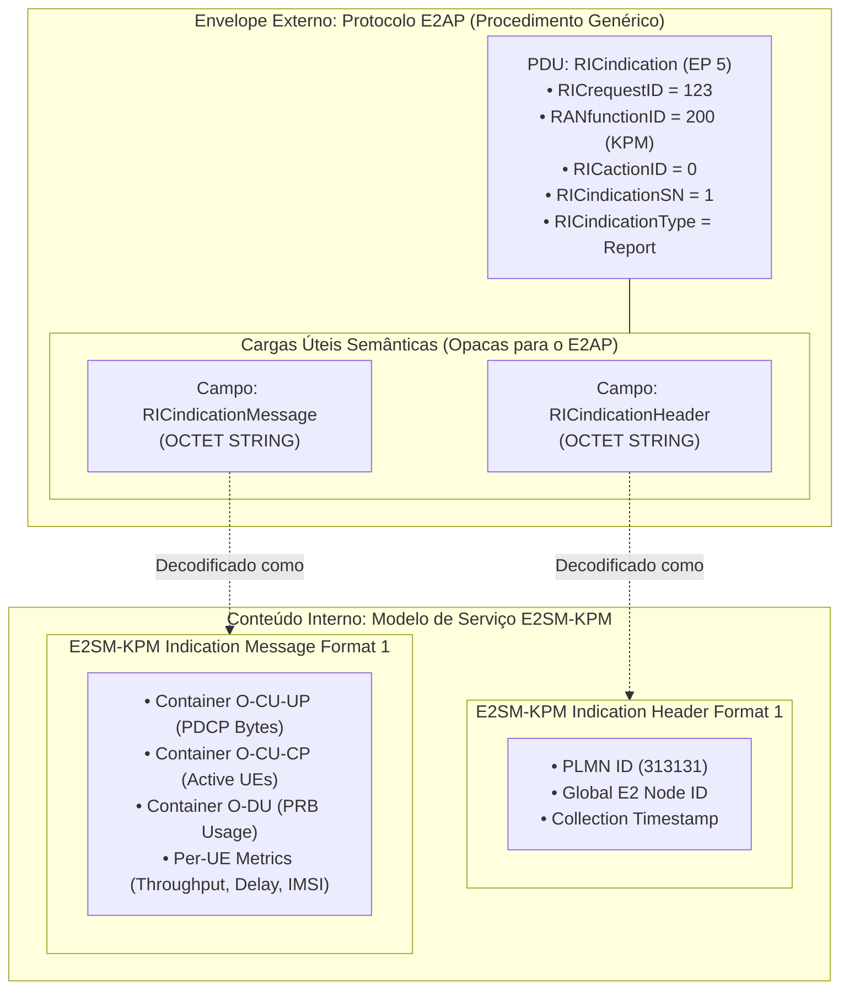
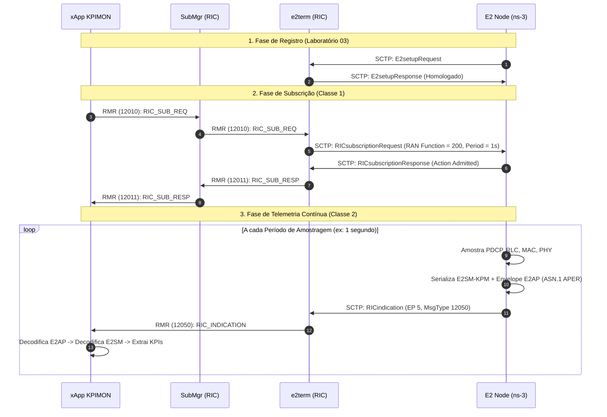
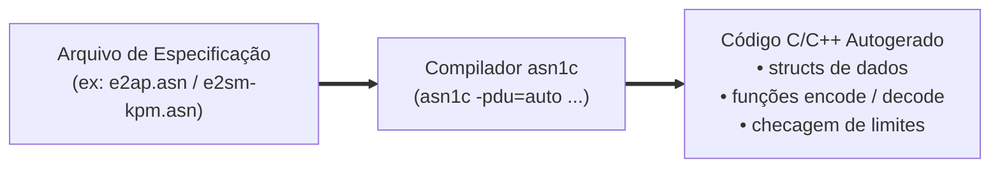

# Laboratório 5: Fundamentos de E2AP e E2SM — O Ciclo de Vida da RIC Indication (Construção, Codificação, Envio e Decodificação de Telemetria com KPIMON xApp)

No [Laboratório 1](./lab01-setup-RIC.md), realizamos o deploy do Near-RT RIC no Kubernetes. No [Laboratório 2](./lab02-setup-ns3.md), preparamos o ambiente de simulação do ns-3 com a pilha de Conectividade Dupla (LTE + mmWave). No [Laboratório 3](./lab03-validacao-e2setup.md), validamos o handshake de **E2 Setup**, assegurando que os nós simulados se registram formalmente perante o controlador O-RAN. No [Laboratório 4](./lab04-fundamentos-xapps-onboarding.md), compreendemos os fundamentos dos **xApps**, seu papel no loop quase-real e realizamos o onboarding e deploy do container do **KPIMON**.

Agora, adentramos o verdadeiro propósito da arquitetura Open RAN: **a inteligência orientada a dados**. Como o Near-RT RIC e seus xApps tomam decisões de otimização em tempo quase-real (10 ms a 1 s) se não receberem dados contínuos do comportamento do canal de rádio e dos fluxos dos usuários?

Neste laboratório, dissecamos **os fundamentos dos protocolos E2AP e E2SM**, explorando minuciosamente o ciclo de vida completo de uma mensagem **`RICindication`**: desde a sua concepção e coleta de métricas nas camadas PDCP/RLC/MAC do ns-3, passando pela codificação binária **ASN.1 APER**, empacotamento no envelope E2AP, transporte via **SCTP/RMR**, até a recepção e decodificação na aplicação em linguagem Go do **xApp KPIMON**.

---

## 🎯 Objetivos de Aprendizagem

Ao final deste laboratório, você será capaz de:

1. Diferenciar conceitualmente o protocolo base **E2AP** (*E2 Application Protocol*) dos Modelos de Serviço de Domínio **E2SM** (*E2 Service Models*), em especial o **E2SM-KPM** (*Key Performance Metrics*).
2. Compreender a taxonomia dos **Procedimentos Elementares (EPs)**: diferenciar procedimentos de **Classe 1** (bidirecionais/confirmados, como *RIC Subscription*) de procedimentos de **Classe 2** (unidirecionais/não-confirmados, como *RIC Indication* - EP 5).
3. Analisar a anatomia da PDU `RICindication` e seus *Information Elements* (IEs): `RICrequestID`, `RANfunctionID`, `RICactionID`, `RICindicationSN`, `RICindicationType`, `RICindicationHeader` e `RICindicationMessage`.
4. Dissecagem do formato do Modelo de Serviço E2SM-KPM: formatos de cabeçalho (*Indication Header Format 1*) e corpo de mensagem (*Indication Message Format 1* com containers de CU-UP, CU-CP, DU e listas de métricas por UE/IMSI).
5. Desmistificar o **ASN.1** (*Abstract Syntax Notation One*): entender seu papel como linguagem formal de contrato (IDL), por que a O-RAN não utiliza formatos web como JSON/XML, como funciona o compilador `asn1c` e por que a regra de codificação **APER** (*Aligned Packed Encoding Rules*) é mandatória em redes celulares.
6. Rastrear no código C++ do ns-3 (`oran-interface`) as rotinas de amostragem de dados, construção de objetos ASN.1 e serialização binária com o compilador `asn1c` (`asn_encode_to_new_buffer`).
7. Compreender a arquitetura de recepção e decodificação no ecossistema Go/CGO do xApp KPIMON, identificando como os wrappers do `libe2proto` processam as cargas úteis binárias.
8. Realizar o *onboarding* e o *deploy* do container do xApp KPIMON no cluster Kubernetes via ferramenta `dms_cli`.
9. Executar o cenário de simulação integrado e realizar observabilidade em múltiplos níveis: correlacionando os logs de envio do simulador, o trânsito no pod `e2term` e a exibição das métricas decodificadas no xApp KPIMON.

---

## 📚 1. Fundamentos Teóricos: E2AP, E2SM e o Modelo Matryoshka

### 1.1 O Princípio da Separação entre Sinalização (E2AP) e Semântica (E2SM)

A arquitetura O-RAN adota um princípio rigoroso de projeto: **o desacoplamento total entre o protocolo de transporte de aplicação e o modelo semântico das funções de rádio**.

* **E2AP (E2 Application Protocol - O-RAN WG3):** É um protocolo genérico de sinalização que opera na interface E2. O E2AP não possui nenhum conhecimento sobre conceitos específicos de telecomunicações móveis, como blocos de recursos (PRBs), Throughput, potência recebida (RSRP) ou modulação (MCS). Sua função é puramente estabelecer sessões, gerenciar subscrições de xApps e fornecer "envelopes" seguros e padronizados para transportar dados opacos de e para os nós E2.
* **E2SM (E2 Service Model):** Define a **semântica** (o vocabulário e os tipos de dados) de um domínio específico da RAN. Cada modelo de serviço atende a uma finalidade bem definida:
  * **E2SM-KPM (*Key Performance Metrics*, RAN Function ID = 200):** Especializado em coleta e relatório de métricas de desempenho periódicas ou orientadas a eventos.
  * **E2SM-RC (*RAN Control*, RAN Function ID = 300):** Especializado em ações de comando, controle de admissão, gerenciamento de mobilidade (*handover*) e particionamento de recursos (*slicing*).



> [!NOTE]
> **Analogia dos Correios:** Pense no **E2AP** como o envelope de uma carta registrada: ele possui o endereço de remetente (Global Node ID), o destinatário (RIC Request ID) e o selo de triagem (RAN Function ID). O carteiro (o protocolo E2AP e o pod `e2term`) não precisa ler nem entender o conteúdo da carta; ele apenas entrega o envelope. O **E2SM-KPM** é a carta escrita dentro do envelope: ela possui uma linguagem específica (métricas de rádio) que apenas o remetente (o nó de rádio no ns-3) e o destinatário final (o xApp KPIMON) sabem interpretar.

---

### 1.2 Procedimentos de Classe 1 vs. Classe 2: Por que a Telemetria é Não-Confirmada?

As especificações do E2AP classificam as mensagens em duas categorias:

1. **Procedimentos de Classe 1 (Com Resposta Obrigatória):** Transações atômicas de controle em que o emissor aguarda confirmação explícita de sucesso ou falha antes de prosseguir.
   * **Exemplo:** `RICsubscription` (EP 2). O xApp envia `RICsubscriptionRequest` e o nó responde com `RICsubscriptionResponse` ou `RICsubscriptionFailure`.
2. **Procedimentos de Classe 2 (Sem Resposta / Não-Confirmados):** Mensagens unidirecionais transmitidas sem confirmação no nível de aplicação E2AP.
   * **Exemplo:** `RICindication` (EP 5). O nó E2 gera o relatório de métricas e o envia diretamente para o RIC.

| Característica | Procedimento de Subscrição (`RICsubscription`) | Procedimento de Indicação (`RICindication`) |
| :--- | :--- | :--- |
| **Classe E2AP** | **Classe 1** | **Classe 2** |
| **PDU de Disparo** | `initiatingMessage` (`RICsubscriptionRequest`) | `initiatingMessage` (`RICindication`) |
| **PDU de Resposta** | `successfulOutcome` (`RICsubscriptionResponse`) | **Nenhuma** (Unidirecional) |
| **Direção do Fluxo** | Near-RT RIC (xApp) $\rightarrow$ E2 Node (ns-3) | E2 Node (ns-3) $\rightarrow$ Near-RT RIC (xApp) |
| **Frequência Típica** | Esporádica (Setup inicial do xApp) | Alta frequência (Periódica: a cada 10 ms a 1000 ms) |
| **Impacto de Sobrecarga** | Baixo impacto (configuração) | Crítico: se exigisse ACK, geraria o dobro de mensagens na rede |

> [!IMPORTANT]
> **Por que a `RICindication` não exige confirmação (ACK) no E2AP?**
> Em redes móveis reais com milhares de células transmitindo telemetria em alta frequência, exigir uma mensagem de confirmação para cada indicação sobrecarregaria o barramento interno do RIC e as CPUs das estações base. A confiabilidade do transporte já é garantida pela camada **SCTP** subjacente (que provê controle de fluxo, retransmissões automáticas SACK e prevenção de congestionamento).

---

### 1.3 O Pré-Requisito Mandatório: O Fluxo de Subscrição (RIC Subscription)

Um nó E2 **jamais envia telemetria por conta própria**. Ele somente inicia o envio de mensagens `RICindication` após receber uma ordem formal de subscrição configurada por um xApp.

O ciclo de vida da interação é representado abaixo:



---

### 1.4 Desmistificando o ASN.1: O Que É, Por Que Usar e Como Funciona na O-RAN

Ao iniciar os estudos em telecomunicações móveis e na **O-RAN**, uma das primeiras siglas que costuma assustar os iniciantes é o **ASN.1 (*Abstract Syntax Notation One*)**. À primeira vista, ele pode parecer um bicho de sete cabeças, com nomes formais e especificações complexas. No entanto, o seu propósito é simples, elegante e indispensável para que equipamentos de diferentes fabricantes consigam se comunicar sem falhas.

Vamos entender do zero o que ele é e como funciona.

#### 1.4.1 O que é o ASN.1 afinal? (A "Planta Baixa" de uma Mensagem)

Pense na seguinte situação do dia a dia: quando você vai ao banco ou a um órgão público preencher uma ficha cadastral, esse documento possui regras rígidas e bem delimitadas:
* O campo *"CPF"* só aceita números e tem exatamente 11 dígitos;
* O campo *"Nome Completo"* aceita texto;
* O campo *"Deseja receber avisos por SMS?"* é uma caixinha de marcar apenas **Sim** ou **Não**;
* Certos campos são obrigatórios, enquanto outros são opcionais.

Se cada pessoa tentasse inventar o seu próprio formulário na hora de abrir uma conta, o sistema do banco entraria em colapso.

Em redes de computadores e telecomunicações ocorre exatamente o mesmo desafio: uma antena de rádio (gNB) fabricada pela empresa **A** precisa conversar com o controlador (Near-RT RIC) desenvolvido pela empresa **B**, e os dados precisam chegar a um aplicativo inteligente (xApp) programado pela equipe **C**. Como garantir que todos entendam os dados exatamente da mesma forma?

A resposta é o **ASN.1 (*Abstract Syntax Notation One*)**: ele é uma **linguagem internacional padrão utilizada para desenhar a "planta baixa" (ou o modelo formal) das mensagens** que trafegam na rede.

Entendendo o significado do nome:
* **Abstract (Abstrato):** Significa que ele se preocupa apenas com a **estrutura lógica** dos dados, e não com computadores específicos. Ele é totalmente independente da linguagem de programação utilizada (seja C++, Python, Go ou Java) e do tipo de processador (seja Intel x86 de um servidor ou ARM de uma estação base).
* **Syntax (Sintaxe):** É a gramática formal que define os tipos de dados (números inteiros, textos, listas, valores booleanos).
* **Notation (Notação):** É a forma legível e organizada de escrever essa estrutura em um arquivo de texto comum (com extensão `.asn`, como `e2ap.asn` ou `e2sm-kpm.asn`).

Veja um exemplo prático e simplificado de como uma regra é escrita em um arquivo `.asn`:

```asn1
-- Exemplo de especificação formal escrita no arquivo .asn

-- 1. Um identificador de função que só pode assumir números entre 0 e 4095
RANfunctionID ::= INTEGER (0..4095)

-- 2. Um seletor de opções com valores pré-fixados (tipo enumerado)
RICindicationType ::= ENUMERATED {
    report  (0),   -- Valor 0: Apenas relata dados (telemetria)
    insert  (1)    -- Valor 1: Interrompe e aguarda instrução
}

-- 3. A estrutura da mensagem reunindo os campos em sequência
RICindication-Item ::= SEQUENCE {
    funcaoId      RANfunctionID,        -- Campo obrigatório: usa a regra definida acima
    tipo          RICindicationType,    -- Campo obrigatório: report ou insert
    valorMedido   INTEGER OPTIONAL      -- Campo opcional: pode ou não estar presente
}
```

O arquivo `.asn` funciona como uma **certidão oficial**: ele não faz contas nem envia pacotes; ele apenas declara solenemente: *"Qualquer mensagem de telemetria desta rede deve conter exatamente estes campos, respeitando estes limites"*.

---

#### 1.4.2 Por que a O-RAN não usa JSON, YAML ou XML na Interface E2?

Uma dúvida clássica é: *"Se JSON e XML são tão fáceis de ler, por que a O-RAN Alliance não adotou JSON nas mensagens da interface E2?"*

A resposta se resume a três pilares indispensáveis de telecomunicações: **Tamanho no Fio (*Overhead*)**, **Latência/Consumo de CPU** e **Determinismo**.

| Desafio | Mensageria Web (JSON / XML) | Telecom / O-RAN (ASN.1 APER) |
| :--- | :--- | :--- |
| **Tamanho da Mensagem** | **Altíssimo:** Repete o nome de cada chave em texto claro em todo pacote (`"throughput": 300`). | **Mínimo Absoluto:** Nomes de campos nunca trafegam na rede. Apenas os valores binários compactados em bits são enviados. |
| **Custo de Processamento** | **Elevado:** Fazer parsing de strings, alocar memória dinâmica e validar chaves consome milissegundos preciosos de CPU. | **Quase Nulo:** Decodificação direta na memória em microssegundos via ponteiros de baixo nível em C/C++. |
| **Ambiguidade de Tipagem** | **Frágil:** Um lado pode enviar `"1"` (string) e o outro esperar `1` (inteiro). Falhas só aparecem em tempo de execução. | **Blindada:** Tipagem matemática estrita. Se o campo tem restrição `(0..4095)`, o compilador rejeita qualquer violação de limites. |
| **Tempo Real (RAN)** | Inviável para relatórios de métricas a cada 1 ms a 10 ms sob milhares de usuários. | Nativo para restrições estritas de tempo real e alta densidade de conexões. |

Considere enviar uma métrica de telemetria de Throughput:
* Em **JSON**:
  ```json
  {"ueId":"00001","drbId":1,"nrThroughputKbps":300,"latencyMs":9}
  ```
  O texto acima consome **65 bytes**. Se multiplicarmos isso por centenas de UEs transmitindo a cada 100 milissegundos, criamos um gargalo de banda gigantesco no canal de controle.
* Em **ASN.1 APER**:
  Os nomes dos campos não são transmitidos. Apenas os valores essenciais empacotados em bits específicos trafegam pelo fio. A mesma informação ocupa **menos de 10 bytes**!

---

#### 1.4.3 O "Gerador Mágico de Código": O Compilador `asn1c`

A maior preocupação dos desenvolvedores é: *"Eu vou ter que calcular deslocamentos de bits (*bit-shifts*) e codificar binários manualmente?"*

**A resposta é NÃO.** No dia a dia de O-RAN, ninguém escreve codificação binária na mão. Para isso existe o compilador **`asn1c`**:



1. A O-RAN Alliance fornece os arquivos `.asn` oficiais padronizados.
2. O utilitário `asn1c` compila esses arquivos e gera automaticamente:
   * As estruturas C (`struct`) correspondentes a cada tipo definido na norma;
   * Funções nativas de serialização: `asn_encode_to_new_buffer(...)`;
   * Funções nativas de decodificação: `asn_decode(...)`;
   * Validadores de integridade: `asn_check_constraints(...)`.
3. No simulador ns-3 (em C++), nós apenas preenchemos os membros da `struct` e invocamos a função de codificação.
4. No xApp KPIMON (em Go), o wrapper CGO (`libe2proto`) faz a ponte com essas mesmas bibliotecas compiladas em C para preencher structs nativas de Go!

---

#### 1.4.4 O Padrão Mandatório na O-RAN: APER (*Aligned Packed Encoding Rules*)

O ASN.1 define a estrutura lógica dos dados, mas cabe a uma regra de empacotamento (*Encoding Rule*) ditar como esses dados se tornam bits para trafegar pelo cabo ou fibra.

Para todas as mensagens da interface E2 (tanto o protocolo base **E2AP** quanto os modelos de serviço **E2SM**), a O-RAN Alliance padronizou o uso estrito do **APER (*Aligned Packed Encoding Rules*)**:

* **Remoção total de metadados redundantes:** Nomes de campos e tags de identificação de tipo não são transmitidos. Apenas os valores brutos empacotados em bits mínimos são enviados.
* **Alinhamento em octetos (bytes):** Diferente de formatos puramente bit a bit que exigem operações complexas de deslocamento (*bit-shifting*) do processador, o APER alinha os limites das variáveis em múltiplos de bytes sempre que conveniente. Isso permite que processadores modernos (x86 e ARM) leiam e gravem os campos na memória em frações de microssegundo, garantindo o determinismo exigido pelas camadas de tempo real da rede de acesso.

---

#### 1.4.5 Da Teoria ao Fio: O Ciclo de um Dado na Prática

Para consolidar o conceito, veja o que acontece com a atribuição de um `RANfunctionID = 200`:

1. **Na Especificação (`.asn`):**
   ```asn1
   RANfunctionID ::= INTEGER (0..4095)
   ```
2. **Na Estrutura C gerada pelo `asn1c` (ns-3):**
   ```c
   typedef long RANfunctionID_t;
   ```
3. **No Código do ns-3 (`encode_e2apv1.cpp`):**
   ```cpp
   ricind_ies2->value.choice.RANfunctionID = 200;
   ```
4. **No Fio (SCTP / Wireshark - APER):**
   O valor `200` é codificado em hexadecimal como `0x00C8`, ocupando apenas os 2 bytes necessários para cobrir a faixa de 0 a 4095.
5. **No xApp (`control/e2ap.go` via CGO):**
   ```go
   decodedMsg.FuncID = int32(decodedCMsg.ranfunctionID) // Valor 200 entregue diretamente em Go!
   ```

Como se vê, o ASN.1 não é um obstáculo impenetrável: ele é a ferramenta que garante que o simulador ns-3, o controlador Near-RT RIC e os xApps falem a mesma língua com precisão matemática e performance de tempo real.

---

## 🔬 2. Anatomia do Código no Simulador (ns-3): Construção, Codificação e Envio

Vamos analisar as implementações em C++ que geram a telemetria dentro do módulo `oran-interface` e no simulador ns-3.

### 2.1 Construção do Cabeçalho e Mensagem E2SM-KPM

No arquivo [`kpm-indication.h`](file:///home/ns3/ns3-mmwave-oran/contrib/oran-interface/model/kpm-indication.h), as classes `KpmIndicationHeader` e `KpmIndicationMessage` abstraem a manipulação das estruturas complexas geradas pelo `asn1c`.

#### 1. Construção do Cabeçalho (*Indication Header Format 1*):
```cpp
// Definição dos valores essenciais de identificação do nó
KpmIndicationHeader::KpmRicIndicationHeaderValues headerValues;
headerValues.m_plmId = "111";                                    // PLMN Identity (MCC/MNC)
headerValues.m_gnbId = std::to_string(m_cellId);                 // Identificador da célula
headerValues.m_nrCellId = m_cellId;                              // NR Cell Identity
headerValues.m_timestamp = m_startTime + Simulator::Now().GetMilliSeconds();

// Instanciação do cabeçalho que dispara a codificação ASN.1 APER
Ptr<KpmIndicationHeader> header = Create<KpmIndicationHeader>(
    KpmIndicationHeader::GlobalE2nodeType::eNB, 
    headerValues
);
```

#### 2. Codificação Interna com o `asn1c`:
Em [`kpm-indication.cc`](file:///home/ns3/ns3-mmwave-oran/contrib/oran-interface/model/kpm-indication.cc#L76-L84):
```cpp
void KpmIndicationHeader::Encode(E2SM_KPM_IndicationHeader_t *descriptor)
{
    asn_codec_ctx_t *opt_cod = 0; // Desativa checagem estrita de pilha
    asn_encode_to_new_buffer_result_s encodedHeader = asn_encode_to_new_buffer(
        opt_cod, 
        ATS_ALIGNED_BASIC_PER, 
        &asn_DEF_E2SM_KPM_IndicationHeader, 
        descriptor
    );
    m_buffer = encodedHeader.buffer; // Aponta para os bytes binários serializados
    m_size = encodedHeader.result.encoded; // Tamanho exato em bytes
}
```

#### 3. Construção do Corpo (*Indication Message Format 1*):
O corpo da mensagem transporta os **Containers de Medição de Desempenho (PM Containers)** das camadas desagregadas:
* **CU-UP Container:** Transporta bytes PDCP transmitidos e recebidos no enlace direto e reverso.
* **CU-CP Container:** Transporta a quantidade de conexões ativas de controle RRC (*Active UEs*).
* **DU Container:** Transporta a utilização de blocos de recursos físicos (PRBs) no agendador MAC.
* **Per-UE Measurement Items:** Lista associada ao IMSI de cada usuário conectado com métricas finas (Throughput instantâneo em kbps, Atraso de pacotes em décimos de milissegundo e SINR medido).

---

### 2.2 O Encapsulamento no Envelope E2AP

Uma vez que os buffers binários do cabeçalho (`header->m_buffer`) e da mensagem (`cuUpMsg->m_buffer`) foram produzidos, eles são encapsulados na PDU `E2AP_PDU` pela biblioteca `e2sim` através da função [`encoding::generate_e2apv1_indication_request_parameterized()`](file:///home/ns3/ns-o-ran-e2-sim/e2sim/src/encoding/encode_e2apv1.cpp#L633-L759):

```cpp
void encoding::generate_e2apv1_indication_request_parameterized(
    E2AP_PDU *e2ap_pdu,
    long requestorId,
    long instanceId,
    long ranFunctionId,
    long actionId,
    long seqNum,
    uint8_t *ind_header_buf,
    int header_length,
    uint8_t *ind_message_buf,
    int message_length) 
{
    // 1. Aloca os IEs (Information Elements) do E2AP
    auto *ricind_ies  = (RICindication_IEs_t *) calloc(1, sizeof(RICindication_IEs_t));
    auto *ricind_ies2 = (RICindication_IEs_t *) calloc(1, sizeof(RICindication_IEs_t));
    auto *ricind_ies3 = (RICindication_IEs_t *) calloc(1, sizeof(RICindication_IEs_t));
    auto *ricind_ies4 = (RICindication_IEs_t *) calloc(1, sizeof(RICindication_IEs_t));
    auto *ricind_ies5 = (RICindication_IEs_t *) calloc(1, sizeof(RICindication_IEs_t));
    auto *ricind_ies6 = (RICindication_IEs_t *) calloc(1, sizeof(RICindication_IEs_t));
    auto *ricind_ies7 = (RICindication_IEs_t *) calloc(1, sizeof(RICindication_IEs_t));

    // IE 1: RIC Request ID (Requestor ID + Instance ID do xApp)
    ricind_ies->id = ProtocolIE_ID_id_RICrequestID;
    ricind_ies->value.present = RICindication_IEs__value_PR_RICrequestID;
    ricind_ies->value.choice.RICrequestID.ricRequestorID = requestorId;
    ricind_ies->value.choice.RICrequestID.ricInstanceID = instanceId;

    // IE 2: RAN Function ID (200 para KPM)
    ricind_ies2->id = ProtocolIE_ID_id_RANfunctionID;
    ricind_ies2->value.choice.RANfunctionID = ranFunctionId;

    // IE 3: RIC Action ID
    ricind_ies3->id = ProtocolIE_ID_id_RICactionID;
    ricind_ies3->value.choice.RICactionID = actionId;

    // IE 4: Sequence Number da Indicação
    ricind_ies4->id = ProtocolIE_ID_id_RICindicationSN;
    ricind_ies4->value.choice.RICindicationSN = seqNum;

    // IE 5: Tipo de Indicação (REPORT)
    ricind_ies5->id = ProtocolIE_ID_id_RICindicationType;
    ricind_ies5->value.choice.RICindicationType = RICindicationType_report;

    // IE 6: Cabeçalho E2SM inserido como OCTET STRING opaca
    ricind_ies6->id = ProtocolIE_ID_id_RICindicationHeader;
    ricind_ies6->value.choice.RICindicationHeader.size = header_length;
    ricind_ies6->value.choice.RICindicationHeader.buf = (uint8_t *) calloc(1, header_length);
    memcpy(ricind_ies6->value.choice.RICindicationHeader.buf, ind_header_buf, header_length);

    // IE 7: Carga Útil E2SM inserida como OCTET STRING opaca
    ricind_ies7->id = ProtocolIE_ID_id_RICindicationMessage;
    ricind_ies7->value.choice.RICindicationMessage.size = message_length;
    ricind_ies7->value.choice.RICindicationMessage.buf = (uint8_t *) calloc(1, message_length);
    memcpy(ricind_ies7->value.choice.RICindicationMessage.buf, ind_message_buf, message_length);

    // 2. Empacota a estrutura na PDU de InitiatingMessage do E2AP
    auto *ricindication = (RICindication_t *) calloc(1, sizeof(RICindication_t));
    ASN_SEQUENCE_ADD(&ricindication->protocolIEs.list, ricind_ies);
    // ... adiciona demais IEs ...

    auto *initmsg = (InitiatingMessage_t *) calloc(1, sizeof(InitiatingMessage_t));
    initmsg->procedureCode = ProcedureCode_id_RICindication; // Código 5 (Classe 2)
    initmsg->criticality = Criticality_ignore;
    initmsg->value.present = InitiatingMessage__value_PR_RICindication;
    initmsg->value.choice.RICindication = *ricindication;

    e2ap_pdu->present = E2AP_PDU_PR_initiatingMessage;
    e2ap_pdu->choice.initiatingMessage = initmsg;
}
```

---

### 2.3 O Ponto de Disparo no Dispositivo de Rede ns-3

Nos arquivos [`lte-enb-net-device.cc`](file:///home/ns3/ns3-mmwave-oran/src/lte/model/lte-enb-net-device.cc#L1533-L1572) e [`mmwave-enb-net-device.cc`](file:///home/ns3/ns3-mmwave-oran/src/mmwave/model/mmwave-enb-net-device.cc), a função `BuildAndSendReportMessage()` é invocada periodicamente pelo temporizador de simulação. 

Ao ser acionada, ela coleta as estatísticas dos calculadores de PDCP e RLC e despacha a mensagem pela interface E2:

```cpp
void LteEnbNetDevice::BuildAndSendReportMessage(E2Termination::RicSubscriptionRequest_rval_s params)
{
    // Constrói os objetos e buffers serializados
    Ptr<KpmIndicationHeader> header = BuildRicIndicationHeader(plmId, gnbId, m_cellId);
    Ptr<KpmIndicationMessage> cuUpMsg = BuildRicIndicationMessageCuUp(plmId);

    // Aloca a PDU E2AP e monta os IEs
    E2AP_PDU* pdu_cuup_ue = new E2AP_PDU;
    encoding::generate_e2apv1_indication_request_parameterized(
        pdu_cuup_ue,
        params.requestorId,
        params.instanceId,
        params.ranFuncionId,
        params.actionId,
        1,                           // Sequence number
        (uint8_t*)header->m_buffer,  // Buffer do cabeçalho E2SM
        header->m_size,              // Tamanho do cabeçalho
        (uint8_t*)cuUpMsg->m_buffer, // Buffer do corpo E2SM
        cuUpMsg->m_size              // Tamanho do corpo
    );

    // Envia os bytes serializados via socket SCTP para a porta 36422 do e2term
    m_e2term->SendE2Message(pdu_cuup_ue);
    delete pdu_cuup_ue;
}
```

---

## 🧩 3. Anatomia do Código no Receptor (xApp KPIMON em Go)

No lado receptor, o xApp KPIMON é implementado em **Go** utilizando a biblioteca padrão da O-RAN SC `xapp-frame` e wrappers em **CGO** (`libe2proto`) para decodificar o ASN.1.

### 3.1 O Roteamento de Mensagens RMR (`MsgType = 12050`)

O pod `e2term` do RIC recebe a PDU via SCTP, decodifica a camada de transporte e injeta a carga no barramento RMR com o identificador de tipo **`Mtype = 12050` (`RIC_INDICATION`)**.

Em [`xapps/kpimon/control/control.go`](../xapps/kpimon/control/control.go):
```go
// Loop principal de despacho de eventos RMR do xApp
for {
    msg := <-c.rcChan
    switch msg.Mtype {
    case 12050: // RIC_INDICATION recebida
        c.handleIndication(msg)
    case 12011: // RIC_SUB_RESP recebida (confirmação da subscrição)
        c.handleSubscriptionResponse(msg)
    case 12012: // RIC_SUB_FAILURE recebida
        c.handleSubscriptionFailure(msg)
    }
}
```

---

### 3.2 O Desempacotamento em Duas Etapas

A função `handleIndication()` executa exatamente a operação inversa àquela realizada pelo simulador ns-3:

```go
func (c *Control) handleIndication(params *xapp.RMRParams) (err error) {
    var e2ap *E2ap
    var e2sm *E2sm

    // ETAPA 1: Decodifica o envelope exterior E2AP
    indicationMsg, err := e2ap.GetIndicationMessage(params.Payload)
    if err != nil {
        log.Printf("Falha ao decodificar envelope E2AP: %v", err)
        return
    }

    // ETAPA 2: Decodifica a carga útil interna E2SM-KPM contida em indicationMsg.IndMessage
    if err = c.logIndicationMessage(e2sm, params.Meid.RanName, indicationMsg.IndMessage); err != nil {
        return err
    }

    return nil
}
```

1. **Etapa 1: Decodificação E2AP ([`xapps/kpimon/control/e2ap.go`](../xapps/kpimon/control/e2ap.go)):**
   Chama a rotina em C `e2ap_decode_ric_indication_message()`. Ela extrai o `RequestID`, `RanFunctionID` (200), `IndicationSN` e separa os buffers brutos de `IndicationHeader` e `IndicationMessage`.
2. **Etapa 2: Decodificação E2SM-KPM ([`xapps/kpimon/control/e2sm.go`](../xapps/kpimon/control/e2sm.go)):**
   Chama a rotina em C `e2sm_decode_ric_indication_message()`. Ela interpreta os bytes do APER conforme a árvore ASN.1 do modelo KPM Format 1, preenchendo as estruturas de dados nativas da linguagem Go.

---

### 3.3 A Extração das Métricas por Usuário (`ListOfMatchedUes`)

No arquivo [`xapps/kpimon/control/control.go`](../xapps/kpimon/control/control.go), os dados decodificados são formatados e impressos no console e no arquivo `/opt/kpimon.log`:

```go
func (c *Control) logMatchedUEs(ranName string, indMsgFormat1 *IndicationMessageFormat1) {
    log.Printf("[Per-UE Metrics (%s)] Total UEs no relatório: %d", ranName, indMsgFormat1.ListOfMatchedUesCount)

    for i := 0; i < indMsgFormat1.ListOfMatchedUesCount; i++ {
        ueItem := indMsgFormat1.ListOfMatchedUes[i]
        ueID := string(ueItem.UeID.Buf) // IMSI do UE (ex: "00001")

        log.Printf("    UE[%d] ID (IMSI): %s | Métricas Coletadas: %d", i, ueID, ueItem.ListOfPMInfoCount)
        for j := 0; j < ueItem.ListOfPMInfoCount; j++ {
            pm := ueItem.ListOfPMInfo[j]
            metricName := string(pm.PMType.Buf) // Nome formal da métrica (ex: NR.Throughput)
            log.Printf("      -> %-38s : %v", metricName, pm.PMVal)
        }
    }
}
```

Exemplo real de saída gerada:
```text
[Per-UE Metrics (gnb_131_133_32000000)] Total UEs in report: 1
    UE[0] ID (IMSI): 00001 | Metrics Count: 6
      -> QCI                                    : 2
      -> LTE.Throughput                         : 0
      -> LTE.Delay                              : 0
      -> NR.Throughput                          : 300
      -> NR.Delay                               : 9
      -> DRB.UEThpDl.UEID                       : 300
```

---

## 💻 4. Prática Guiada: Execução e Validação Fim-a-Fim no Laboratório

Agora realizaremos a homologação prática do envio de `RICindication` entre o ns-3 e o xApp KPIMON.

### Pré-requisitos
Certifique-se de que o cluster Kubernetes do Near-RT RIC está ativo (concluído no [Lab 1](./lab01-setup-RIC.md)) e que a compilação do ns-3 com `oran-interface` foi concluída (concluído no [Lab 2](./lab02-setup-ns3.md)).

---

### Passo 1: Verificar a Saúde dos Microsserviços do RIC

Abra um terminal e verifique se todos os pods do Near-RT RIC estão em estado `Running`:

```bash
kubectl get pods -n ricplt
```

Confirme especificamente que os pods **`e2term`**, **`submgr`**, **`e2mgr`** e **`dbaas`** estão saudáveis.

---

### Passo 2: Construir e Implantar o xApp KPIMON

O código-fonte do xApp KPIMON customizado para o bootcamp está localizado em `xapps/kpimon`.

> [!NOTE]
> [!IMPORTANT]
> **Privilégios de Execução (`sudo -i`):**
> Como as etapas a seguir realizam `docker build`, publicação no registry local `:5000` e instalação via `dms_cli` no Kubernetes, certifique-se de executar os comandos com privilégios de superusuário:
> ```bash
> sudo -i
> ```

1. **Garantir que as Imagens Base estão compiladas (executado uma única vez):**
   ```bash
   cd /home/ns3/ns3-oran-bootcamp/xapps/base-image
   ./build_base.sh
   ```

2. **Navegue até o diretório do xApp KPIMON:**
   ```bash
   cd /home/ns3/ns3-oran-bootcamp/xapps/kpimon
   ```

3. **Execute o deploy otimizado (⚡ Recomendado):**
   ```bash
   ./launch_app_fast.sh
   ```
   *(Alternativamente, se desejar compilar todas as camadas CGO do zero, você pode utilizar `./launch_app.sh`).*

   *O script assegura que os repositórios locais estejam ativos, desinstala versões prévias, compila a imagem Docker, registra os descritores no App Manager via `dms_cli` e dispara o deploy no namespace `ricxapp`.*

4. **Verifique se o pod do xApp foi criado com sucesso:**
   ```bash
   kubectl get pods -n ricxapp
   ```
   *Saída esperada:*
   ```text
   NAME                                READY   STATUS    RESTARTS   AGE
   ricxapp-xappkpimon-xxxxxxxxxx-xxxxx 1/1     Running   0          30s
   ```

---

### Passo 3: Preparar os Terminais de Observabilidade

Para visualizar o ciclo de vida completo da mensagem em tempo real, utilizaremos múltiplos terminais ou janelas do utilitário `tmux`:

#### 📟 Terminal 1: Executar e Monitorar o xApp KPIMON
Como vimos no [Laboratório 4](./lab04-fundamentos-xapps-onboarding.md), o container do xApp foi inicializado em modo de desenvolvimento (`sleep infinity`). No Terminal 1, execute o binário do KPIMON para que ele inicie o barramento RMR e o loop de subscrição:

```bash
POD_NAME=$(kubectl get pods -n ricxapp -o jsonpath='{.items[0].metadata.name}')
kubectl exec -ti -n ricxapp $POD_NAME -- ./kpimon -f /opt/ric/config/config-file.json
```
*Observe que o xApp iniciará o envio periódico de subscrições (`RIC_SUB_REQ`) para os nós `gnb_131_133_31000000` e `gnb_131_133_32000000`.*

#### 📟 Terminal 2: Monitorar os Logs de Chegada no `e2term`
No Terminal 2, acompanhe em tempo real a recepção dos pacotes SCTP e a publicação no barramento RMR pelo `e2term`:
```bash
kubectl logs -n ricplt -l app=ricplt-e2term-alpha -f | grep -E "RIC_INDICATION|E2_SETUP|RIC_SUB"
```

---

### Passo 4: Executar a Simulação do ns-3 com Geração de Tráfego

No **Terminal 3**, execute o cenário de treinamento do ns-3 apontando para o IP do `e2term` e isolando os arquivos gerados com `--cwd`:

```bash
cd /home/ns3/ns3-mmwave-oran

# 1. Obtém o IP atual do pod e2term no Kubernetes
E2TERM_IP=$(kubectl get pods -n ricplt -l app=ricplt-e2term-alpha -o jsonpath='{.items[0].status.podIP}')
echo "IP do e2term: $E2TERM_IP"

# 2. Cria a pasta para isolar os arquivos .txt e traces
mkdir -p ./outputs/teste

# 3. Executa a simulação apontando para o e2term
./waf --run "scratch/scenario-trainning --e2TermIp=$E2TERM_IP --simTime=30" --cwd=./outputs/teste
```

> [!TIP]
> **Por que utilizar o parâmetro `--cwd=./outputs/teste`?**
> Por padrão, o ns-3 grava diversos arquivos de métricas e traces (`.txt`, `.tr`, `.pcap`) diretamente no diretório raiz onde o comando `./waf` é executado. O argumento `--cwd` (*Change Working Directory*) instrui o simulador a salvar todos os relatórios exclusivamente dentro de `./outputs/teste`, mantendo a raiz do ns-3 limpa e organizada.

#### O que observar durante a execução:

1. **No Terminal 3 (ns-3):**
   * Os nós eNB e gNB realizam o handshake de `E2 Setup` com sucesso (`status: CONNECTED`).
   * O nó recebe a mensagem `Received RIC Subscription Request` enviada pelo KPIMON.
   * O simulador inicia o envio periódico:
     ```text
     LteEnbNetDevice 1 BuildAndSendMessage at time 2.1
     Send LTE CU-UP
     Send LTE CU-CP
     ```
2. **No Terminal 2 (`e2term`):**
   * O `e2term` registra a recepção de pacotes SCTP vindos da porta do ns-3 e despacha as mensagens pelo RMR:
     ```text
     [INFO] Message type 12050 sent to RMR bus
     ```
3. **No Terminal 1 (xApp KPIMON):**
   * O xApp recebe o `Mtype 12050`, decodifica o cabeçalho e corpo E2SM-KPM e começa a cuspir os relatórios estruturados de métricas de usuário:
     ```text
     [RIC Indication] E2 Node: gnb_131_133_32000000 | ReqID: 123 | FuncID: 200 | ActionID: 0 | IndSN: 1
     --- [E2SM-KPM Indication Header (Format 1)] ---
       CollectionStartTime : 000001a187e60c7c
       Node Type           : gNB | PLMN: 313131
     --- [E2SM-KPM Indication Message (Format 1)] ---
       [Per-UE Metrics (gnb_131_133_32000000)] Total UEs in report: 1
         UE[0] ID (IMSI): 00001 | Metrics Count: 6
           -> QCI                                    : 2
           -> LTE.Throughput                         : 0
           -> LTE.Delay                              : 0
           -> NR.Throughput                          : 300
           -> NR.Delay                               : 9
           -> DRB.UEThpDl.UEID                       : 300
     ```

---

### Passo 5: Inspeção com Captura de Tráfego de Rede (`tshark`)

Para inspecionar o pacote binário trafegando pelo socket SCTP antes de entrar no cluster, execute uma captura na interface de loopback ou interface de rede externa:

```bash
sudo tshark -i any -f "sctp port 36422" -V
```

Procure pelo bloco do protocolo **E2AP**:
* **`ProcedureCode`**: `id-RICindication (5)`
* **`Type of Message`**: `initiatingMessage (0)`
* **`Criticality`**: `ignore (1)`
* **`RICindication-IEs`**:
  * `ProtocolIE-ID`: `id-RICrequestID (29)`
  * `ProtocolIE-ID`: `id-RANfunctionID (5)` = `200`
  * `ProtocolIE-ID`: `id-RICindicationType (30)` = `report (0)`
  * `ProtocolIE-ID`: `id-RICindicationHeader (25)` = *Sequência de octetos binários APER*
  * `ProtocolIE-ID`: `id-RICindicationMessage (26)` = *Sequência de octetos binários APER*

---

## 🛠️ 5. Resolução de Problemas Comuns (Troubleshooting)

### 1. O xApp não recebe nenhuma `RIC_INDICATION` (Logs silenciosos)
* **Causa 1 (Ausência de Subscrição):** Verifique se o xApp conseguiu enviar `RIC_SUB_REQ`. Se o xApp estiver configurado com a lista incorreta de nós em `ranList`, ele tentará subscrever nós inexistentes.
  * *Verificação:* Consulte a variável `ranList` em [`xapps/kpimon/control/control.go`](../xapps/kpimon/control/control.go). Ela deve apontar exatamente para `gnb_131_133_31000000,gnb_131_133_32000000`.
* **Causa 2 (SubMgr não roteado):** Verifique o arquivo `routes.txt` do xApp. A rota para `RIC_SUB_REQ` (12010) deve estar apontada para o serviço do Subscription Manager (`service-ricplt-submgr-rmr.ricplt:4560`).

### 2. Erro de decodificação no xApp: `Failed to decode RIC Indication message`
* **Causa:** Incompatibilidade de versão do ASN.1 entre o compilador `asn1c` utilizado no ns-3 e a biblioteca `libe2proto` em CGO no xApp.
  * *Solução:* Certifique-se de que ambos os projetos foram compilados com a mesma especificação do E2AP v1.01 e E2SM-KPM v1.0.

### 3. Simulador ns-3 finaliza com erro ou trava na inicialização
* **Causa:** O modo de sincronização `RealtimeSimulatorImpl` requer capacidade computacional para manter o relógio do simulador alinhado ao relógio do sistema operacional.
  * *Solução:* Execute com `--ns3::RealtimeSimulatorImpl::SynchronizationMode=HardLimit` e garanta que a CPU da VM não esteja sob sobrecarga severa.

---

## 🧠 6. Exercícios de Fixação e Desafio Prático

### Questões Teóricas

1. **Por que a mensagem `RICindication` é definida como um Procedimento Elementar de Classe 2 em vez de Classe 1? Qual seria a consequência técnica para a interface de rádio se ela fosse de Classe 1?**
2. **Qual é o papel do `RANfunctionID` dentro do envelope E2AP? Como o Near-RT RIC sabe se a indicação recebida deve ser encaminhada a um xApp de KPM ou a um xApp de Controle de Tráfego (RC)?**
3. **Explique a diferença entre o formato de codificação ASN.1 APER (*Aligned Packed Encoding Rules*) e formatos de serialização populares na Web como JSON ou XML, destacando aspectos de consumo de CPU e largura de banda.**

### Desafio Prático: Coletando uma Nova Métrica de Rádio

1. Abra o arquivo [`xapps/kpimon/control/control.go`](../xapps/kpimon/control/control.go).
2. Localize a função `logMatchedUEs()` e adicione uma linha de cálculo que compute a taxa agregada em Megabits por segundo ($\text{Mbps} = \text{NR.Throughput} / 1000$) sempre que o valor for reportado.
3. Recompile a imagem localmente e reinicie o xApp utilizando `./launch_app_fast.sh` (em apenas alguns segundos!) ou `./launch_app.sh`.
4. Execute o cenário do ns-3 e valide se o seu log personalizado exibe o novo valor calculado em tempo real!
