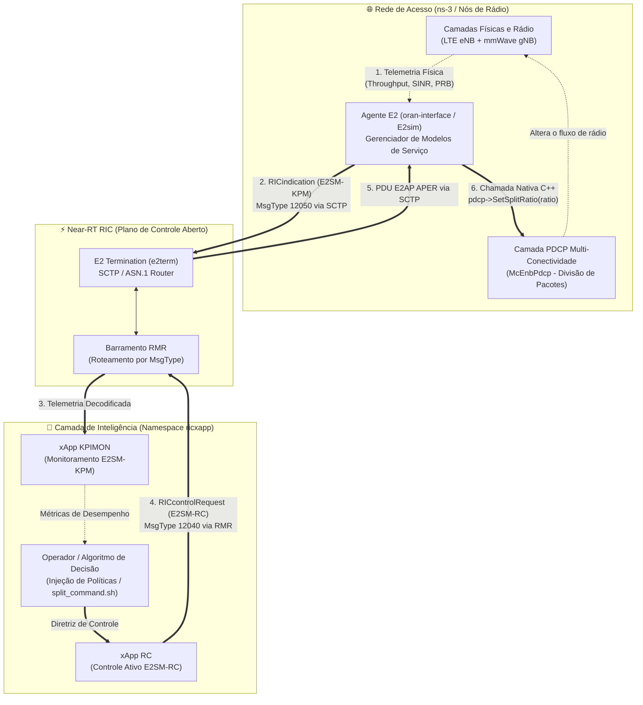
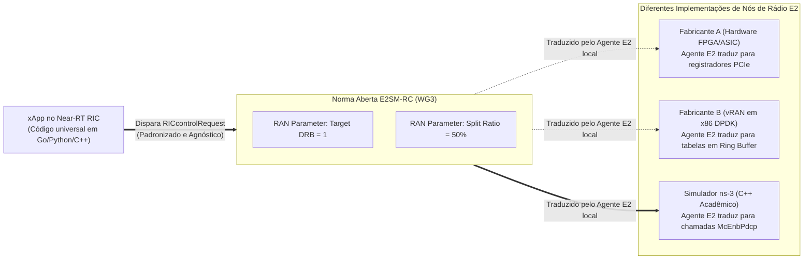
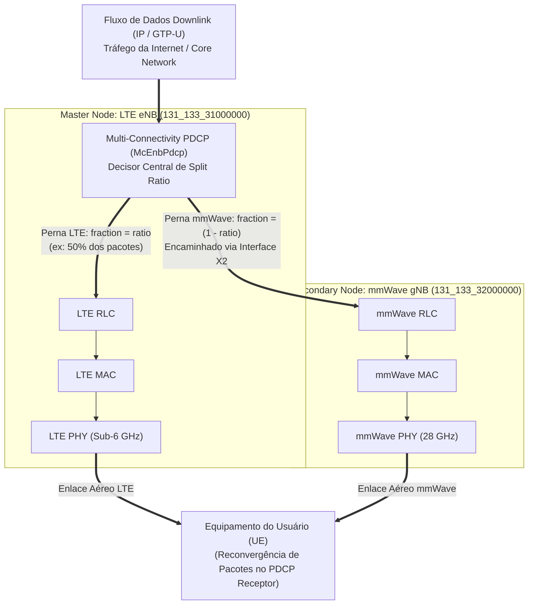
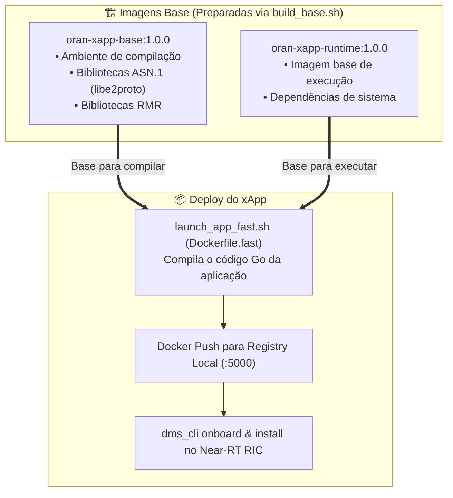

# Laboratório 06: Controle em Malha Fechada (Closed-Loop RAN Control) com E2SM-RC e ns-3

## 🎯 Objetivos de Aprendizagem

Ao final deste laboratório, você será capaz de:

1. **Compreender o Ciclo Completo de Malha Fechada (*Closed-Loop Control*):** Dominar a interação contínua entre Sensoriamento (*Sense* com E2SM-KPM), Decisão (*Decide* na inteligência do xApp) e Atuação (*Act* com E2SM-RC) no Near-RT RIC.
2. **Explorar a Norma O-RAN WG3 E2SM-RC (v1.0):** Compreender a arquitetura do Modelo de Serviço de Controle de RAN (*RAN Control*), focando no estilo de Controle de Portadora de Rádio (*Radio Bearer Control* - Style 1) e na Ação de Controle de Divisão de Tráfego de DRB (*DRB Split Ratio Control* - Action ID 6).
3. **Dissecar a Construção da PDU E2AP `RICcontrolRequest`:** Analisar como uma mensagem de controle é estruturada em Go, codificada em binário ASN.1 APER através de CGO (`libe2proto`) e despachada pelo barramento RMR.
4. **Dominar o Princípio do Design Agnóstico da O-RAN:** Compreender como a O-RAN separa as diretrizes abstratas de controle da implementação física de cada fabricante, e como o Agente E2 no ns-3 traduz Information Elements (IEs) normalizados em chamadas de métodos concretos do rádio (`McEnbPdcp::SetSplitRatio`).
5. **Compreender a Física de Conectividade Dupla (LTE + mmWave):** Entender a alocação de tráfego na camada PDCP (*Packet Data Convergence Protocol*) em cenários de agregação multi-tecnologia.
6. **Executar a Prática de Controle em Tempo Real:** Realizar o deploy do xApp RC utilizando o fluxo com imagens base (`launch_app_fast.sh`), injetar comandos de reconfiguração em tempo real (`split_command.sh`) e observar a migração dinâmica do tráfego nos logs do ns-3 e na telemetria do xApp KPIMON.

---

## 1. Fundamentos Teóricos: Da Telemetria ao Controle Ativo em Malha Fechada

Nos laboratórios anteriores, completamos com sucesso a conexão dos nós de rádio via **E2 Setup** ([Lab 03](./lab03-validacao-e2setup.md)), o ciclo de vida e empacotamento de xApps Cloud-Native ([Lab 04](./lab04-fundamentos-xapps-onboarding.md)) e a extração periódica de telemetria de rádio via modelo de serviço **E2SM-KPM** com a mensagem `RICindication` ([Lab 05](./lab05-e2ap-e2sm-ricindication.md)).

Até este ponto, nossa arquitetura operava em **malha aberta (*open-loop*)**: os nós de rádio enviavam relatórios de métricas para o Near-RT RIC, mas o RIC não interferia no comportamento do rádio.

Neste laboratório, fecharemos o ciclo! Implementaremos a capacidade de **Controle Ativo em Malha Fechada (*Closed-Loop RAN Control*)**, permitindo que uma decisão tomada no plano de software do xApp altere, em milissegundos, o comportamento físico da rede de acesso via modelo **E2SM-RC**.

---

### 1.1 A Arquitetura do Ciclo de Malha Fechada (*Sense $\to$ Decide $\to$ Act*)

O controle em malha fechada no Near-RT RIC opera em uma escala de tempo de **10 ms a 1 segundo**, dividindo-se em três etapas fundamentais:



1. **Sensoriamento (*Sense*):** O nó de rádio coleta continuamente dados da camada física (PHY/MAC). O modelo **E2SM-KPM** empacota essas informações em uma PDU `RICindication` e as entrega ao xApp KPIMON.
2. **Decisão (*Decide*):** O algoritmo de controle (ou o operador de rede) avalia se as condições de qualidade de serviço (QoS) estão sendo atendidas. Se um enlace estiver congestionado ou sofrer degradação de sinal, uma ação corretiva é calculada.
3. **Atuação (*Act*):** O xApp de controle monta uma mensagem padronizada no modelo **E2SM-RC**, encapsulando-a em uma PDU `RICcontrolRequest` (E2AP Procedimento de Classe 1). O Agente E2 no nó de rádio recebe essa ordem e reprograma as estruturas de dados do transmissor em tempo real.

---

### 1.2 A Norma O-RAN E2SM-RC (WG3 RAN Control Service Model)

O Grupo de Trabalho 3 da O-RAN Alliance (*WG3 - Near-Real-Time RIC and E2 Interface*) padronizou o modelo de serviço **E2SM-RC** para permitir que xApps executem comandos determinísticos sobre a rede de rádio de maneira segura e estruturada.

Diferente de mensagens proprietárias, o E2SM-RC organiza as ações em **Estilos de Controle (*Control Service Styles*)**:

| Control Style Type | Nome do Estilo | Finalidade | Exemplos de Ações Padronizadas |
| :--- | :--- | :--- | :--- |
| **Style 1** | **Radio Bearer Control** | Controle de portadoras de rádio e QoS | **Action ID 6: DRB Split Ratio Control**<br/>Action ID 1: DRB QoS Parameter Modification |
| **Style 2** | **Radio Resource Allocation** | Gerenciamento de blocos de recursos físicos (PRBs) | Fatiamento de espectro (Slicing), priorização de feixes (*beamforming*) |
| **Style 3** | **Connected Mode Mobility Control** | Controle de mobilidade e *Handover* | Action ID 1: Handover Triggering entre células |
| **Style 4** | **Radio Admission Control** | Controle de admissão de usuários na célula | Bloqueio/admissão por fatia de rede (S-NSSAI) |

#### O Nosso Caso de Estudo: Style 1, Action ID 6 (DRB Split Ratio Control)

Em redes móveis 5G com Conectividade Dupla, o tráfego de dados de um usuário flui através de uma **Portadora de Dados de Rádio (*Data Radio Bearer* - DRB)**. Quando a DRB é configurada no modo *Split Bearer*, ela pode ser transmitida simultaneamente por duas estações base diferentes.

A norma O-RAN E2SM-RC define formalmente a Ação 6 do Estilo 1 como:
* **`RIC-Control-Style-Type = 1`** (*Radio Bearer Control*)
* **`RIC-Control-Action-ID = 6`** (*DRB Split Ratio Control*)
* **Parâmetros de RAN associados:**
  1. **Target DRB ID:** O identificador numérico da portadora (ex: `DRB 1` para o fluxo de dados do usuário);
  2. **Split Ratio Value:** A porcentagem inteira ($0$ a $100$) do tráfego que deve ser direcionada para a perna primária (*Master Node*).

---

### 1.3 O Princípio do Design Agnóstico da O-RAN

Um dos maiores desafios históricos da telefonia móvel era o chamado *"Vendor Lock-in"*: os comandos de gerenciamento de rádio eram fechados e proprietários. Um controlador da fabricante X não conseguia ordenar uma mudança de portadora em uma antena da fabricante Y.

A O-RAN Alliance rompeu essa barreira através do **Design Agnóstico de Interface**:



> [!NOTE]
> **O que significa ser "Agnóstico" na prática?**
> O xApp RC que você executará neste laboratório **não sabe** e **não precisa saber** que o nó de rádio é um simulador acadêmico escrito em C++ com ns-3. 
> 
> O xApp apenas constrói Information Elements (IEs) normalizados em ASN.1. Quem realiza a "mágica" da tradução é o **Agente E2** embarcado no nó de rádio (`oran-interface`), que recebe os parâmetros normalizados e invoca os métodos concretos da pilha correspondente. O mesmo xApp poderia controlar uma rede real de operadora sem alterar uma única linha de código!

---

### 1.4 A Física da Conectividade Dupla (LTE + mmWave) e a Divisão no PDCP

No cenário de simulação que estamos utilizando (`scenario-trainning.cc`), o ambiente opera em **Conectividade Dupla Multi-RAT (MR-DC / EN-DC)**:
* **Master Node (MN):** Uma estação rádio-base LTE (`eNB`), operando em frequência sub-6 GHz (micro-ondas). Possui cobertura ampla, sinal estável e alta confiabilidade, porém com largura de banda limitada (ex: 20 MHz).
* **Secondary Node (SN):** Uma estação rádio-base 5G mmWave (`gNB`), operando em 28 GHz. Possui largura de banda gigantesca (ex: 100 MHz a 400 MHz) e capacidade de gigabits por segundo, porém sofre com alta atenuação por distância e suscetibilidade a obstáculos físicos (*blockage*).

Para que o usuário desfrute do melhor dos dois mundos, a pilha de protocolos utiliza o **PDCP Multi-Conectividade (`McEnbPdcp`)** localizado no eNB como ponto central de agregação e distribuição de pacotes:



Quando o valor do **Split Ratio** é alterado dinamicamente:
* **Ratio = 1.0 (100% LTE / 0% mmWave):** 100% dos pacotes são enviados pelo enlace LTE. O throughput fica estritamente limitado pela capacidade da portadora LTE (geralmente entre 10 e 20 Mbps). O transmissor mmWave fica ocioso para este fluxo.
* **Ratio = 0.0 (0% LTE / 100% mmWave):** 100% dos pacotes são encaminhados para a antena mmWave. O throughput pode saltar para centenas de Mbps, aproveitando toda a largura de banda de alta frequência.
* **Ratio = 0.5 (50% LTE / 50% mmWave):** Os pacotes são intercalados igualmente entre as duas tecnologias de rádio, distribuindo a carga e mitigando flutuações de canal.

---

## 2. Dissecagem do Código: Do xApp em Go ao C++ no ns-3

Vamos analisar a engenharia de software que viabiliza essa comunicação em tempo real, dissecando tanto o código do xApp RC quanto o código do simulador ns-3.

---

### 2.1 Lado do xApp: Construção e Codificação em Go (CGO)

No diretório do xApp RC ([`xapps/rc/`](../xapps/rc/)), os arquivos [`control/rcControl.go`](../xapps/rc/control/rcControl.go) e [`control/rcE2SmRc.go`](../xapps/rc/control/rcE2SmRc.go) são responsáveis por construir o envelope E2AP e o payload E2SM-RC.

#### 1. Chamada CGO de Codificação E2SM-RC (`rcE2SmRc.go`):
O xApp utiliza a biblioteca C compilada `libe2smwrapper` para codificar os cabeçalhos ASN.1 em formato APER:

```go
func (c *E2sm) SetRicControlMessageDRB(buffer []byte, drbID int64, splitRatio int64) (newBuffer []byte, err error) {
    cptr := unsafe.Pointer(&buffer[0])
    
    // Invocação direta da função C que serializa a mensagem E2SM-RC Format 1
    size := C.e2sm_encode_ric_control_message_drb(
        cptr, 
        C.size_t(len(buffer)), 
        C.long(drbID), 
        C.long(splitRatio),
    )

    if size < 0 {
        return make([]byte, 0), errors.New("e2sm wrapper is unable to set DRB Split Ratio message")
    }
    // Converte os bytes gerados pelo codificador C de volta para slice Go
    newBuffer = C.GoBytes(cptr, (C.int(size)+7)/8)
    return
}
```

#### 2. Montagem e Envio da PDU E2AP `RICcontrolRequest` (`rcControl.go`):
A função central [`SendDrbSplitControl`](../xapps/rc/control/rcControl.go#L151) orquestra a preparação do comando:

```go
func (c *Control) SendDrbSplitControl(ueID string, drbID int64, splitRatio int64) error {
    ranFuncId := uint16(300)      // ID padronizado do E2SM-RC no ns-3
    ricRequestorID := uint16(1002) // Identificador do xApp no Near-RT RIC
    controlStyle := int64(1)       // Style 1: Radio Bearer Control
    controlActionId := int64(6)    // Action 6: DRB Split Ratio Control

    // 1. Codifica o E2SM Control Header contendo o identificador do UE (IMSI)
    encodedHeader, err := e2sm.SetRicControlHeader(headerBuf, []byte(ueID), controlStyle, controlActionId)

    // 2. Codifica a E2SM Control Message contendo o DRB ID e a taxa de Split desejada
    encodedMsg, err := e2sm.SetRicControlMessageDRB(msgBuf, drbID, splitRatio)

    // 3. Empacota ambos no envelope E2AP RIC Control Request (Procedimento de Classe 1)
    payload, err := e2ap.SetRicControlRequestPayload(payloadBuf, ricRequestorID, reqSN, ranFuncId, encodedHeader, encodedMsg)

    // 4. Despacha para o barramento RMR usando o Message Type 12040 (RIC_CONTROL_REQ)
    params := &xapp.RMRParams{
        Mtype:   12040,               // Código numérico do RIC_CONTROL_REQ
        SubId:   -1,
        Payload: payload,
        Meid:    &xapp.RMRMeid{PlmnID: c.plmnID, EnbID: c.enbID, RanName: c.ranName},
    }
    return c.Rmr.SendMsg(params)
}
```

#### 3. Mecanismo de Injeção em Tempo Real: FIFO e `split_command.sh`
Para permitir que o operador envie comandos dinamicamente para o xApp sem interromper sua execução, o xApp RC monitora uma fila nomeada (*pipe/FIFO*) em `/tmp/rc_cmd`.

O utilitário [`split_command.sh`](../xapps/rc/split_command.sh) injeta os comandos diretamente dentro do Pod no Kubernetes via `kubectl exec`:

```bash
kubectl exec -i -n ricxapp "$POD_NAME" -- /bin/bash -c "echo '$UE_ID $DRB_ID $SPLIT_RATIO' > /tmp/rc_cmd"
```

Assim que o texto é gravado na fila, a goroutine `listenCommandPipe()` em `rcControl.go` lê os valores e dispara imediatamente a função `SendDrbSplitControl()`.

---

### 2.2 Lado do ns-3: Recepção, Validação e Atuação na Pilha de Rádio

Quando a mensagem serializada via SCTP atinge a porta do simulador ns-3, o módulo de interface O-RAN (`contrib/oran-interface`) repassa a PDU para a classe de dispositivo de rede eNB LTE em [`src/lte/model/lte-enb-net-device.cc`](file:///home/ns3/ns3-mmwave-oran/src/lte/model/lte-enb-net-device.cc).

#### 1. Recepção do Callback e Decodificação do Comando ([`lte-enb-net-device.cc#L475`](file:///home/ns3/ns3-mmwave-oran/src/lte/model/lte-enb-net-device.cc#L475)):

```cpp
void
LteEnbNetDevice::ControlMessageReceivedCallback(E2AP_PDU_t* sub_req_pdu)
{
    NS_LOG_UNCOND("LteEnbNetDevice::ControlMessageReceivedCallback: Received RIC Control Message");

    // Instancia o objeto C++ RicControlMessage que decodifica o ASN.1 APER
    Ptr<RicControlMessage> controlMessage = Create<RicControlMessage>(sub_req_pdu);

    switch (controlMessage->m_requestType)
    {
    case RicControlMessage::ControlMessageRequestIdType::QoS: {
        NS_LOG_UNCOND("ControlMessageRequestIdType::QoS (Processing DRB Split)");

        // 1. Extrai o identificador do UE (IMSI) do Header Format 1
        Ptr<OctetString> imsiString = Create<OctetString>(
            (void*)controlMessage->m_e2SmRcControlHeaderFormat1->ueId.buf,
            controlMessage->m_e2SmRcControlHeaderFormat1->ueId.size);
        char* end;
        uint64_t imsi = std::strtoull(imsiString->DecodeContent().c_str(), &end, 10);

        // 2. Extrai os parâmetros normalizados do Message Format 1
        long drbID = controlMessage->m_drbId;
        long splitRatio = controlMessage->m_drbSplitRatio;

        if (drbID != -1 && splitRatio != -1){
            NS_LOG_UNCOND("Received DRB Split Control: DRB ID = " << drbID << ", Split Ratio = " << splitRatio << "%");
            // Converte a porcentagem (ex: 50) para fator numérico (0.50)
            double ratio = (double)splitRatio / 100.0;
            
            // Invoca a reconfiguração da camada de rádio
            SetUeQoS(imsi, (uint16_t)drbID, ratio);
        }
        break;
    }
    // ...
    }
}
```

#### 2. Aplicação Direta na Pilha de Rádio via `SetUeQoS` ([`lte-enb-net-device.cc#L380`](file:///home/ns3/ns3-mmwave-oran/src/lte/model/lte-enb-net-device.cc#L380)):

Aqui ocorre a **concretização do comando agnóstico**:

```cpp
void
LteEnbNetDevice::SetUeQoS(uint64_t imsi, uint16_t targetDrbId, double percentage)
{
    // 1. Converte o IMSI global para o identificador local de célula (RNTI)
    uint16_t rnti = m_rrc->GetRntiFromImsi(imsi);
    if (rnti == 0) return;

    // 2. Localiza o gerenciador de contexto do usuário no RRC
    auto ueManager = m_rrc->GetUeManager(rnti);
    if (ueManager == nullptr) return;

    // 3. Itera sobre o mapa de portadoras de rádio ativas do UE
    auto drbMap = ueManager->GetDrbMap();
    for (auto iter = drbMap.begin(); iter != drbMap.end(); ++iter){
        Ptr<LteDataRadioBearerInfo> drb = DynamicCast<LteDataRadioBearerInfo>(iter->second);
        int currentDrbId = static_cast<int>(drb->m_drbIdentity);

        // 4. Identifica a portadora alvo solicitada pelo xApp (DRB 1)
        if (currentDrbId == targetDrbId){
            // 5. Faz o downcast do protocolo PDCP genérico para McEnbPdcp
            Ptr<McEnbPdcp> pdcp = DynamicCast<McEnbPdcp>(drb->m_pdcp);

            if (pdcp){
                NS_LOG_UNCOND("Setting Split Ratio for IMSI " << imsi
                            << " (RNTI " << rnti << ")"
                            << " DRB " << targetDrbId
                            << " to " << percentage);
                
                // 6. Reprograma o ponto de bifurcação do PDCP em tempo real!
                pdcp->SetSplitRatio(percentage);
            }
        }
    }
}
```

Observe a precisão do encadeamento: o comando originado em uma especificação de alto nível da O-RAN Alliance atravessa o Near-RT RIC, chega ao nó de rádio e reprograma a variável interna de decisão de pacotes do transmissor C++ instantaneamente.

---

## 3. Arquitetura de Build Otimizada para xApps O-RAN

Um dos maiores obstáculos no desenvolvimento ágil de xApps é o tempo de compilação: a biblioteca de protocolos O-RAN (`libe2proto`) contém mais de 600 arquivos de estruturas geradas pelo compilador ASN.1. Compilar todas as dependências a cada pequena alteração de código levava entre 3 a 5 minutos por deploy.

Para simplificar esse processo, o ambiente do bootcamp adota uma **Estrutura de Build com Imagens Base**:



* **[`xapps/base-image/build_base.sh`](../xapps/base-image/build_base.sh):** Prepara as imagens base e as envia para o registro local `127.0.0.1:5000`. Esse passo só precisa ser executado uma única vez.
* **[`launch_app_fast.sh`](../xapps/rc/launch_app_fast.sh):** Presente em `xapps/kpimon/` e `xapps/rc/`. Utiliza o `Dockerfile.fast` sobre a imagem base para compilar e instalar o xApp diretamente.

---

## 4. Prática Guiada: Fechando a Malha em Tempo Real

Agora, colocaremos a teoria em prática em um teste fim a fim de malha fechada.

> [!IMPORTANT]
> **Sessão com Privilégios Administrativos (`sudo -i`):**
> O gerenciamento do Docker daemon, publicação no repositório ChartMuseum e comandos do `dms_cli` requerem permissões de superusuário. Abra o terminal onde gerenciará os xApps e execute:
> ```bash
> sudo -i
> ```

---

### Passo 1: Assegurar as Imagens Base Compiladas

Antes de subir os xApps, certifique-se de que as imagens base estejam construídas no registro local:

```bash
cd /home/ns3/ns3-oran-bootcamp/xapps/base-image
./build_base.sh
```

*Se você já executou esse script em um laboratório anterior, as imagens já estarão disponíveis no registro local e o script concluirá rapidamente.*

---

### Passo 2: Fazer o Deploy do xApp KPIMON (Sensoriamento)

O xApp KPIMON será os nossos "olhos", coletando as métricas de rádio para que possamos auditar a transferência de tráfego em tempo real:

```bash
cd /home/ns3/ns3-oran-bootcamp/xapps/kpimon
./launch_app_fast.sh
```

Aguarde a mensagem de confirmação do onboarding e deploy via Helm no namespace `ricxapp`.

---

### Passo 3: Fazer o Deploy do xApp RC (Atuação)

Agora, realizaremos o onboarding e deploy do xApp de Controle de RAN:

```bash
cd /home/ns3/ns3-oran-bootcamp/xapps/rc
./launch_app_fast.sh
```

*O script subirá o Pod `ricxapp-rc-xxxxxxxxxx-xxxxx` no Kubernetes e colocará o serviço de controle em background.*

Verifique se ambos os xApps estão ativos:
```bash
kubectl get pods -n ricxapp
```

*Saída esperada:*
```text
NAME                                READY   STATUS    RESTARTS   AGE
ricxapp-rc-xxxxxxxxxx-xxxxx         1/1     Running   0          25s
ricxapp-xappkpimon-xxxxxxxxxx-xxxxx 1/1     Running   0          1m
```

---

### Passo 4: Preparar o Ambiente de Observabilidade com Múltiplos Terminais

Para acompanhar a malha fechada em tempo real, utilizaremos **4 terminais** (ou painéis do `tmux`):

```text
+---------------------------------------+---------------------------------------+
| 📟 TERMINAL 1 (xApp KPIMON - Métricas)| 📟 TERMINAL 2 (xApp RC - Logs)        |
| Monitora o throughput LTE e mmWave    | Acompanha os comandos E2SM-RC         |
+---------------------------------------+---------------------------------------+
| 📟 TERMINAL 3 (Simulador ns-3)        | 📟 TERMINAL 4 (Painel de Atuação)     |
| Executa a simulação em tempo real     | Injeta comandos de Split Ratio        |
+---------------------------------------+---------------------------------------+
```

#### 📟 Terminal 1: Iniciar o xApp KPIMON
```bash
POD_KPIMON=$(kubectl get pods -n ricxapp --no-headers -o custom-columns=":metadata.name" | grep -E "kpimon" | head -n 1)
kubectl exec -ti -n ricxapp $POD_KPIMON -- ./kpimon -f /opt/ric/config/config-file.json
```
*(Deixe este terminal aberto; ele reportará as métricas periódicas dos UEs).*

#### 📟 Terminal 2: Acompanhar os Logs do xApp RC
```bash
POD_RC=$(kubectl get pods -n ricxapp --no-headers -o custom-columns=":metadata.name" | grep -E "^ricxapp-rc-" | head -n 1)
kubectl logs -f -n ricxapp $POD_RC
```
*(Deixe este terminal aberto para visualizar a chegada dos comandos e a codificação das PDUs).*

---

### Passo 5: Iniciar a Simulação do ns-3 (Terminal 3)

No **Terminal 3**, inicie a simulação do ns-3 apontando para o IP do `e2term`, definindo o Split Ratio inicial em `0.0` (100% mmWave) e direcionando os arquivos gerados para a pasta de saída via `--cwd`:

```bash
cd /home/ns3/ns3-mmwave-oran

# 1. Obtém o IP atual do pod e2term no Kubernetes
E2TERM_IP=$(kubectl get pods -n ricplt -l app=ricplt-e2term-alpha -o jsonpath='{.items[0].status.podIP}')
echo "IP do e2term: $E2TERM_IP"

# 2. Cria a pasta para isolar os arquivos .txt e traces
mkdir -p ./outputs/teste

# 3. Executa a simulação com ratio inicial 0.0 (100% mmWave) por 120 segundos
./waf --run "scratch/scenario-trainning --e2TermIp=$E2TERM_IP --simSplitRatio=0.0 --simTime=120" --cwd=./outputs/teste
```

> [!TIP]
> **Por que utilizar o parâmetro `--cwd=./outputs/teste`?**
> Por padrão, o ns-3 grava diversos arquivos de métricas e traces (`.txt`, `.tr`, `.pcap`) diretamente no diretório raiz onde o comando `./waf` é disparado. O parâmetro `--cwd` (*Change Working Directory*) instrui o simulador a gerar todos esses arquivos de saída exclusivamente dentro de `./outputs/teste`, mantendo a raiz do ns-3 limpa e organizada.

*Assim que o ns-3 inicializar:*
1. Ele estabelecerá a conexão SCTP com o `e2term` (E2 Setup);
2. O xApp KPIMON enviará a subscrição e começará a imprimir o throughput no Terminal 1;
3. Como definimos `--simSplitRatio=0.0`, o tráfego inicial começará fluindo **100% pelo enlace mmWave** (e 0% pelo LTE).

---

### Passo 6: Injetar Comandos de Controle em Malha Fechada (Terminal 4)

Com a simulação em execução, vá para o **Terminal 4** e explore a reconfiguração dinâmica da rede com o script [`split_command.sh`](../xapps/rc/split_command.sh):

#### Experimento A: Redirecionar 100% do Tráfego para o LTE
Vamos forçar o transmissor a enviar todo o tráfego pela perna LTE (Split Ratio = 100%):

```bash
cd /home/ns3/ns3-oran-bootcamp/xapps/rc
./split_command.sh 100
```

**O que observar:**
* **No Terminal 2 (Logs do RC):** O xApp detecta o comando, codifica o Header Format 1 com `ueID="00001"` e a Message Format 1 com `drbID=1, splitRatio=100`, despachando a PDU E2AP `RIC_CONTROL_REQ` (Mtype 12040).
* **No Terminal 3 (ns-3):** O simulador imprime:
  ```text
  LteEnbNetDevice::ControlMessageReceivedCallback: Received RIC Control Message
  ControlMessageRequestIdType::QoS (Processing DRB Split)
  Received DRB Split Control: DRB ID = 1, Split Ratio = 100%
  Setting Split Ratio for IMSI 1 (RNTI 1) DRB 1 to 1
  ```
* **No Terminal 1 (KPIMON):** Em poucos segundos, observe que o throughput da portadora mmWave cai para zero, e todo o volume de tráfego é estrangulado no teto de capacidade da célula LTE!

---

#### Experimento B: Redirecionar 100% do Tráfego para o mmWave
Agora, vamos desviar 100% dos pacotes para a antena de ondas milimétricas de altíssima capacidade (Split Ratio = 0% LTE / 100% mmWave):

```bash
./split_command.sh 0
```

**O que observar:**
* **No Terminal 3 (ns-3):** O simulador registra:
  ```text
  Setting Split Ratio for IMSI 1 (RNTI 1) DRB 1 to 0
  ```
* **No Terminal 1 (KPIMON):** O throughput medido na perna mmWave (`NR.Throughput`) dispara instantaneamente para centenas de Mbps, enquanto o enlace LTE transporta apenas sinalização de controle!

---

#### Experimento C: Divisão Equitativa (50% LTE / 50% mmWave)
Restaure o balanceamento de carga clássico:

```bash
./split_command.sh 50
```

**O que observar:**
* **No Terminal 3 (ns-3):** O `McEnbPdcp` define `ratio = 0.5`.
* **No Terminal 1 (KPIMON):** Ambas as tecnologias voltam a registrar fluxo contínuo de pacotes simultaneamente.

> [!TIP]
> Você também pode especificar o UE e a DRB diretamente no comando, caso haja múltiplos usuários simulados:
> ```bash
> ./split_command.sh 75 1 00001
> ```
> *(Aplica 75% LTE / 25% mmWave para o UE com IMSI 00001 na DRB 1).*

---

## 5. Resolução de Problemas (Troubleshooting)

### 1. `dms_cli install` falha com erro de conexão recusada na porta 8080 ou 8090
* **Causa:** A variável de ambiente `CHART_REPO_URL` não foi configurada ou o container do ChartMuseum parou.
* **Solução:**
  ```bash
  sudo -i
  /home/ns3/ns3-oran-bootcamp/xapps/start_repo.sh
  export CHART_REPO_URL=http://0.0.0.0:8090
  dms_cli health
  ```

### 2. O comando `./split_command.sh` reporta: `Pod do xApp RC não encontrado`
* **Causa:** O Pod do xApp RC ainda não terminou de subir ou está com nome diferente no namespace `ricxapp`.
* **Solução:**
  ```bash
  kubectl get pods -n ricxapp
  ```
  Se o status for `ContainerCreating`, aguarde alguns segundos. Se falhou, consulte os logs de erro:
  ```bash
  kubectl describe pod -l app=ricxapp-rc -n ricxapp
  ```

### 3. O xApp RC envia a mensagem, mas o ns-3 não imprime o log de recepção
* **Causa:** O simulador ns-3 ainda não concluiu o procedimento de **E2 Setup** com o Near-RT RIC antes do envio do comando de controle, ou o nome do nó (`RanName`) configurado no xApp não confere com o eNB.
* **Solução:**
  1. No ns-3, certifique-se de que a mensagem `E2 Setup Request ... response was successfully received` apareceu antes de enviar os comandos do xApp;
  2. Verifique se o eNB conectado é o `gnb_131_133_31000000` (padrão configurado na variável `RC_RAN_NAME`).

### 4. ns-3 reporta: `Could not find RNTI for IMSI`
* **Causa:** O comando foi enviado com um IMSI que ainda não realizou o procedimento de anexo (*RRC Connection Setup*) na simulação.
* **Solução:** Aguarde cerca de 3 a 5 segundos após iniciar o `./waf --run "scratch/scenario-trainning ..."` para que o UE complete o anexo inicial antes de disparar o `./split_command.sh`.

---

## 6. Exercícios de Fixação e Desafio Prático

### Perguntas Conceituais

1. **Diferença de Procedimento E2AP:**
   No [Laboratório 05](./lab05-e2ap-e2sm-ricindication.md), vimos que a `RICindication` é um **Procedimento de Classe 2** (*Unsuccessful Outcome* não existe, apenas envio unidirecional). Por que o `RICcontrolRequest` utilizado pelo E2SM-RC é categorizado como um **Procedimento de Classe 1**? O que acontece caso o nó de rádio não consiga aplicar a divisão de tráfego solicitada?

2. **Princípio Agnóstico:**
   Explique com suas palavras por que o código do xApp RC em Go não possui nenhuma referência a classes C++ do ns-3 (`LteEnbNetDevice`, `McEnbPdcp`). Onde exatamente reside a camada de adaptação que torna o comando compatível com o simulador?

3. **Arquitetura de Divisão no PDCP:**
   Por que a divisão de tráfego de Conectividade Dupla ocorre especificamente na camada **PDCP**, e não nas camadas RLC ou MAC? (Dica: pense sobre reordenação de pacotes, criptografia e numeração sequencial IP).

---

### Desafio Prático: Automação de Malha Fechada Adaptativa

Atualmente, o comando de split ratio é disparado manualmente pelo operador através do script `./split_command.sh`.

O xApp RC já possui um mecanismo nativo de loop autônomo, e o seu descritor já vem previamente estruturado com a seção `appenv` contendo a automação desativada por padrão (`"RC_AUTO_MODE": "false"`).

Para ativar o ciclo autônomo:

1. Abra o descritor de configuração do xApp RC em [`xapps/rc/xapp-descriptor/config_dev.json`](../xapps/rc/xapp-descriptor/config_dev.json);
2. Na seção `appenv`, altere apenas a variável `"RC_AUTO_MODE"` de `"false"` para `"true"`:
   ```json
     "appenv": {
       "RC_AUTO_MODE": "true",
       "RC_AUTO_INTERVAL": "10"
     },
   ```
3. Salve o arquivo e reimplante o xApp executando:
   ```bash
   cd /home/ns3/ns3-oran-bootcamp/xapps/rc
   sudo ./launch_app_fast.sh
   ```
4. Com a simulação do ns-3 e o KPIMON em execução, acompanhe os logs em tempo real do pod do RC:
   ```bash
   POD_NAME=$(kubectl get pods -n ricxapp --no-headers -o custom-columns=":metadata.name" | grep -E "^ricxapp-rc-" | head -n 1)
   kubectl logs -f -n ricxapp $POD_NAME
   ```
5. Observe o xApp alternando **automaticamente** o Split Ratio a cada 10 segundos entre 0%, 25%, 50%, 75% e 100%, e comprove no terminal do KPIMON a transição de vazão entre as pernas LTE e mmWave sem nenhuma intervenção manual!
